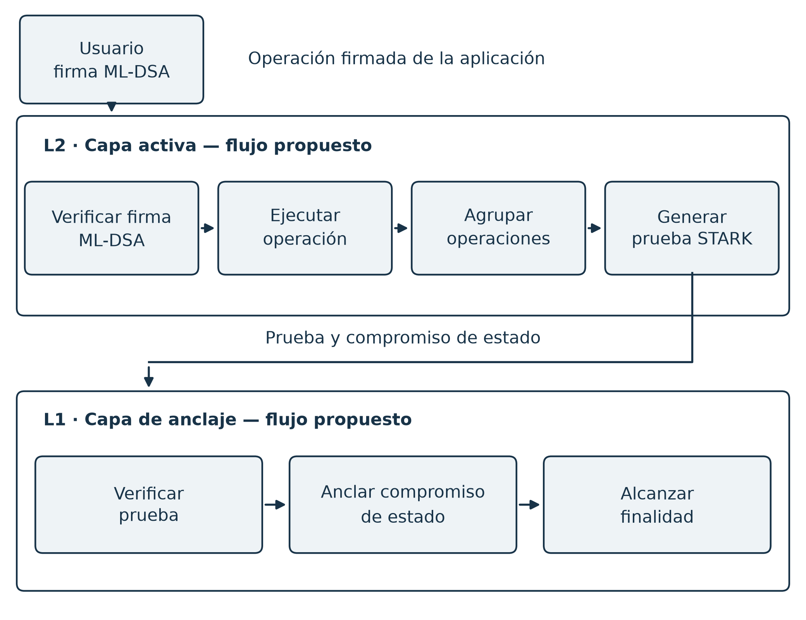

# Capítulo 3 — Diseño de la Arquitectura Dual-Chain

*Objetivo 1 · el capítulo "espina": Costo → Respuesta → Coherencia*

> **Rol en el arco de la tesis.** Este capítulo es la articulación central: toma la **solución** (firmas post-cuánticas, Cap. 4), expone el **costo** que introducen, y muestra que la **arquitectura dual-chain** es la *respuesta* a ese costo, exigiendo además **coherencia post-cuántica** en su capa de verificación. El análisis cuantitativo detallado vive en el documento companion `Analisis-Overhead-PQC-DualChain`; aquí se integra con el diseño arquitectónico completo.

---

## 3.1 Introducción

Una arquitectura blockchain post-cuántica para sistemas en general enfrenta una tensión que este capítulo resuelve. Por un lado, **debe** usar firmas post-cuánticas (Dilithium) para resistir la amenaza cuántica a la autenticación de transacciones (Cap. 1, Cap. 6). Por otro, esas firmas son **~50× más grandes** que las clásicas, lo que —aplicado de forma ingenua sobre una cadena única— degrada el rendimiento en un orden de magnitud.

La arquitectura dual-chain es la respuesta de diseño estudiada para distribuir el sobrecosto de firmas poscuánticas entre ejecución y anclaje. Su amortización se modela bajo condiciones de disponibilidad de datos, prueba de la lógica pertinente y costo del probador (§6.6.5). La validación TG2 distingue esa propuesta de una implementación integral y exige una capa de pruebas cuya seguridad se justifique para el modelo de amenaza considerado.

El capítulo desarrolla el Objetivo 1: especifica los roles de la **Anchor Layer (L1)** y la **Active Layer (L2)**, el camino de la firma post-cuántica a través del sistema, y los componentes clave (Nexus Sequencer, Nitro Verifier), integrando la evidencia de que las cadenas líderes (Ethereum, Solana) convergen hacia el mismo diseño.

---

## 3.2 Visión general de la arquitectura

NEXUS separa **anclaje y confirmación del estado** de **ejecución** en dos capas:

- **Anchor Layer (L1) — la capa de anclaje.** Provee consenso, finalidad irreversible y disponibilidad de datos. Es la raíz de confianza: lenta pero segura. Almacena los compromisos de estado del L2 y garantiza que los datos necesarios estén disponibles.
- **Active Layer (L2) — la capa activa.** Ejecuta transacciones a alta velocidad: secuencia, verifica firmas Dilithium, aplica transiciones de estado, agrupa en *batches* y produce una prueba de validez que asienta en L1.

### El camino de la firma post-cuántica

El elemento que estructura el diseño es **el recorrido de una firma Dilithium a través del sistema**:

**Figura 3.1 — Recorrido propuesto de una operación firmada en NEXUS.**

{width=6.5in}

*Fuente: elaboración propia. Arquitectura de referencia: la aritmetización completa de ML-DSA, la disponibilidad de datos y el consenso operativo no quedan implementados por la PoC STARK (§3.5 y §6.7). El diagrama muestra el flujo de autenticación y anclaje; la política de disponibilidad de datos se especifica por separado.*

En el diseño propuesto, la firma de 3,3 KB se verifica **en el L2** y esa verificación se incorpora a una prueba de validez; L1 recibe la prueba y el compromiso de estado. Esta separación es el mecanismo de amortización modelado en §3.4. Su realización completa exige la aritmetización y la política de disponibilidad de datos indicadas en la nota de la figura.

> **Validación externa.** La hoja de ruta *rollup-centric* de Ethereum adopta exactamente esta separación (L1 = liquidación + DA; ejecución en L2), lo que respalda la elección arquitectónica como consenso de diseño de la industria.

---

## 3.3 El sobrecosto de la criptografía post-cuántica

El costo de la PQC tiene **dos dimensiones**, y solo una es el cuello de botella.

**Tabla 3.1 — ECDSA P-256 vs. Dilithium3.** *(El cociente exacto 3 309/64 ≈ 52× se redondea a ~50× en el texto narrativo; ambas cifras designan el mismo dato.)*

| Magnitud | ECDSA P-256 | Dilithium3 | Razón | ¿Cuello de botella? |
|---|---:|---:|---:|:---:|
| Firma | 64 B | 3 309 B | ~52× | **Sí (datos)** |
| Clave pública | 33 B | 1 952 B | ~59× | **Sí (datos)** |
| Verificación (CPU) | decenas de µs | ~0,17–0,44 ms (medido) | ~1× (mismo orden, sub-ms) | No |

**Hallazgo central:** el penalizador post-cuántico es de **tamaño** (ancho de banda, almacenamiento, disponibilidad de datos), **no de cómputo** —verificar Dilithium cuesta lo mismo que ECDSA—. Por tanto, lo que hay que optimizar es **la cantidad de datos de autenticación que tocan la L1**, que es precisamente la función de un rollup.

**Impacto en una cadena única.** Modelando una transacción como carga útil base $b$ más la firma, y un presupuesto de datos por bloque $B_d$, el throughput es $\mathrm{TPS}=B_d/(\tau(b+s))$. Con $b\approx100$ B, $B_d=1$ MB, $\tau=12$ s:

$$
\frac{\mathrm{TPS}_{\text{ECDSA}}}{\mathrm{TPS}_{\text{Dilithium}}} = \frac{b+s_q}{b+s_c} = \frac{3409}{164} \approx 20{,}8\times.
$$

Es decir, **adoptar PQC de forma ingenua cuesta ~20× de throughput** (la firma es el ~97 % de los bytes de la transacción), y la componente de firmas del libro mayor crece ~50× más rápido. *(Derivación completa y análisis de sensibilidad: documento `Analisis-Overhead`, §2.)*

---

## 3.4 La amortización dual-chain

El rollup ejecuta $M$ transacciones fuera de cadena y publica en L1 solo un compromiso $C$, una prueba $\pi$ y los datos de disponibilidad $D$. La observación crucial:

> Si una **prueba de validez** atestigua sucintamente que las $M$ transacciones estaban correctamente firmadas (Dilithium) y ejecutadas, **las firmas no necesitan publicarse en L1**. El sobrecosto de 50× se paga una vez fuera de cadena y se **elimina** de la L1.

El costo on-chain por transacción es entonces

$$
F(M) = d + \frac{C+\pi}{M} \xrightarrow{\ M\to\infty\ } d,
$$

donde $d$ es la **diferencia de estado** por transacción —**independiente del esquema de firma**—. El factor $s_q$ **desaparece** del costo on-chain. Con valores modelados ($d\approx40$ B), un rollup de validez reduce el costo por transacción post-cuántica de 3 409 B a $\sim$ 40–140 B (reducción **~24–85×**), con punto de equilibrio en lotes de $\sim$ 10⁴ transacciones (§3.5).

**En la dimensión de cómputo**, la L1 verifica **una** prueba por *batch* (independiente de $M$) en lugar de $M$ firmas, distribuyendo el costo de verificación de la prueba entre las operaciones del lote, sin eliminarlo. Como el costo de verificar Dilithium ya es bajo (§3.3), este ahorro es secundario frente al de datos.

> **Conclusión de diseño.** El costo por operación puede distribuirse entre el lote y sus diferencias de estado bajo el modelo de disponibilidad y publicación adoptado. Las firmas siguen teniendo costo de almacenamiento, transmisión y verificación en la frontera que las conserva. El modelo no elimina esos costos ni mide por sí solo el rendimiento de una blockchain completa (§6.6.5).

---

## 3.5 Coherencia post-cuántica de la capa de pruebas

El diseño requiere que los compromisos y el sistema de pruebas sean compatibles con su modelo de amenaza. Los argumentos basados en emparejamientos y logaritmos discretos, como Groth16 sobre curvas clásicas, incorporan supuestos vulnerables a un adversario cuántico suficientemente potente. NEXUS explora una construcción basada en hash y FRI; su ausencia de emparejamientos evita esa dependencia particular, pero no demuestra solidez QROM de la construcción completa.

**Tabla 3.2 — Supuestos de las familias de prueba.**

| Familia | Dependencia principal | Condición de validación |
|---|---|---|
| Groth16 sobre curvas clásicas | Emparejamientos y logaritmo discreto | No satisface el modelo frente a Shor con recursos suficientes |
| Argumentos basados en hash y FRI | Compromisos, proximidad y compilación Fiat–Shamir | Requieren prueba de composición, parámetros y modelo ROM/QROM |

**PoC heredada y revisión TG2.** El prototipo usa el campo Goldilocks, NTT, Merkle sobre SHA3-256, retos de extensión y FRI para una recurrencia ilustrativa. Las pruebas del software comprueban casos, pero su aceptación no acredita por sí sola proximidad de la traza ni validez de transacciones completas. La revisión del Objetivo 4 caracteriza la aceptación heredada, el enlace parcial de raíces y la recuperación del testigo pequeño. La variante TG2 v1 vincula un FRI de traza al AIR por una raíz común (§§6.7.1–6.7.4).

**Presupuesto histórico de seguridad.** La cifra de aproximadamente 100 bits se conserva como objetivo del diseño anterior. La auditoría no la acredita: el campo de extensión no basta para cerrar composición y consultas, y el trabajo del nonce no impide reinicios de transcripción. Las derivaciones por rondas y ROM de §§6.7.8–6.7.9 explicitan hipótesis y presupuesto adversario; permanecen propuestas pendientes de dictamen y no garantizan 100 bits, conocimiento cero ni QROM completo.

**Tabla 3.3 — Mediciones históricas del AIR ilustrativo.**

| Filas de traza | Tamaño de prueba histórico | Verificación histórica |
|---:|---:|---:|
| 16 | 132 KB | 6,0 ms |
| 256 | 268 KB | 8,9 ms |
| 4096 | 445 KB | 12,9 ms |

Estas cifras pertenecen a la serie histórica y a una carga ilustrativa. Filas AIR no equivalen a transacciones ML-DSA. Las nuevas mediciones preservan repeticiones y dispersión (§6.6), y las diferencias de procedencia se conservan explícitas. El costo del probador, incluido el trabajo del nonce, forma parte del balance de viabilidad; una curva de verificación no certifica seguridad ni el flujo L2/L1 completo.

Las propuestas poscuánticas de Ethereum y Solana aportan contexto sobre tamaño de firmas y agregación. Sus hojas de ruta no sustituyen la validación de NEXUS ni se presentan como despliegue completo de la arquitectura de esta tesis [EthRoadmap26, Solana-QR26].

### 3.5.1 Una tensión de diseño honesta: Dilithium vs. STARK-friendliness

La tensión técnica es el costo de aritmetizar ML-DSA dentro de un sistema de pruebas. NEXUS selecciona ML-DSA como esquema de firma por su estandarización y por la API semillada del backend, mientras estudia separadamente la agregación por pruebas. El AIR actual no verifica firmas ML-DSA: medirlo no resuelve el costo de esa aritmetización. Las propuestas externas de firmas hash-based o Falcon ilustran alternativas de diseño, con supuestos y costos propios.

---

## 3.6 Modelo de cuenta: identidad estable vs. clave rotable

Un sistema que **rota** y **migra** claves (Cap. 5, cripto-agilidad) enfrenta un problema: si la dirección se deriva de la clave pública, rotar la clave **cambia la dirección/identidad**. NEXUS lo resuelve con **abstracción de verificación**:

$$
\textbf{Cuenta} = (\ \text{id\_estable},\ \ \text{política\_de\_verificación},\ \ \text{epoch}\ ).
$$

- La **id_estable** identifica la cuenta de forma permanente (no cambia con la clave).
- La **política_de_verificación** especifica el esquema de firma y la clave pública actuales; una transacción se valida ejecutando esta política.
- El **epoch** registra la versión de clave (rotación/migración).

Rotar o migrar de esquema actualiza la **política** y el **epoch**, **sin tocar la id_estable**. Un **Registro de Claves (Key Registry)** permite asociar claves post-cuánticas junto a las clásicas, habilitando **firmas híbridas** durante la transición y la **migración por cuenta**.

> **Referencia de diseño.** La abstracción de cuentas permite separar identidad de política de verificación. Las propuestas de agilidad de firmas y registros poscuánticos de Ethereum son antecedentes de esa separación [Eth-PQ26]. En NEXUS, R3 comprueba un registro local y firmas por época; su integración con el sequencer y el anclaje L1 sigue pendiente (§5.8).

---

## 3.7 Disponibilidad de datos

La L1 debe garantizar que los datos del L2 (necesarios para reconstruir/auditar el estado) estén **disponibles**, sin almacenarlos permanentemente. *(Diseño de referencia; la DA —erasure coding y muestreo— no está implementada operativamente, sino especificada como modelo. Cf. §3.10 y Cap. 7.)* El diseño prevé:

- **Erasure coding real** (Reed-Solomon u otro código MDS) para redundancia con umbral de recuperación genuino (no duplicación de *chunks*).
- **Muestreo de disponibilidad (DAS)** entre **pares**: los nodos verifican la disponibilidad muestreando fragmentos distribuidos en la red, no consultando su propia memoria. La probabilidad de detección de retención es estadísticamente significativa solo si el muestreo es **remoto**.
- **Poda** de los datos tras una ventana (estilo *blob*), de modo que las firmas (50× mayores) **no se acumulan** indefinidamente en la L1.

> **Validación externa (ya en producción).** Ethereum activó **Fusaka/PeerDAS en mainnet el 3-dic-2025**: muestreo de disponibilidad que reduce ~85 % la descarga de los validadores, con blobs efímeros y podables. NEXUS modela su DA sobre este diseño desplegado. La **ZK Compression** de Solana ofrece además un mecanismo para comprimir el estado (claves públicas grandes) con pruebas de validez. Esto corrige y sustituye el "DAS" del prototipo original (que muestreaba su propia RAM).

---

## 3.8 Secuenciación e incentivos

El **Nexus Sequencer** ordena las transacciones del L2. Un secuenciador único concentra poder de censura y de extracción de valor (MEV). El diseño contempla dos mitigaciones, ambas con respaldo en la frontera:

- **Separación proponente/constructor (PBS):** separar *quién ordena* de *quién construye* el bloque, para limitar el MEV — el enfoque del **PBS enshrined (ePBS)** de Ethereum.
- **Secuenciadores concurrentes:** múltiples productores concurrentes, como los **Multiple Concurrent Leaders (MCL)** de Solana, que reducen el poder de un único líder.

**Modelo de incentivos.** El comportamiento del secuenciador se modela con teoría de juegos: se **argumenta** que, bajo un modelo de pagos con *stake* y *slashing*, la estrategia honesta sería un **equilibrio de Nash** (la deshonestidad conduce a la pérdida del *stake*) — análisis de diseño, no resultado formalmente probado. Con secuenciación **concurrente**, el juego pasa de un único jugador a **N jugadores**, de modo que la censura/MEV requeriría la **colusión de la mayoría** — un argumento de robustez más fuerte que el del secuenciador único. *(El mecanismo operativo de slashing es diseño de referencia; su implementación es trabajo futuro.)*

---

## 3.9 Finalidad

El modelo contempla **finalidad rápida e irreversible** para confirmar operaciones y mantener registros consistentes. El **Finality Gadget** de la Anchor Layer se especifica para finalizar un bloque cuando el peso de voto (ponderado por *stake*) cruza el umbral de 2/3, con verificación de las firmas de voto y enlace de ascendencia entre bloques finalizados. *(Diseño de referencia; su implementación operativa es trabajo futuro, §3.10.)*

> **Validación externa y diseño a contrastar.** Solana **Alpenglow** (Votor + Rotor; testnet may-2026, mainnet ~finales 2026) reduce la finalidad de 12,8 s a **100–150 ms**: **Votor** finaliza en **una ronda** con ≥80 % del *stake* en línea (~100 ms) y en dos rondas al 60 % (~150 ms). Ethereum persigue **finalidad de un solo paso (SSF)** y ~4 s en Lean Consensus. NEXUS adopta como requisito una **finalidad determinista rápida** y contrasta su gadget con el diseño de Votor (quórum por *stake*, finalidad en 1–2 rondas), coherente con las correcciones del consenso (quórum ponderado por *stake* + verificación de votos).

---

## 3.10 Síntesis y supuesto de consenso

El diseño dual-chain de NEXUS responde, pieza por pieza, al problema que la PQC plantea:

1. La PQC introduce un sobrecosto de **datos** (~50× firma, ~20× throughput en L1) — §3.3.
2. El **rollup de validez** amortiza ese costo a $\sim d$ (la diferencia de estado clásica), eliminando las firmas de la L1 — §3.4.
3. La coherencia PQ exige un **verificador STARK**, no Groth16 — §3.5; con la tensión Dilithium-vs-STARK declarada — §3.5.1.
4. La **abstracción de cuenta + Key Registry** resuelve identidad-vs-clave y habilita migración — §3.6.
5. La **DA estilo PeerDAS** y la **secuenciación con incentivos** y la **finalidad rápida** completan la arquitectura — §3.7–3.9.

> **Supuesto explícito (para que las afirmaciones de seguridad estén bien formadas).** La integridad del libro mayor depende, además de la in-falsificabilidad de las firmas (Cap. 6), de la **seguridad del consenso**. En NEXUS el consenso BFT operativo es **diseño de referencia**, no implementación; por tanto, la garantía del sistema se enuncia condicionalmente: *in-falsificabilidad a nivel de transacción bajo el supuesto de consenso honesto-mayoritario*. La realización completa del consenso, la DA y el verificador STARK es trabajo futuro (Cap. 7).

Con ello, el **Objetivo 1 queda atendido**: la arquitectura dual-chain está especificada como modelo de referencia, con su rol —amortizar el sobrecosto post-cuántico manteniendo coherencia PQ— justificado cuantitativamente y contextualizado por propuestas externas y sujeto a la validación TG2.

---

## Referencias del capítulo

> *Índice local del capítulo; la **Bibliografía** consolidada al final del documento reúne todas las obras bajo clave única.*

- [Buterin21] V. Buterin. *An Incomplete Guide to Rollups*. 2021.
- Ethereum Foundation. *Fusaka Mainnet Announcement* (PeerDAS, EIP-7594). Nov. 2025. · ethereum.org/roadmap (Account abstraction EIP-7702; Quantum resistance / Lean Consensus, EIP-8141).
- Anza. *Alpenglow* (Votor/Rotor). 2025–2026. · Solana. *Quantum Readiness* (Falcon; Winternitz Vault). 2026.
- *(Análisis de overhead: documento companion `Analisis-Overhead-PQC-DualChain`; validación de fuentes: `Ideas-Ethereum-Solana-para-NEXUS`.)*
