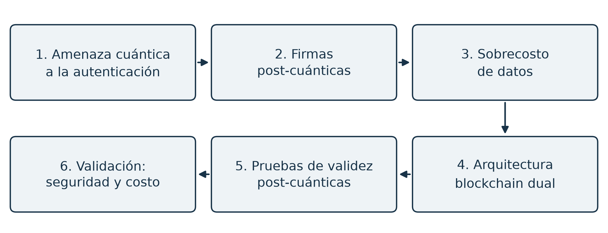
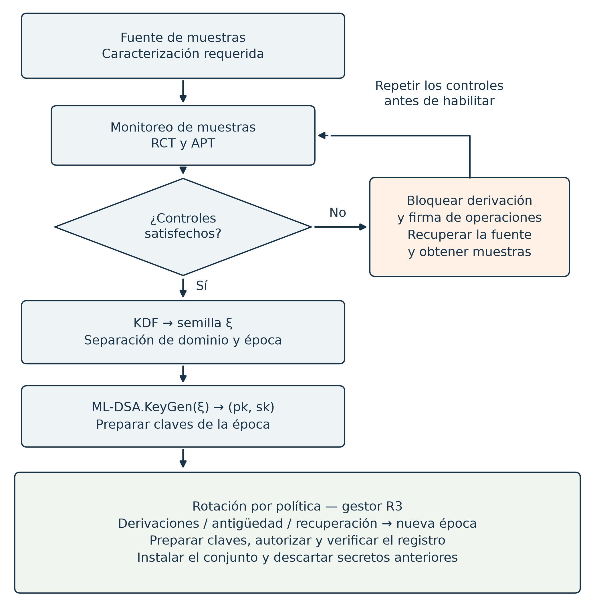

# Resumen {.unnumbered}

NEXUS es un modelo matemático-computacional y prototipo de referencia para estudiar la autenticación y la gestión de claves frente a amenazas poscuánticas en sistemas digitales. Emplea ML-DSA, derivado de CRYSTALS-Dilithium y estandarizado en FIPS 204, y una arquitectura blockchain dual como modelo de ejecución y anclaje. La amortización del tamaño de firmas mediante pruebas por lote depende de la disponibilidad de datos, del costo del probador y de la aritmetización de la lógica de aplicación.

La validación identifica el perfil de firma implementado, contrasta los parámetros y las reducciones citadas, y explicita las obligaciones para obtener una garantía concreta de inforjabilidad. El gestor incorpora min-entropía, pruebas de salud NIST SP 800-90B, recuperación, rotación efectiva y un registro local autenticado. La protección de la semilla, la calificación de una fuente concreta y las integraciones de custodia y anclaje permanecen pendientes.

Las mediciones trazables evalúan componentes con repeticiones y dispersión. La revisión STARK refuta una premisa de proximidad del verificador básico y comprueba el enlace de FRI de traza con AIR mediante raíz común. Rust incorpora ese contrato y lo conecta con `ActiveChain` mediante contexto local; rechaza raíces fuera del modelo escalar. Lean demuestra una cota conservadora de aceptación falsa para el verificador matemático de bytes en ROM clásico finito, con consultas adaptativas, muestra compartida, trabajo y reinicios. La compilación global y la auditoría de axiomas comprueban esos resultados bajo sus hipótesis; no demuestran equivalencia universal con Rust. La transferencia QROM completa de AIR/FRI queda como trabajo futuro. El catálogo relaciona afirmaciones, hipótesis y evidencia.

El aporte reúne modelo, componentes y evaluación delimitada. El AIR ilustrativo no valida firmas ML-DSA ni aplicaciones completas; no se acreditan 100 bits, conocimiento cero, seguridad incondicional de SHA3 ni una blockchain operativa.

**Palabras clave:** criptografía post-cuántica, blockchain, CRYSTALS-Dilithium, Module-LWE, arquitectura dual-chain, seguridad de sistemas, validación formal.

# Abstract {.unnumbered}

NEXUS is a mathematical-computational model and reference prototype for studying authentication and key management under post-quantum threats in digital systems. It uses ML-DSA, derived from CRYSTALS-Dilithium and standardized in FIPS 204, with a dual blockchain architecture as an execution and anchoring model. Amortizing signature size through batch proofs depends on data availability, prover cost, and arithmetization of application logic.

The validation identifies the implemented signature profile, checks parameters and cited reductions, and states the obligations for a concrete unforgeability guarantee. The key manager implements min-entropy monitoring, NIST SP 800-90B health tests, recovery, effective key rotation, and a locally authenticated audit log. Seed protection, qualification of a concrete entropy source, and durable custody and anchoring integrations remain pending.

Traceable measurements evaluate components with repetitions and dispersion. The STARK review refutes a proposed proximity premise for the basic verifier and checks the shared-root link between trace FRI and AIR. Rust implements this contract and connects it to `ActiveChain` using local context; roots outside the scalar model are rejected. Lean proves a conservative false-acceptance bound for the mathematical byte verifier in a finite classical ROM, accounting for adaptive queries, a shared sample, work and restarts. The global build and axiom audit check these results under their stated assumptions; they do not prove universal equivalence with Rust. Full QROM transfer for AIR/FRI remains future work. A catalogue links claims, assumptions, and evidence.

The contribution combines a model, components, and evaluation within stated limits. The illustrative AIR does not validate ML-DSA signatures or complete applications. It does not establish 100-bit security, zero knowledge, unconditional SHA3 security, or an operational blockchain.

**Keywords:** post-quantum cryptography, blockchain, CRYSTALS-Dilithium, Module-LWE, dual-chain architecture, systems security, formal validation.

# Alcance de la tesis {.unnumbered}

NEXUS se plantea para sistemas que requieren autenticación de operaciones, integridad de registros y gestión de claves. La arquitectura blockchain dual es el modelo y el prototipo de referencia utilizados para estudiar esos requisitos. La aplicabilidad a distintos dominios exige definir y validar las reglas de cada aplicación; los experimentos de componentes no acreditan una implementación integral en todos ellos.

El gestor de claves y su registro local están implementados y probados, con integración de despliegue pendiente. La cota conservadora de aceptación falsa se demuestra para un verificador matemático en un ROM clásico finito, bajo los perfiles y presupuestos de §6.7.9. La correspondencia universal con el ejecutable Rust, la protección de una fuente física y las garantías operativas se delimitan por separado. La transferencia cuántica completa de AIR/FRI constituye trabajo futuro.

# Capítulo 1 — Introducción

*Planteamiento del problema, modelo de amenaza y objetivos*

> **Rol en el arco de la tesis.** Este capítulo abre el arco narrativo: establece la **amenaza** (cuántica a las firmas digitales de los sistemas), anticipa la **solución** (firmas post-cuánticas) y su **costo** (que motiva el dual-chain), fija el **modelo de amenaza preciso**, y enuncia los objetivos, el alcance y la contribución. Los desarrollos correspondientes están en los Capítulos 3–6.

---

## 1.1 Contexto y motivación

Los sistemas digitales emplean criptografía de clave pública para autenticar operaciones, verificar la integridad de registros y proteger comunicaciones: las **firmas digitales** sustentan la autenticación y los esquemas de cifrado protegen la confidencialidad. Hoy esa criptografía es, casi universalmente, **RSA** y **criptografía de curva elíptica (ECC)**, cuya seguridad se apoya en la dureza de la factorización y del logaritmo discreto.

La computación cuántica amenaza ese cimiento. El **algoritmo de Shor** resuelve ambos problemas en **tiempo polinómico** sobre un computador cuántico suficientemente grande, rompiendo RSA y ECC. Aunque tal computador no existe aún, la amenaza es **presente** por el fenómeno **"Harvest Now, Decrypt Later" (HNDL)**: un adversario puede **cosechar hoy** información (datos cifrados, claves públicas expuestas) y **explotarla mañana**, cuando disponga de capacidad cuántica. Para sistemas que requieren preservar la autenticidad o la confidencialidad de su información a largo plazo, esto motiva adoptar **criptografía post-cuántica (PQC)** **desde ya**, no cuando la amenaza se materialice. La estandarización del NIST (FIPS 203/204/205, finalizados en 2024) y la migración de las grandes cadenas (Cap. 2) confirman que esta transición está en marcha.

## 1.2 Modelo de amenaza

Una validación de seguridad requiere un modelo de amenaza **preciso**. NEXUS distingue cuidadosamente dos amenazas cuánticas, frecuentemente confundidas:

**(A) Amenaza a la confidencialidad (HNDL en sentido estricto).** Datos cifrados con un esquema clásico y cosechados hoy podrían descifrarse en el futuro. Mitigar esto requiere un **mecanismo de encapsulado de claves (KEM) post-cuántico** (p. ej. ML-KEM / Kyber, FIPS 203). **Esta amenaza queda fuera del alcance** de esta tesis, que se centra en las firmas; se enuncia como trabajo futuro (Cap. 7).

**(B) Amenaza a la autenticación (el foco de NEXUS).** Una clave pública clásica expuesta permite a un adversario con capacidad cuántica suficiente aplicar Shor a los problemas de factorización o logaritmo discreto y falsificar firmas. NEXUS estudia la sustitución de ECDSA por ML-DSA, derivado de CRYSTALS-Dilithium (Cap. 4). La validación de sus fundamentos y las obligaciones para obtener una garantía concreta de la implementación se presentan en §6.4; el funcionamiento de la API no constituye por sí solo una prueba de inforjabilidad.

**Adversario.** El análisis de las firmas considera los modelos clásicos y cuánticos de las reducciones citadas, incluido QROM cuando corresponde a R1. Para AIR/FRI se distingue la derivación interactiva ideal de la cota demostrada para el verificador matemático en ROM clásico (§§6.7.8–6.7.9); su extensión QROM completa permanece como trabajo futuro (§6.7.10). Los canales laterales, fallos de implementación y el consenso operativo quedan fuera de esta validación; el diseño asume las condiciones de consenso de §3.10.

**Mitigación complementaria de la exposición.** Derivar la dirección como $H(pk)$ evita mostrar directamente la clave pública mientras no se revele por otro canal. Esta condición deja de cumplirse cuando la transacción transmite la clave. La protección depende también de la resistencia de preimagen del hash y del protocolo de uso; no garantiza que la clave sea irrecuperable ni sustituye una firma post-cuántica. El modelo de identidad estable y claves por época se desarrolla en §3.6.

## 1.3 El problema: seguridad post-cuántica a un costo tractable

Adoptar firmas post-cuánticas no es gratis. Una firma Dilithium es **~50× más grande** que una firma ECDSA (3 309 B vs. 64 B). Aplicada de forma ingenua sobre una blockchain de cadena única, el modelo limitado por ancho de banda estima una reducción de rendimiento de orden 20× bajo sus tamaños y capacidad asumidos (Cap. 3, §3.3); no es una medición de un sistema completo, reabriendo el **trilema de la blockchain** (escalabilidad, seguridad, descentralización) que se creía en vías de solución.

El problema central de esta tesis es, por tanto:

> **¿Cómo proteger las firmas digitales de sistemas en general frente a la amenaza cuántica y gestionar su sobrecosto mediante una arquitectura blockchain dual escalable?**

La respuesta de NEXUS es un modelo de arquitectura dual: L2 ejecuta operaciones y L1 recibe compromisos y pruebas por lote. La amortización depende de aritmetizar la lógica pertinente, disponer de los datos y asumir el costo de generación de las pruebas (§6.6.5). La PoC actual evalúa una recurrencia ilustrativa y no demuestra todavía la verificación de firmas ML-DSA dentro de ese flujo completo.

## 1.4 Propuesta y contribución

**Tesis (en una frase).**

> *NEXUS modela y prototipa firmas digitales post-cuánticas y gestión activa de claves para sistemas en general. Analiza los fundamentos de seguridad de CRYSTALS-Dilithium/ML-DSA y el sobrecosto de datos que motiva una arquitectura blockchain dual con pruebas de validez post-cuánticas; la validación se delimita a las condiciones y los componentes estudiados.*

**Arco narrativo.** El trabajo se organiza como una sola cadena de razonamiento:

**Figura 1.1 — Secuencia del argumento de la tesis.**

{width=6.5in}

*Fuente: elaboración propia. El esquema organiza el argumento; el estado y los límites de su validación se detallan en los capítulos 5 y 6.*

**Naturaleza del aporte.** El entregable es un **modelo matemático-computacional acompañado de un prototipo de referencia**. La arquitectura se especifica y modela; el núcleo de firmas cuenta con implementación y registros de pruebas. La gestión activa de claves conserva las integraciones pendientes de §5.8. El análisis de seguridad presenta fundamentos citados y condiciones cuya correspondencia con el prototipo debe completarse (§6.4). La capa de computación verificable se entrega como **PoC STARK de una transición ilustrativa**, con los límites de §6.7; la aritmetización completa y el consenso bizantino operativo permanecen como diseño de referencia y trabajo futuro.

**Novedad.** La criptografía post-cuántica, los esquemas de firma reticulares y los *rollups* existen por separado. La contribución de NEXUS es la **síntesis específica**:

> *el estudio formal y cuantificado del sobrecosto de datos de las firmas post-cuánticas y de su amortización en una arquitectura dual-chain. El costo de anclaje por operación tiende al de su diferencia de estado si el tamaño de prueba crece sublinealmente con el lote y la política de disponibilidad permite ese presupuesto de publicación; la realización completa de la capa de pruebas conserva las condiciones de §6.7.*

Las propuestas de Ethereum y Solana aportan antecedentes para esta dirección de diseño (Cap. 2); su coincidencia no demuestra la seguridad ni la viabilidad de la implementación de NEXUS.

## 1.5 Objetivos

**Objetivo general.** Diseñar, modelar y **validar formalmente** un modelo matemático-computacional de firmas digitales post-cuánticas (CRYSTALS-Dilithium) para una arquitectura blockchain dual orientada a sistemas seguros y resilientes de distintos dominios, incorporando la gestión activa del ciclo de vida de claves y la prueba formal de su seguridad (reducción a Module-LWE) y de su complejidad computacional.

**Objetivos específicos.**

1. **Diseñar la arquitectura Dual-Chain** como modelo de referencia, especificando los roles de la Anchor Layer (L1) y la Active Layer (L2) y el camino de la firma post-cuántica (Cap. 3).
2. **Desarrollar e implementar el núcleo criptográfico** post-cuántico (Dilithium) y la derivación determinística de claves desde semilla mediante un KDF (Cap. 4).
3. **Modelar e implementar la lógica de seguridad activa** del ciclo de vida de claves: min-entropía de la fuente, pruebas de salud (NIST SP 800-90B) y rotación con secrecia hacia adelante (Cap. 5).
4. **Formalizar y validar la seguridad y la complejidad**: reducción de la in-forjabilidad de Dilithium a Module-LWE / SelfTargetMSIS / Module-SIS → Mod-SIVP, con el argumento de resistencia cuántica; y análisis de complejidad (notación O) (Cap. 6).

**Alcance de cumplimiento.** El componente de reducción de seguridad del objetivo general y del objetivo específico 4 tiene cumplimiento parcial: se identifican los resultados publicados, sus condiciones y las correspondencias pendientes para ML-DSA implementado (§6.4), sin afirmar una cadena concreta completa para el ejecutable. Las demostraciones propias incluyen resultados de los modelos y la cota conservadora de aceptación falsa del verificador matemático AIR/FRI en ROM clásico (§6.7.9); esa cota no es una prueba de inforjabilidad de ML-DSA. En el objetivo 3 se comprueban monitor, rotación por épocas y registro local; la secrecia hacia adelante permanece condicionada por la custodia y la eliminación de secretos (§5.5). El capítulo 7 evalúa los objetivos con estas distinciones.

## 1.6 Alcance

**Dominio de aplicación.** NEXUS se plantea para sistemas en general que necesitan autenticar operaciones, conservar registros verificables y gestionar el ciclo de vida de sus claves. En este trabajo, una transacción representa una operación firmada que modifica el estado de una aplicación; puede corresponder, por ejemplo, a la actualización de un registro o de un permiso. La arquitectura blockchain dual es el entorno de referencia del modelo y del prototipo. Cada aplicación debe definir sus reglas de autorización y transición de estado; los resultados de los componentes no constituyen validación de todas las aplicaciones posibles.

**Dentro del alcance:** diseño y especificación de la arquitectura dual; implementación y comprobación funcional de ML-DSA y su enlace a las transacciones; derivación determinística contextual desde semilla; gestión activa de claves; estudio de las reducciones de seguridad y de sus condiciones de aplicación; demostraciones para los modelos declarados, incluida la cota ROM del verificador matemático; análisis de complejidad y mediciones de componentes. Este alcance no acredita una reducción completa de seguridad del ejecutable ni una garantía operativa de secrecia hacia adelante.

**Fuera del alcance (declarado):** autenticación biométrica / extractores difusos (**eliminados**); implementación operativa de la capa ZK, del consenso BFT en red y de la disponibilidad de datos (diseño de referencia + trabajo futuro); confidencialidad post-cuántica (KEM); seguridad de implementación (canales laterales).

## 1.7 Estructura del documento

**Tabla 1.1 — Estructura del documento.**

| Cap. | Contenido | Objetivo |
|---|---|:---:|
| **1** | Introducción, modelo de amenaza, objetivos | — |
| **2** | Marco teórico y estado del arte | — |
| **3** | Diseño de la arquitectura Dual-Chain (overhead → respuesta → coherencia) | Obj 1 |
| **4** | Núcleo criptográfico post-cuántico (Dilithium + KDF) | Obj 2 |
| **5** | Gestión activa del ciclo de vida de claves | Obj 3 |
| **6** | Validación formal de seguridad y complejidad | Obj 4 |
| **7** | Conclusiones y trabajo futuro | — |

# Capítulo 2 — Marco Teórico y Estado del Arte

*Fundamentos y posicionamiento del trabajo*

> **Rol en el arco de la tesis.** Este capítulo provee los **fundamentos conceptuales** que el resto del documento usa y sitúa a NEXUS frente al estado del arte. Las definiciones formales rigurosas (retículos, Module-LWE, etc.) se enuncian aquí a nivel **expositivo** y se desarrollan con precisión en el **Capítulo 6**.

---

## 2.1 Blockchain, el trilema y las arquitecturas de capas

Una **blockchain** es un libro mayor distribuido y replicado, cuyo estado evoluciona mediante transacciones autenticadas por firmas digitales y ordenadas por un protocolo de **consenso**. Su diseño enfrenta el llamado **trilema de la blockchain**: la dificultad de lograr simultáneamente **escalabilidad**, **seguridad** y **descentralización**.

La respuesta dominante de la industria es la **arquitectura de capas** (*rollup-centric*): una capa base **L1** que provee consenso, finalidad y **disponibilidad de datos**, y capas de ejecución **L2** (*rollups*) que procesan transacciones a alta velocidad y asientan en L1 un compromiso de su estado, acompañado de una prueba (de **validez**, en los *ZK-rollups*, o impugnable, en los *optimistic rollups*) [Buterin21]. NEXUS adopta esta separación (Anchor L1 / Active L2; Cap. 3), pero por una razón adicional y específica: **amortizar el sobrecosto de las firmas post-cuánticas** (Cap. 3, §3.4).

## 2.2 La amenaza cuántica: Shor y Grover

Dos algoritmos cuánticos definen la amenaza:

- **Algoritmo de Shor (1997).** Resuelve la factorización de enteros y el logaritmo discreto en **tiempo polinómico**, rompiendo RSA, Diffie-Hellman y ECC. Para una blockchain, implica que un adversario cuántico puede **recuperar la clave privada** desde la pública expuesta y **falsificar firmas** (Cap. 1, §1.2).
- **Algoritmo de Grover (1996).** Ofrece una aceleración cuadrática para búsqueda no estructurada. Para búsqueda de claves o preimágenes ideales, el costo de consultas pasa de orden $2^b$ a $2^{b/2}$; esta interpretación no se aplica automáticamente a búsqueda de colisiones, al costo físico ni a todos los ataques reticulares. Las estimaciones de retículos y los supuestos específicos se tratan separadamente en §6.4.3.

La combinación de ambos con el fenómeno **HNDL** (Cap. 1) hace que la migración a criptografía post-cuántica sea urgente para infraestructura de larga vida.

## 2.3 Criptografía post-cuántica basada en retículos

La familia post-cuántica más madura para firmas se basa en **retículos**. Un **retículo** es el conjunto de combinaciones enteras de un conjunto de vectores base; sobre él se definen problemas computacionales —hallar el vector más corto (SVP), o $n$ vectores cortos independientes (SIVP)— que se conjeturan **difíciles tanto clásica como cuánticamente** (a diferencia de la factorización, Shor **no** se les aplica; Cap. 6, §6.4.3).

La seguridad práctica se apoya en dos problemas promedio sobre **retículos de módulo**, eficientes en tamaño de clave:

- **Module-LWE** (*Learning With Errors*): distinguir $(\mathbf{A}, \mathbf{A}\mathbf{s}+\mathbf{e})$ de uniforme, con $\mathbf{s},\mathbf{e}$ "pequeños".
- **Module-SIS** (*Short Integer Solution*): hallar un vector corto no nulo en el núcleo de $\mathbf{A}$.

CRYSTALS-Dilithium y su estándar ML-DSA emplean Fiat–Shamir con abortos [Lyu09, Lyu12]. El capítulo 6 identifica MLWE, SelfTargetMSIS y MSIS, así como las condiciones de las reducciones de peor caso. La correspondencia de distribuciones y parámetros es parte de la obligación de validación; no se atribuye una cadena concreta completa al prototipo a partir de esas definiciones expositivas.

## 2.4 El panorama PQC y la estandarización NIST

El NIST estandarizó en 2024 los primeros esquemas post-cuánticos, con un cuarto en camino:

**Tabla 2.1 — El panorama PQC y la estandarización NIST.**

| Estándar | Esquema | Tipo | Estado |
|---|---|---|---|
| FIPS 203 | ML-KEM (Kyber) | KEM reticular (cifrado) | final (2024) |
| **FIPS 204** | **ML-DSA (Dilithium)** | **firma reticular** | **final (2024)** — *usado por NEXUS* |
| FIPS 205 | SLH-DSA (SPHINCS+) | firma hash-based | final (2024) |
| FIPS 206 | FN-DSA (Falcon) | firma reticular (NTRU) | estandarización en curso [NIST-PQC26] |

Estos esquemas difieren en sus compromisos (tamaño de firma, conservadurismo, facilidad de implementación). El **Capítulo 4, §4.6** desarrolla la comparativa y justifica la elección de Dilithium para NEXUS frente a Falcon (firma menor) y a los esquemas hash-based (más conservadores).

## 2.5 Aleatoriedad, entropía y derivación de claves

La seguridad de toda clave depende de la calidad de la **aleatoriedad** de la que nace. La medida pertinente **no** es la entropía de Shannon de una muestra, sino la **min-entropía de la fuente**, $H_\infty(X) = -\log_2 \max_x \Pr[X{=}x]$, que captura la imprevisibilidad en el peor caso. El estándar **NIST SP 800-90B** define la **estimación de min-entropía** y las **pruebas de salud en línea** (*Repetition Count Test*, *Adaptive Proportion Test*) que vigilan la degradación de un generador. A partir de una fuente sana, una **función de derivación de claves (KDF)** con separación de dominio (HKDF, RFC 5869 / SHAKE256) produce semillas para las claves. Estos fundamentos sustentan la gestión activa de claves del **Capítulo 5**.

## 2.6 Pruebas de conocimiento cero y su coherencia post-cuántica

Las **pruebas de conocimiento cero** (ZK) permiten demostrar la validez de una afirmación sin revelar su contenido, y son el mecanismo que hace que un *ZK-rollup* pueda asentar en L1 una prueba sucinta de que un *batch* de transacciones es correcto (Cap. 3, §3.4). Dos familias son relevantes:

- **SNARKs de emparejamientos** (p. ej. Groth16): pruebas muy pequeñas (~200 B), pero su seguridad descansa en el logaritmo discreto en curvas → **rotas por Shor** (no post-cuánticas).
- **STARKs** (basados en compromisos hash y pruebas de proximidad como FRI): permiten construir argumentos transparentes sin emparejamientos. Su seguridad poscuántica requiere justificar los compromisos, la compilación Fiat–Shamir, las distribuciones de retos y los parámetros en el modelo cuántico. La denominación STARK no acredita por sí sola una implementación, un nivel de seguridad ni conocimiento cero.

La coherencia del diseño exige que la capa de pruebas tenga garantías compatibles con la amenaza poscuántica. Solidez, extracción y conocimiento cero son propiedades distintas: un AIR demostrativo y FRI no prueban automáticamente las tres. La validación de NEXUS las delimita en §6.7.

## 2.7 Estado del arte y posicionamiento de NEXUS

Los sistemas blockchain poscuánticos constituyen un área de investigación [Yang23]. Las referencias de diseño analizadas incluyen dos líneas de preparación, consultadas en fuentes primarias el 12 de octubre de 2026:

- **Ethereum.** Su hoja de ruta plantea firmas hash-based y agregación por pruebas dentro del programa Lean Ethereum. Los hitos publicados son objetivos de migración, no una afirmación de que la transición completa esté operativa [Eth-PQ26].
- **Solana.** Anza estudia Falcon y las modificaciones necesarias para incorporar firmas poscuánticas. Esa preparación no acredita una adopción completa en producción [Anza-PQ26].
- **Custodia de claves.** Conservar la semilla permite regenerar claves ML-DSA, por lo que su protección forma parte del modelo. R5 distingue tamaño serializado, representaciones en memoria y política de residencia (§5.6). Las propuestas de atestación y señuelos quedan como trabajo futuro complementario; el corpus bibliográfico no demuestra la inexistencia de otras soluciones ni garantiza indistinguibilidad del sistema propuesto.

**Posicionamiento.** NEXUS aporta una síntesis de arquitectura, firmas y gestión de claves para sistemas en general. La comparación externa contextualiza las decisiones; las garantías del prototipo dependen de la correspondencia, derivaciones y evidencia propias de los capítulos 5 y 6. Coincidir con una hoja de ruta no valida la seguridad ni la ejecución del sistema completo.

## 2.8 Síntesis del marco

Este capítulo estableció: el contexto de capas L1/L2 (§2.1), la amenaza cuántica concreta (§2.2), los fundamentos reticulares y de Dilithium (§2.3), el panorama de estándares (§2.4), la entropía y derivación de claves (§2.5), el papel y la coherencia post-cuántica de las pruebas ZK (§2.6), y el estado del arte que contextualiza y posiciona a NEXUS (§2.7). Sobre estos fundamentos se construyen el diseño (Cap. 3), el núcleo criptográfico (Cap. 4), la gestión de claves (Cap. 5) y la validación formal (Cap. 6).

---

## Referencias del capítulo

> *Índice local del capítulo; la **Bibliografía** consolidada al final del documento reúne todas las obras bajo clave única.*

- [Buterin21] V. Buterin. *An Incomplete Guide to Rollups*. 2021.
- [Sho97] P. Shor. *Polynomial-Time Algorithms for Prime Factorization and Discrete Logarithms on a Quantum Computer*. SIAM J. Comput. 1997.
- [Gro96] L. Grover. *A Fast Quantum Mechanical Algorithm for Database Search*. STOC 1996.
- [Lyu09] V. Lyubashevsky. *Fiat-Shamir with Aborts*. ASIACRYPT 2009. · [Lyu12] *Lattice Signatures without Trapdoors*. EUROCRYPT 2012.
- NIST. *FIPS 203 (ML-KEM) / 204 (ML-DSA) / 205 (SLH-DSA)*, 2024; *FN-DSA (Falcon)*, estandarización en curso [NIST-PQC26].
- NIST. *SP 800-90B* (fuentes de entropía); H. Krawczyk, *HKDF* (RFC 5869).
- [Yang23] Z. Yang et al. *A Survey and Comparison of Post-Quantum and Quantum Blockchains*. IEEE Communications Surveys & Tutorials, 2023.
- [Eth-PQ26] Ethereum Foundation. *Roadmap — Future-proofing: Quantum resistance* (Lean Consensus / leanXMSS; leanVM; EIP-7702, EIP-8141). ethereum.org/roadmap/future-proofing/quantum-resistance. Acceso: jun. 2026.
- [Anza-PQ26] Solana / Anza. *Quantum Readiness* (Falcon; Winternitz Vault) y *Alpenglow* (Votor/Rotor). 2026. Acceso: jun. 2026.
- [RFC9881] J. Massimo, P. Kampanakis, S. Turner, B. Westerbaan. *RFC 9881: Internet X.509 PKI — Algorithm Identifiers for ML-DSA*. IETF, 2025.
- [JR13] A. Juels, R. L. Rivest. *Honeywords: Making Password-Cracking Detectable*. ACM CCS 2013.
- [US10521584] N. Sharifi Mehr (Amazon Technologies). *Computer Threat Analysis Service*. Patente US 10,521,584 B1, 2019.
- Puffer Finance. *Secure-Signer / RAVe* (claves de validador en SGX + atestación on-chain), 2023–2025; Flashbots. *Rollup-Boost* (builder de L2 en TEE, Unichain), 2025.

# Capítulo 3 — Diseño de la Arquitectura Dual-Chain

*Objetivo 1 · el capítulo "espina": Costo → Respuesta → Coherencia*

> **Alcance del capítulo.** Se presenta el costo de las firmas post-cuánticas y la arquitectura dual-chain propuesta para distribuirlo entre ejecución y anclaje. La capa de pruebas debe satisfacer el modelo de amenaza considerado. Los cálculos de sobrecosto y amortización se relacionan con el análisis de complejidad y sensibilidad de §§6.5–6.6.

---

## 3.1 Introducción

Una arquitectura blockchain post-cuántica debe considerar tanto la seguridad de la autenticación como su costo. Las firmas ML-DSA-65 estudiadas ocupan aproximadamente 52 veces los bytes de la firma ECDSA de referencia. En un modelo limitado exclusivamente por datos, ese aumento reduce el número de operaciones que caben en un bloque (§3.3); no determina por sí solo el rendimiento de un sistema completo.

La arquitectura dual-chain es la respuesta de diseño estudiada para distribuir el sobrecosto de firmas poscuánticas entre ejecución y anclaje. Su amortización se modela bajo condiciones de disponibilidad de datos, prueba de la lógica pertinente y costo del probador (§6.6.5). La validación distingue esa propuesta de una implementación integral y exige una capa de pruebas cuya seguridad se justifique para el modelo de amenaza considerado.

El capítulo desarrolla el Objetivo 1: especifica los roles de la **Anchor Layer (L1)** y la **Active Layer (L2)**, el camino de la firma post-cuántica a través del sistema, y los componentes clave (Nexus Sequencer, Nitro Verifier), integrando la evidencia de que las cadenas líderes (Ethereum, Solana) convergen hacia el mismo diseño.

---

## 3.2 Visión general de la arquitectura

NEXUS separa **anclaje y confirmación del estado** de **ejecución** en dos capas:

- **Anchor Layer (L1) — la capa de anclaje.** Provee consenso, finalidad irreversible y disponibilidad de datos. Es la raíz de confianza: lenta pero segura. Almacena los compromisos de estado del L2 y garantiza que los datos necesarios estén disponibles.
- **Active Layer (L2) — la capa activa.** Ejecuta transacciones a alta velocidad: secuencia, verifica firmas Dilithium, aplica transiciones de estado, agrupa en *batches* y produce una prueba de validez que asienta en L1.

### El camino de la firma post-cuántica

El elemento que estructura el diseño es **el recorrido de una firma Dilithium a través del sistema**:

**Figura 3.1 — Recorrido propuesto de una operación firmada en NEXUS.**

{width=6.5in}

*Fuente: elaboración propia. Arquitectura de referencia: la aritmetización completa de ML-DSA, la disponibilidad de datos y el consenso operativo no quedan implementados por la PoC STARK (§3.5 y §6.7). El diagrama muestra el flujo de autenticación y anclaje; la política de disponibilidad de datos se especifica por separado.*

En el diseño propuesto, la firma de 3,3 KB se verifica **en el L2** y esa verificación se incorpora a una prueba de validez; L1 recibe la prueba y el compromiso de estado. Esta separación es el mecanismo de amortización modelado en §3.4. Su realización completa exige la aritmetización y la política de disponibilidad de datos indicadas en la nota de la figura.

> **Validación externa.** La hoja de ruta *rollup-centric* de Ethereum adopta exactamente esta separación (L1 = liquidación + DA; ejecución en L2), lo que respalda la elección arquitectónica como consenso de diseño de la industria.

---

## 3.3 El sobrecosto de la criptografía post-cuántica

El costo de la PQC incluye datos y cómputo. El recurso limitante depende de la carga y de la implementación; las comparaciones siguientes no establecen un cuello de botella universal.

**Tabla 3.1 — ECDSA P-256 vs. Dilithium3.** *(El cociente exacto 3 309/64 ≈ 52× se redondea a ~50× en el texto narrativo; ambas cifras designan el mismo dato.)*

| Magnitud | ECDSA P-256 | Dilithium3 | Razón | Implicación |
|---|---:|---:|---:|:---:|
| Firma | 64 B | 3 309 B | ~52× | Aumentan los datos |
| Clave pública | 33 B | 1 952 B | ~59× | Aumentan los datos |
| Verificación CPU (H2) | 144,8 µs | 77,6 µs | ~0,54× (tiempo) | Depende de la carga |

Las latencias CPU corresponden a la serie histórica H2 de la Tabla 6.8; no son medidas del sistema completo.

**Resultado de la comparación.** El incremento de bytes motiva estudiar la cantidad de datos de autenticación publicada en L1. Las verificaciones de la serie histórica H2 son del mismo orden de magnitud, pero no tienen el mismo costo ni permiten descartar CPU, generación de pruebas u otras operaciones como recursos limitantes. La procedencia y las restricciones de esas mediciones se detallan en §6.6.

**Impacto en una cadena única.** Modelando una transacción como carga útil base $b$ más la firma, y un presupuesto de datos por bloque $B_d$, el throughput es $\mathrm{TPS}=B_d/(\tau(b+s))$. Con $b\approx100$ B, $B_d=1$ MB, $\tau=12$ s:

$$
\frac{\mathrm{TPS}_{\text{ECDSA}}}{\mathrm{TPS}_{\text{Dilithium}}} = \frac{b+s_q}{b+s_c} = \frac{3409}{164} \approx 20{,}8\times.
$$

Es decir, **adoptar PQC de forma ingenua cuesta ~20× de throughput** (la firma es el ~97 % de los bytes de la transacción), y la componente de firmas del libro mayor crece ~50× más rápido. *(Derivación completa y análisis de sensibilidad: documento `Analisis-Overhead`, §2.)*

---

## 3.4 La amortización dual-chain

El modelo de rollup ejecuta $M$ operaciones en L2 y publica en L1 un compromiso $C$, una prueba de tamaño $\pi(M)$ y los datos exigidos por la política de disponibilidad. La prueba debe autenticar la verificación de firmas y la lógica ejecutada; el AIR ilustrativo actual no implementa ese flujo completo.

> Una prueba de validez puede sustituir la verificación directa de las firmas en L1. Omitir además sus bytes de la publicación depende de que la política de disponibilidad y reconstrucción no los exija allí. La prueba no elimina las obligaciones de almacenar y distribuir los datos necesarios.

En un escenario donde la disponibilidad publicada se representa mediante $d$ bytes de diferencia de estado por operación, y el compromiso y los metadatos fijos ocupan $c$ bytes, el costo de datos de anclaje por operación es

$$
F(M) = d + \frac{c+\pi(M)}{M}.
$$

El límite $F(M)\to d$ requiere $\pi(M)/M\to0$, es decir, crecimiento sublineal del tamaño de prueba. Con una prueba fija es inmediato; no se presume para una familia arbitraria de pruebas. Si la política exige publicar además una firma de $s_q$ bytes por operación, el costo de ese escenario es $F(M)+s_q$, y su límite conserva ese sumando. La independencia de $d$ respecto del esquema es una hipótesis de este modelo de publicación.

**Ejemplo aritmético.** Con $d=40$ B, $c=32$ B y una prueba fija supuesta de 100.000 B, el modelo da 140,032 B por operación para $M=1000$ y 50,0032 B para $M=10000$. Frente a la referencia de 3409 B por operación, el equilibrio $F(M)\leq3409$ exige $M\geq30$; aproximarse a $d$ con un sobrecosto de a lo sumo el 10 % exige $M\geq25008$. Son umbrales distintos. Estas cifras describen el escenario supuesto, no los tamaños medidos del PoC ni un ahorro demostrado para transacciones ML-DSA completas.

**En la dimensión de cómputo**, se verifica una prueba por lote, pero su tiempo $t_\pi(M)$ puede crecer con $M$. El costo por operación es $t_\pi(M)/M$; solo tiende a cero si ese tiempo es sublineal. El costo del probador y la espera para formar el lote también deben contabilizarse (§6.6.5).

> **Conclusión de diseño.** El costo por operación puede distribuirse entre el lote y sus diferencias de estado bajo el modelo de disponibilidad y publicación adoptado. Las firmas siguen teniendo costo de almacenamiento, transmisión y verificación en la frontera que las conserva. El modelo no elimina esos costos ni mide por sí solo el rendimiento de una blockchain completa (§6.6.5).

---

## 3.5 Coherencia post-cuántica de la capa de pruebas

El diseño requiere que los compromisos y el sistema de pruebas sean compatibles con su modelo de amenaza. Los argumentos basados en emparejamientos y logaritmos discretos, como Groth16 sobre curvas clásicas, incorporan supuestos vulnerables a un adversario cuántico suficientemente potente. NEXUS explora una construcción basada en hash y FRI; su ausencia de emparejamientos evita esa dependencia particular, pero no demuestra solidez QROM de la construcción completa.

**Tabla 3.2 — Supuestos de las familias de prueba.**

| Familia | Dependencia principal | Condición de validación |
|---|---|---|
| Groth16 sobre curvas clásicas | Emparejamientos y logaritmo discreto | No satisface el modelo frente a Shor con recursos suficientes |
| Argumentos basados en hash y FRI | Compromisos, proximidad y compilación Fiat–Shamir | Requieren prueba de composición, parámetros y modelo ROM/QROM |

**Prototipo y alcance del verificador.** El prototipo usa el campo Goldilocks, NTT, Merkle sobre SHA3-256, retos de extensión y FRI para una recurrencia ilustrativa. La ruta activa de validez exige dos recorridos FRI, de traza y composición, con raíz compartida entre traza y AIR, lectura canónica y perfil externo. El verificador básico se conserva para reproducir los contraejemplos y límites auditados (§§6.7.1–6.7.4); no habilita la aceptación de esa ruta activa.

`ActiveChain` suministra el contexto mediante instantáneas privadas de los lotes construidos localmente. Comprueba el certificado antes de registrar un envío de validez o híbrido, rechaza metadatos alterados y evita registrar dos envíos del mismo índice. La raíz inicial se captura antes de ejecutar y los lotes se separan entre bloques completos. Estos controles son locales en memoria; no demuestran consenso persistente ni antirrepetición entre reinicios. El modo optimista mantiene su aceptación provisional separada.

El motor de transacciones produce raíces SHA3 generales, mientras el AIR solo admite escalares canónicos. Los lotes fuera de ese dominio se rechazan sin truncar hashes ni fabricar una prueba de recurrencia para presentarla como prueba de transacciones. La conexión de la API está implementada, pero la validez de una aplicación completa requiere aritmetizar sus reglas y vincular íntegramente sus raíces. Los casos positivos escalares de integración son ensayos sintéticos, no validaciones de transacciones L2.

**Presupuesto de seguridad.** No se acredita una garantía de aproximadamente 100 bits: el campo de extensión no basta para cerrar composición y consultas, y el trabajo del nonce no impide reinicios de transcripción. La cota de §6.7.9 incorpora trabajo y presupuesto adversario en el modelo ROM clásico; no demuestra seguridad del ejecutable, conocimiento cero ni transferencia cuántica completa.

**Tabla 3.3 — Mediciones históricas del AIR ilustrativo.**

| Filas de traza | Tamaño histórico (KB decimales, redondeado) | Verificación histórica |
|---:|---:|---:|
| 16 | 132 KB | 6,0 ms |
| 256 | 268 KB | 8,9 ms |
| 4096 | 445 KB | 12,9 ms |

Estas cifras pertenecen a la serie histórica y a una carga ilustrativa. Los tamaños se expresan en KB decimales (1000 B), con cifras históricas redondeadas; las Tablas 6.9 y 6.12 distinguen KiB (1024 B). La coincidencia de magnitudes tras convertir unidades no identifica la misma corrida ni igualdad de bytes de las pruebas. Filas AIR no equivalen a transacciones ML-DSA. Las nuevas mediciones preservan repeticiones y dispersión (§6.6), y las diferencias de procedencia se conservan explícitas. El costo del probador, incluido el trabajo del nonce, forma parte del balance de viabilidad; una curva de verificación no certifica seguridad ni el flujo L2/L1 completo.

Las propuestas poscuánticas de Ethereum y Solana aportan contexto sobre tamaño de firmas y agregación. Sus hojas de ruta no sustituyen la validación de NEXUS ni se presentan como despliegue completo de la arquitectura de esta tesis [EthRoadmap26, Solana-QR26].

### 3.5.1 Una tensión de diseño honesta: Dilithium vs. STARK-friendliness

La tensión técnica es el costo de aritmetizar ML-DSA dentro de un sistema de pruebas. NEXUS selecciona ML-DSA como esquema de firma por su estandarización y por la API semillada del backend, mientras estudia separadamente la agregación por pruebas. El AIR actual no verifica firmas ML-DSA: medirlo no resuelve el costo de esa aritmetización. Las propuestas externas de firmas hash-based o Falcon ilustran alternativas de diseño, con supuestos y costos propios.

---

## 3.6 Modelo de cuenta: identidad estable vs. clave rotable

Un sistema que **rota** y **migra** claves (Cap. 5, cripto-agilidad) enfrenta un problema: si la dirección se deriva de la clave pública, rotar la clave **cambia la dirección/identidad**. NEXUS lo resuelve con **abstracción de verificación**:

$$
\textbf{Cuenta} = (\ \text{id\_estable},\ \ \text{política\_de\_verificación},\ \ \text{epoch}\ ).
$$

- La **id_estable** identifica la cuenta de forma permanente (no cambia con la clave).
- La **política_de_verificación** especifica el esquema de firma y la clave pública actuales; una transacción se valida ejecutando esta política.
- El **epoch** registra la versión de clave (rotación/migración).

Rotar o migrar de esquema actualiza la **política** y el **epoch**, **sin tocar la id_estable**. Un **Registro de Claves (Key Registry)** permite asociar claves post-cuánticas junto a las clásicas, habilitando **firmas híbridas** durante la transición y la **migración por cuenta**.

> **Referencia de diseño.** La abstracción de cuentas permite separar identidad de política de verificación. Las propuestas de agilidad de firmas y registros poscuánticos de Ethereum son antecedentes de esa separación [Eth-PQ26]. En NEXUS, R3 comprueba un registro local y firmas por época; su integración con el sequencer y el anclaje L1 sigue pendiente (§5.8).

---

## 3.7 Disponibilidad de datos

La L1 debe garantizar que los datos del L2 (necesarios para reconstruir/auditar el estado) estén **disponibles**, sin almacenarlos permanentemente. *(Diseño de referencia; la DA —erasure coding y muestreo— no está implementada operativamente, sino especificada como modelo. Cf. §3.10 y Cap. 7.)* El diseño prevé:

- **Erasure coding real** (Reed-Solomon u otro código MDS) para redundancia con umbral de recuperación genuino (no duplicación de *chunks*).
- **Muestreo de disponibilidad (DAS)** entre **pares**: los nodos verifican la disponibilidad muestreando fragmentos distribuidos en la red, no consultando su propia memoria. La probabilidad de detección de retención es estadísticamente significativa solo si el muestreo es **remoto**.
- **Poda** de los datos tras una ventana (estilo *blob*), de modo que las firmas (50× mayores) **no se acumulan** indefinidamente en la L1.

> **Validación externa (ya en producción).** Ethereum activó **Fusaka/PeerDAS en mainnet el 3-dic-2025**: muestreo de disponibilidad que reduce ~85 % la descarga de los validadores, con blobs efímeros y podables. NEXUS modela su DA sobre este diseño desplegado. La **ZK Compression** de Solana ofrece además un mecanismo para comprimir el estado (claves públicas grandes) con pruebas de validez. Esto corrige y sustituye el "DAS" del prototipo original (que muestreaba su propia RAM).

---

## 3.8 Secuenciación e incentivos

El **Nexus Sequencer** ordena las transacciones del L2. Un secuenciador único concentra poder de censura y de extracción de valor (MEV). El diseño contempla dos mitigaciones, ambas con respaldo en la frontera:

- **Separación proponente/constructor (PBS):** separar *quién ordena* de *quién construye* el bloque, para limitar el MEV — el enfoque del **PBS enshrined (ePBS)** de Ethereum.
- **Secuenciadores concurrentes:** múltiples productores concurrentes, como los **Multiple Concurrent Leaders (MCL)** de Solana, que reducen el poder de un único líder.

**Modelo de incentivos.** Para un jugador $i$, sean $r_i$ la recompensa honesta, $c_i$ su costo, $g_i$ la ganancia de desviarse, $p_i$ la probabilidad de detección y $D_i$ el depósito perdido al detectarse la desviación. En el juego de referencia, las utilidades son $r_i-c_i$ y $g_i-p_iD_i$. El perfil honesto es equilibrio de Nash si y solo si $g_i-p_iD_i\leq r_i-c_i$ para cada jugador. El depósito por sí solo no demuestra esa desigualdad; deben justificarse pagos, detección y reglas del mecanismo. El modelo condicional está formalizado, pero no acredita el equilibrio del secuenciador desplegado.

La concurrencia introduce varios productores, pero no determina un umbral universal de colusión para censura o MEV. Ese resultado depende de las reglas de inclusión, la comunicación y el modelo de coaliciones. El mecanismo operativo de incentivos y slashing permanece como diseño de referencia.

---

## 3.9 Finalidad

El diseño busca finalidad determinista para confirmar operaciones y mantener registros consistentes. El **Finality Gadget** de referencia exige un quórum de peso estrictamente mayor que $2/3$, verificación de firmas y enlace de ascendencia. Con peso bizantino menor que $1/3$, dos quórums de ese tamaño tienen intersección honesta. Para excluir certificados incompatibles se requiere además que los participantes honestos respeten las reglas de voto y bloqueo del protocolo; el lema de intersección no demuestra por sí solo seguridad y vivacidad del consenso. Su implementación operativa permanece como trabajo futuro (§3.10).

> **Validación externa y diseño a contrastar.** Solana **Alpenglow** (Votor + Rotor; testnet may-2026, mainnet ~finales 2026) reduce la finalidad de 12,8 s a **100–150 ms**: **Votor** finaliza en **una ronda** con ≥80 % del *stake* en línea (~100 ms) y en dos rondas al 60 % (~150 ms). Ethereum persigue **finalidad de un solo paso (SSF)** y ~4 s en Lean Consensus. NEXUS adopta como requisito una **finalidad determinista rápida** y contrasta su gadget con el diseño de Votor (quórum por *stake*, finalidad en 1–2 rondas), coherente con las correcciones del consenso (quórum ponderado por *stake* + verificación de votos).

---

## 3.10 Síntesis y supuesto de consenso

El diseño dual-chain de NEXUS responde, pieza por pieza, al problema que la PQC plantea:

1. La firma de referencia introduce aproximadamente 52 veces los bytes de ECDSA; el modelo limitado por datos estima una razón de throughput de 20,8 bajo sus parámetros (§3.3).
2. La amortización tiende a $d$ si la prueba crece sublinealmente y la política de disponibilidad admite el presupuesto de publicación supuesto (§3.4).
3. La capa de pruebas requiere garantías compatibles con la amenaza cuántica. NEXUS estudia hash y FRI, con transferencia QROM completa pendiente y la aritmetización de ML-DSA aún no realizada (§3.5).
4. La **abstracción de cuenta + Key Registry** resuelve identidad-vs-clave y habilita migración — §3.6.
5. La **DA estilo PeerDAS** y la **secuenciación con incentivos** y la **finalidad rápida** completan la arquitectura — §3.7–3.9.

> **Supuestos y límite de composición.** La integridad del libro mayor requiere garantías propias de firmas, autorización, transiciones y consenso. El diseño de quórums supone menos de $1/3$ de peso bizantino y certificados de peso mayor que $2/3$, junto con las reglas de voto, bloqueo y comunicación del protocolo; una mayoría honesta simple no basta. La inforjabilidad del esquema de firma y la seguridad del consenso son propiedades distintas. NEXUS no deduce una garantía del sistema completo de esos supuestos ni del lema de intersección: la integración del consenso, la disponibilidad de datos y la lógica completa de la capa de pruebas permanece como trabajo futuro (Cap. 7).

Con ello, el **Objetivo 1 queda atendido**: la arquitectura dual-chain está especificada como modelo de referencia, con su rol —amortizar el sobrecosto post-cuántico manteniendo coherencia PQ— justificado cuantitativamente y contextualizado por propuestas externas y sujeto a la validación.

---

## Referencias del capítulo

> *Índice local del capítulo; la **Bibliografía** consolidada al final del documento reúne todas las obras bajo clave única.*

- [Buterin21] V. Buterin. *An Incomplete Guide to Rollups*. 2021.
- Ethereum Foundation. *Fusaka Mainnet Announcement* (PeerDAS, EIP-7594). Nov. 2025. · ethereum.org/roadmap (Account abstraction EIP-7702; Quantum resistance / Lean Consensus, EIP-8141).
- Anza. *Alpenglow* (Votor/Rotor). 2025–2026. · Solana. *Quantum Readiness* (Falcon; Winternitz Vault). 2026.

# Capítulo 4 — Núcleo Criptográfico Post-Cuántico

*Objetivo 2 · la "solución" del arco*

> **Rol en el arco de la tesis.** Este capítulo describe el esquema de firma, su integración de referencia y la generación determinista desde semilla. La validación identifica el perfil implementado y las condiciones de aplicación de las reducciones en §6.4; las pruebas funcionales y la garantía concreta de inforjabilidad mantienen alcances distintos.

---

## 4.1 Introducción

La autenticación requiere un esquema de firma y un protocolo de uso: mensaje y dominio correctos, asociación entre identidad y clave, política de vigencia y verificación antes de aplicar cambios. NEXUS emplea ML-DSA, derivado de CRYSTALS-Dilithium, mediante `fips204`. El capítulo 6 identifica MLWE, SelfTargetMSIS y MSIS y las obligaciones de correspondencia para el código. Este capítulo conserva la descripción del núcleo del Objetivo 2 con ese alcance de validación.

1. La **implementación verificada** de Dilithium (firma y verificación reales mediante el backend `fips204`), §4.2.
2. El **enlace de la firma a la transacción** y la verificación en la transición de estado, con las obligaciones de composición entre hash, codificación, firma y autorización (Cap. 6, §6.4), §4.3–4.4.
3. La **derivación determinística de claves** desde una semilla retenida, cuya generación y protección requieren hipótesis explícitas (Cap. 5), §4.5; y la **justificación de la elección de Dilithium** frente a esquemas alternativos, §4.6.

---

## 4.2 CRYSTALS-Dilithium en NEXUS

### 4.2.1 Selección multinivel

NEXUS soporta los tres niveles estandarizados, seleccionables según el compromiso seguridad/tamaño (Cap. 6, §6.2.3):

**Tabla 4.1 — CRYSTALS-Dilithium en NEXUS.**

| Nivel | Seguridad NIST | Clave pública | Firma | Uso recomendado |
|---|:---:|---:|---:|---|
| Dilithium2 | 2 | 1312 B | 2420 B | operaciones de alto volumen |
| **Dilithium3** | **3** | **1952 B** | **3309 B** | **por defecto en el prototipo** |
| Dilithium5 | 5 | 2592 B | 4627 B | activos de máxima criticidad |

Las claves y firmas tienen tamaños fijos por nivel, validados contra los tamaños reportados por la biblioteca antes de cualquier operación criptográfica.

### 4.2.2 Implementación verificada

La implementación (`nexus-crypto/src/dilithium.rs`) **delega en `fips204`** (backend Rust de ML-DSA / FIPS 204, versión 0.4.6 en R1), no en código criptográfico propio. Es una decisión de diseño deliberada: la criptografía post-cuántica de bajo nivel es delicada (canales laterales, *rejection sampling*) y debe descansar sobre implementaciones revisadas. Se eligió `fips204` por exponer una **`KeyGen` determinística basada en semilla** (§4.5), necesaria para el Objetivo 2.

- **Generación de claves:** `ml_dsa_N::KG::try_keygen()` (aleatoria) o `keygen_from_seed(ξ)` (determinística, §4.5) producen $(pk, sk)$ reales.
- **Firma:** `sk.try_sign(mensaje, ctx)` produce una firma genuina; **no** hay bytes de firma fijos o simulados.
- **Verificación:** `pk.verify(mensaje, firma, ctx)` **propaga el resultado real** (booleano); un mensaje o firma incorrectos producen `false`. **No** existe un verificador que retorne `true` incondicionalmente.

Una prueba unitaria de ida y vuelta confirma que una firma sobre un mensaje verifica como válida y que sobre un mensaje distinto verifica como inválida.

> **Estado funcional.** La API genera claves y firmas y ejecuta verificación real. R1 contrasta mensajes, contextos y modos, pero sus pruebas comparten backend: no equivalen a KAT/ACVP independientes, una auditoría de canales laterales o una reducción mecanizada de la implementación.

---

## 4.3 Enlace criptográfico de la firma a la transacción

La autenticación de transacciones requiere ligar la firma al contenido y comprobarla antes de aplicar cambios. El código de referencia incorpora los controles siguientes; la correspondencia criptográfica y las políticas de autorización conservan las obligaciones de §6.4:

1. **Mensaje de firma (`signing_hash`).** La ruta serializa $tx$ con `bincode`, calcula **SHA3-256** y firma sus 32 bytes mediante ML-DSA puro con contexto vacío; no invoca HashML-DSA. El contenido incluye `chain_id`, `nonce`, tipo de transacción y montos. La autenticidad del contenido requiere una codificación de aplicación inequívoca y resistencia a colisiones del hash externo, además de la inforjabilidad de la firma sobre el digest. Las reglas de aceptación deben comprobar cadena y nonce para impedir repeticiones.

2. **Enlace clave pública ↔ dirección.** La validación de estructura recomputa $\mathrm{dirección} = H(pk)$ y rechaza la transacción si no coincide con el remitente declarado. Este control liga el remitente a la clave presentada bajo los supuestos del hash; no es una imposibilidad incondicional de sustitución de clave.

3. **Verificación en la transición de estado.** El motor de ejecución (`nexus-active/src/execution.rs`) llama a `verify_signed_transaction` —que recomputa `signing_hash` y ejecuta la verificación Dilithium— **antes** de aplicar el débito/crédito; lo mismo hace la validación de bloques de la Anchor Layer. Una transacción con firma inválida **no** modifica el estado.

**Fuerza de la composición.** FIPS 204 §5.4 trata tanto el hash a nivel de aplicación como HashML-DSA: para mantener la fuerza del perfil exige que el digest tenga fuerza clásica de colisión y segunda preimagen de al menos $\lambda$. La Tabla 1 fija $\lambda=128/192/256$, con longitudes necesarias de al menos 256/384/512 bits respectivamente. El SHA3-256 externo no permite trasladar automáticamente la fuerza de ML-DSA-65/87 a las transacciones. Esta observación limita la composición; no demuestra un ataque concreto ni un incumplimiento de la operación ML-DSA pura que firma el digest [NIST24, §5.4]. Los localizadores de la ruta son `nexus-core/src/transaction.rs`, `signing_hash`; `nexus-core/src/types.rs`, `Hash256::hash`; y `nexus-crypto/src/signer.rs`, `sign_transaction` y `verify_signed_transaction`.

> **Conexión con el Cap. 6.** Una garantía de autenticación requiere el supuesto de firma correspondiente y demostrar el puente de la implementación al protocolo de transacción, incluido su hash externo. R1-B conserva la obligación de codificaciones y sUF-CMA, y R3 distingue vigencia de época de validación histórica. El AIR ilustrativo de §6.7 no acredita ese puente ni demuestra verificación ML-DSA dentro de la prueba.

---

## 4.4 Higiene del material secreto

El manejo de claves secretas sigue buenas prácticas, verificadas en el código:

- **Borrado de memoria (`zeroize`).** La clave secreta implementa `ZeroizeOnDrop`: sus bytes se sobrescriben al liberarse, reduciendo la ventana de exposición en memoria.
- **`Debug` redactado.** Las representaciones de depuración de la clave secreta y del par de claves muestran `[REDACTED]`, evitando filtraciones accidentales por *logs*.
- **Posesión por valor.** El par de claves mantiene una representación de la clave secreta cuyo destructor aplica el mecanismo de borrado. Las copias, temporales, semilla retenida y efectos del compilador requieren el análisis de residencia de §5.6; no se deduce borrado de todo el material secreto del proceso.

> **Control de copias del material secreto.** La clave secreta deriva `Clone`, lo que permite copias transitorias cuyo borrado depende de que cada copia se destruya. Deben restringirse o auditarse los usos de `.clone()` sobre material secreto antes de atribuir garantías de eliminación de todas sus representaciones.

---

## 4.5 Derivación determinística de claves desde semilla

El Objetivo 2 incluye la **generación determinística de claves a partir de una semilla**. Permite reproducir una clave desde una semilla custodiada y se conecta con la gestión de claves (Cap. 5). La propiedad de reproducción no acredita por sí sola la distribución, imprevisibilidad ni protección de esa semilla.

### 4.5.1 Fundamento: ML-DSA.KeyGen desde semilla

> **FIPS 204 / ML-DSA define `KeyGen_internal` determinística a partir de una semilla de 32 bytes** $\xi$: los valores necesarios para generar el par se derivan expandiendo $\xi$ con SHAKE. La función externa `KeyGen` obtiene primero esa semilla de un generador de bits aleatorios. El determinismo de la función interna no exige biometría ni certifica cualquier fuente que suministre $\xi$.

La ruta implementada por Sentinel deriva la entrada de esa función interna:

$$
\begin{aligned}
\xi_{e,j}&=\mathrm{SHA3\text{-}256}\big(D\parallel\operatorname{LE64}(e)\parallel\operatorname{LE64}(j)\parallel s_e\parallel\mathrm{contexto}\big),\\
(pk,sk)&=\mathsf{ML\text{-}DSA.KeyGen\_internal}(\xi_{e,j}).
\end{aligned}
$$

Aquí $D$ es el dominio fijo `NEXUS_SENTINEL_DERIVE`, $e$ la época, $j$ el contador de derivaciones y $s_e$ la semilla retenida. El flujo recibido por `ingest_source` condiciona la autorización para derivar; sus muestras no se incorporan a esta expresión. La semilla inicial se obtiene mediante un CSPRNG inicializado desde el sistema operativo y la renovación mezcla material fresco de `OsRng` (§5.3–5.5). La calidad de esos generadores, la función de derivación y su composición mantienen obligaciones propias; el monitor no las acredita automáticamente.

### 4.5.2 Implementación (verificada)

`DilithiumKeypair::from_seed(ξ, esquema)` invoca la `KeyGen` semillada del crate `fips204` (`ml_dsa_N::KG::keygen_from_seed(ξ)`), de modo que **la misma semilla produce siempre el mismo par de claves**. El test `test_deterministic_from_seed` verifica que dos derivaciones con la misma semilla coinciden, que semillas distintas difieren, y que la clave derivada firma/verifica. **El determinismo prometido por el Objetivo 2 está implementado y verificado.**

> **Nota.** La migración de `pqcrypto-dilithium` a `fips204` permitió reconstruir claves desde semilla y adoptó los perfiles ML-DSA definidos en FIPS 204. Las pruebas funcionales no acreditan conformidad independiente del conjunto, fuente aprobada ni comportamiento completo en casos extremos (§6.4).

---

## 4.6 Elección del esquema de firma post-cuántica

La elección de Dilithium debe justificarse explícitamente, porque el sobrecosto de ~50× (Cap. 3) es **específico de Dilithium** y existen alternativas con perfiles distintos. La estandarización NIST y las decisiones de las cadenas líderes ofrecen anclas reales.

**Tabla 4.2 — Esquemas de firma post-cuántica.**

| Esquema (estándar) | Tamaño de firma | Perfil | Adopción real |
|---|---:|---|---|
| **Dilithium / ML-DSA** (FIPS 204, final) | 2,4–4,6 KB | Reticular (Module-LWE); **balanceado**, robusto, fácil de implementar | **NEXUS**; estándar de referencia |
| Falcon / FN-DSA (FIPS 206, **estandarización en curso**) | **~666 B** | Reticular (NTRU); firma **pequeña**, pero usa punto flotante y es sensible a canales laterales | preparación estudiada por Anza [Anza-PQ26] |
| SLH-DSA / SPHINCS+ (FIPS 205, final) | 7,9–49,9 KB | Firma hash-based sin estado; tamaños según parámetros [FIPS205, Tabla 2] | alternativa de firma con costos propios |
| Winternitz OTS (hash-based, un solo uso) | según perfil | Requiere respetar el uso único de cada clave | propuesta de custodia a nivel de aplicación |
| leanXMSS (hash-based, XMSS) | 2–4 KB | Conservador + STARK-friendly; requiere agregación | propuesta de Lean Consensus [Eth-PQ26] |

**Justificación de Dilithium para NEXUS.** Se elige Dilithium por el **equilibrio entre seguridad, tamaño e implementabilidad correcta** (es el esquema reticular más maduro y fácil de implementar sin errores). Las alternativas y sus trade-offs:

- **Falcon** recortaría el sobrecosto de ~50× a **~10×** (firma ~666 B), atacando el problema de tamaño de frente; pero su firma con punto flotante es delicada y su proceso de estandarización sigue en curso [NIST-PQC26]. Es la apuesta de Solana, que prioriza el tamaño.
- **Hash-based (SPHINCS+/Winternitz)** maximiza la confianza (seguridad conservadora) a costa de firmas mayores; es la apuesta de Ethereum para los validadores (donde el conservadurismo y la STARK-friendliness importan más), y un buen modelo para **custodia en frío** (la bóveda Winternitz de Solana).

> **Conexión con el Cap. 3.** La elección de Dilithium se compensa con la **amortización dual-chain**: el sobrecosto de tamaño se paga una vez fuera de cadena y se amortiza en L1. La divergencia **Ethereum (hash-based) / Solana (Falcon) / NEXUS (Dilithium)** muestra que no hay una respuesta única; cada sistema elige según sus prioridades, y NEXUS justifica la suya. *(Recuérdese además la tensión Dilithium-vs-STARK-friendliness del Cap. 3, §3.5.1.)*

---

## 4.7 Estado de implementación y limitaciones

**Tabla 4.3 — Estado de implementación y limitaciones.**

| Componente | Estado |
|---|---|
| Firma/verificación Dilithium (niveles 2/3/5) | **Implementado y verificado** (vía `fips204` / ML-DSA) |
| Enlace firma↔transacción + verificación en ejecución | **Implementado** |
| Higiene de claves (`zeroize`, `Debug` redactado) | **Implementado** (auditar `.clone()` de secretos) |
| Generación **determinística** desde semilla | **Implementado y verificado**: `from_seed` usa la `KeyGen` semillada de `fips204` (test `test_deterministic_from_seed`); ver §4.5 |
| Comparativa formal de esquemas PQ | desarrollada (§4.6) |

---

## 4.8 Conclusiones del capítulo

Este capítulo desarrolló el núcleo criptográfico (Objetivo 2):

1. **Dilithium está implementado y verificado** mediante el backend `fips204`, con selección multinivel y verificación real (no *stubs*).
2. La ruta de referencia firma el digest SHA3-256 de la transacción y **verifica antes** de la transición de estado. La garantía de autenticación conserva las obligaciones de hash externo, codificación, correspondencia y autorización de §4.3 y §6.4; no hereda automáticamente la fuerza del perfil de firma.
3. La **generación determinística desde semilla** está **implementada y comprobada funcionalmente** mediante `keygen_from_seed` de `fips204` y la derivación SHA3-256 de `SentinelSeed`. La evaluación del flujo recibido es una compuerta operativa; la generación y protección de la semilla retenida requieren justificación separada (§5.4).
4. La **elección de Dilithium** se justifica frente a Falcon (menor tamaño, menor madurez) y a los esquemas hash-based (mayor conservadurismo, mayor tamaño), con anclas reales en Ethereum y Solana y conexión con la amortización del Cap. 3.

---

## Referencias del capítulo

> *Índice local del capítulo; la **Bibliografía** consolidada al final del documento reúne todas las obras bajo clave única.*

- NIST. *FIPS 204: Module-Lattice-Based Digital Signature Standard (ML-DSA)*. 2024.
- **[D+18]** Ducas, Kiltz, Lepoint, Lyubashevsky, Schwabe, Seiler, Stehlé. *CRYSTALS-Dilithium: A Lattice-Based Digital Signature Scheme.* IACR ToCHES 2018(1).
- NIST. *FIPS 205: Stateless Hash-Based Digital Signature Standard (SLH-DSA)*. 2024. · *FN-DSA (Falcon)* — estandarización en curso [NIST-PQC26].
- H. Krawczyk. *Cryptographic Extraction and Key Derivation: The HKDF Scheme*. CRYPTO 2010 (RFC 5869).
- Solana. *Quantum Readiness* (Falcon; Winternitz Vault). 2026. · Ethereum. *Lean Consensus / leanXMSS* (ethereum.org/roadmap/future-proofing/quantum-resistance). 2026.

# Capítulo 5 — Gestión Activa del Ciclo de Vida de Claves

*Objetivo 3 · la capa operativa de seguridad*

> **Rol en el arco de la tesis.** Este capítulo desarrolla la **lógica de seguridad activa** que rodea al primitivo de firma (Cap. 4): cómo se obtiene aleatoriedad de calidad, cómo se deriva la semilla de la clave, y cómo se rota la clave para limitar el daño ante un compromiso. Es la capa **operativa** que da *resiliencia* al sistema; reformula sobre bases criptográficas correctas el monitoreo de entropía del alcance original.

---

## 5.1 Introducción

Una clave de firma post-cuántica no vive aislada: nace de una fuente de aleatoriedad, se deriva de una semilla y, a lo largo de su uso, debe **rotarse** para acotar el impacto de un eventual compromiso. El Objetivo 3 modela e implementa esta **gestión activa del ciclo de vida**, estudiada mediante cuatro elementos:

1. una **fuente de entropía monitoreada**, evaluada por su **min-entropía** y vigilada por **pruebas de salud en línea** (NIST SP 800-90B), §5.2–5.3;
2. la **derivación de claves** mediante un KDF con separación de dominio, §5.4 (conecta con el Cap. 4, §4.5);
3. la **rotación por épocas**, disparada por política y con registro auditable, cuyas condiciones de secrecia hacia adelante se explicitan en §5.5;
4. la **política experimental de reexpansión por firma**, evaluada por separado del gestor: propone conservar la semilla y descartar la representación de clave después de cada operación, con los límites de memoria y custodia de §5.6.

El monitor, la derivación y la rotación forman el ciclo del gestor (§5.7); la política de reexpansión se evalúa por separado. El diseño une la fuente de aleatoriedad con la clave Dilithium y su rotación. El capítulo corrige explícitamente el enfoque del prototipo original, que usaba la **entropía de Shannon de la semilla** como métrica de seguridad —un planteamiento erróneo que se explica y reemplaza en §5.2—.

---

## 5.2 La métrica correcta: min-entropía de la fuente

El prototipo original disparaba la rotación cuando la **entropía de Shannon** de la semilla de 32 bytes caía por debajo de 7,5 bits/byte. Este planteamiento es **incorrecto por dos razones**:

1. **La entropía de Shannon de una muestra no mide el secreto de una clave.** La salida de un CSPRNG luce con entropía de Shannon máxima ($\approx 8$ bits/byte) **independientemente** de si la semilla-fuente es secreta o predecible. Lo que importa para una clave es la **imprevisibilidad de la fuente**, no la uniformidad estadística de una muestra.
2. **Es degenerada para 32 bytes.** Con solo 32 muestras sobre 256 valores posibles, la entropía de Shannon empírica máxima alcanzable es $\log_2 32 = 5$ bits/byte, **nunca 7,5**. El umbral era inalcanzable y la prueba habría fallado.

**La métrica pertinente es la min-entropía de la fuente:**

$$
H_\infty(X) = -\log_2 \Big(\max_x \Pr[X=x]\Big).
$$

La min-entropía caracteriza la probabilidad de adivinar el valor más probable. Para un bloque debe considerarse su distribución conjunta. Si $X_1,\ldots,X_n$ son muestras independientes e idénticamente distribuidas, entonces $H_\infty(X_1,\ldots,X_n)=nH_\infty(X_1)$. Sin independencia, la min-entropía marginal no puede multiplicarse por la longitud: 32 copias de un mismo byte uniforme tienen solo 8 bits de min-entropía conjunta, no 256. Para una fuente dependiente se necesita una tasa de entropía o cotas condicionales justificadas. Estas cantidades no equivalen por sí solas a los bits de seguridad del sistema [SP800-90B].

> **NIST SP 800-90B** estandariza precisamente la **estimación de min-entropía** de fuentes de entropía (con estimadores para los casos IID y no-IID, p. ej. el de valor más común, el de Markov, etc.). NEXUS adopta este marco: la fuente se caracteriza por su min-entropía estimada, no por la entropía de Shannon de una muestra.

---

## 5.3 Monitoreo de salud en línea (NIST SP 800-90B)

"Monitoreo activo de entropía", en sentido riguroso, significa **vigilar la salud del generador en tiempo de ejecución** para detectar su degradación. NIST SP 800-90B define dos **pruebas de salud continuas** que NEXUS adopta:

**1. Repetition Count Test (RCT).** Detecta un generador "atascado" (que emite el mismo valor repetidamente). Dado un nivel de min-entropía $H$ y una probabilidad de falso positivo $\alpha$, define un umbral

$$
C = 1 + \left\lceil \frac{-\log_2 \alpha}{H} \right\rceil.
$$

Si un mismo valor aparece $\ge C$ veces **consecutivas**, la prueba **falla** (la fuente se considera comprometida).

**2. Adaptive Proportion Test (APT).** Sobre una ventana de $W$ muestras, cuenta las apariciones del primer valor, incluida la muestra de referencia; si el conteo **alcanza** el corte $C$, la prueba falla. SP 800-90B §4.4.2 establece $W=1024$ para fuentes binarias y $W=512$ para no binarias. NEXUS utiliza el segundo perfil, con muestras de un byte.

**Parámetros implementados.** Para la barra $H=7,5$ bits/byte y $\alpha=2^{-20}$, el RCT conserva $C=4$. El APT emplea el modelo condicional $B=1+\operatorname{Bin}(511,2^{-7,5})$ y elige el menor corte con $\Pr[B\ge C]\le\alpha$. El cálculo numérico de la cola binomial produce $C=16$: la cola en 15 es aproximadamente $1,523\times10^{-6}$ y en 16, $2,764\times10^{-7}$. Se sustituyó la aproximación normal que producía 11; el conteo y la condición de disparo se comprueban explícitamente en las pruebas del módulo.

**Evaluación y recuperación.** `SentinelSeed` comienza sin evaluación y mantiene bloqueadas la derivación y la rotación. `ingest_source` acumula lotes fijos de **65.536 muestras**, incluso si llegan en llamadas parciales, y aplica RCT/APT continuamente. La frecuencia máxima empírica del lote debe satisfacer la barra configurada. Un fallo de salud o de esa barra queda retenido. `begin_source_recovery` inicia una reevaluación: exige otro lote completo y, si este pasa, una renovación de semilla antes de habilitar derivaciones. Rotar conserva los contadores continuos y el historial; nunca declara sana la fuente por sí mismo.

**Fuente observada y límites.** El monitor evalúa el flujo de bytes que entrega la aplicación. La semilla inicial procede de ChaCha20 inicializado desde el generador del sistema operativo; la renovación obtiene material fresco de `OsRng`. El prototipo no ofrece acceso a la fuente física de ruido del sistema operativo ni acredita automáticamente que el flujo observado sea esa fuente. Su vinculación y calificación son requisitos del despliegue. El criterio del modelo exige un margen de calificación de al menos 0,2 bits sobre la barra. La estimación puntual por frecuencia máxima usada en el barrido no incluye el límite de confianza del estimador MCV completo de SP 800-90B §6.3.1; tampoco detecta por sí sola dependencia temporal. Una salida de CSPRNG con frecuencias favorables no demuestra entropía física ni conformidad normativa.

---

## 5.4 Derivación de claves por KDF

El modelo de diseño separa el acondicionamiento del material de una fuente caracterizada, la derivación contextual y la expansión ML-DSA. Una KDF debe analizarse bajo una distribución de entrada y un supuesto criptográfico precisos: la separación de dominio organiza contextos, pero no demuestra por sí sola extracción uniforme ni independencia de claves.

HKDF (RFC 5869, *Extract-then-Expand*) y construcciones basadas en SHAKE256 son posibles alternativas de diseño con hipótesis distintas; no se consideran equivalentes automáticamente. La expresión siguiente describe el modelo propuesto, **no la función ejecutada por Sentinel**:

$$
\xi = \mathrm{KDF}\big(\underbrace{\text{material de la fuente}}_{\text{alta min-entropía}},\ \text{sal},\ \underbrace{\text{contexto}}_{\text{dominio} \,\|\, \text{epoch}}\big),
$$

y la semilla $\xi$ alimentaría `KeyGen_internal` de ML-DSA (Cap. 4, §4.5). Justificar ese modelo requiere caracterizar la fuente, el acondicionamiento, los dominios y las pérdidas de la construcción seleccionada.

**Implementación observada.** `SentinelSeed::derive_key_unchecked` emplea SHA3-256, sin ejecutar HKDF ni SHAKE256 en esta etapa:

$$
\xi_{e,j}=\mathrm{SHA3\text{-}256}\big(D\parallel\operatorname{LE64}(e)\parallel\operatorname{LE64}(j)\parallel s_e\parallel\mathrm{contexto}\big).
$$

$D$ es `NEXUS_SENTINEL_DERIVE`, $e$ la época, $j$ el contador de derivaciones y $s_e$ la semilla retenida. `derive_key` comprueba primero la política de salud, edad y uso; `NexusKeypair::from_sentinel_seed` entrega después $\xi_{e,j}$ a `keygen_from_seed`. La semilla inicial procede de ChaCha20 inicializado desde el generador del sistema operativo; la rotación mezcla la semilla anterior con 32 bytes frescos de `OsRng` mediante SHA3-256 (§5.5). `from_bytes` permite además suministrar una semilla, cuya calidad queda a cargo del consumidor.

**Relación con el monitor.** Las muestras entregadas a `ingest_source` afectan la compuerta de salud; no se incorporan como material de entrada a la derivación anterior. El despliegue debe justificar la relación entre ese flujo observado y el generador que suministra semillas, así como su calificación y protección. Pasar RCT/APT o la barra de frecuencia máxima no demuestra que $s_e$ tenga alta min-entropía ni que sus derivados sean uniformes. La transición de época cambia las entradas; su separación criptográfica y la secrecia hacia adelante permanecen condicionadas por los supuestos y la eliminación de copias de §5.5.

---

## 5.5 Rotación por épocas y condiciones de secrecia hacia adelante

La rotación busca limitar la aceptación de claves comprometidas mediante épocas y revocación. Su efecto exige que el verificador aplique la vigencia, que las copias retiradas se eliminen y que el material fresco futuro no sea accesible al atacante. No protege por sí sola frente a un adversario que conserva el control del firmador.

**Disparadores de rotación (por política).** La rotación se activa cuando se cumple **cualquiera** de:

- **uso** superior a un umbral (p. ej. 100.000 derivaciones),
- **antigüedad** superior a un máximo (p. ej. 24 horas),
- **fallo de las pruebas de salud** (RCT/APT, §5.3) de la fuente.

**Mezcla y separación entre épocas.** La nueva semilla se deriva mezclando la anterior con material fresco mediante un hash de un solo sentido:

$$
\xi_{e+1} = H\big(\text{dominio} \,\|\, \xi_{e} \,\|\, \text{material fresco} \,\|\, e\big), \qquad \text{y se borra } \xi_{e}.
$$

La resistencia a preimagen de $H$, la protección del material fresco y la eliminación de las copias anteriores sustentan la separación entre épocas. El prototipo mezcla material del generador del sistema operativo y usa `zeroize` al descartar semillas y claves. Esto no demuestra el borrado de todas las copias de memoria ni constituye por sí solo una prueba de seguridad de un esquema de firmas con evolución de claves. Esas condiciones delimitan la pretensión de **secrecia hacia adelante**.

**Bloqueo ante degradación.** El gestor bloquea tanto la derivación como la firma de operaciones si la fuente falla, falta evaluación, se agota el cupo de derivaciones o vence la edad permitida. Tras un fallo exige iniciar la recuperación, completar un nuevo lote sano y rotar antes de volver a firmar. Las firmas internas que autorizan la transición de época o el retiro tienen un dominio criptográfico separado; el retiro puede ejecutarse para revocar una identidad aun con la fuente bloqueada. El límite de uso cuenta derivaciones, no firmas de operaciones.

**Rotación efectiva e identidad.** `KeyManager::rotate_sentinel` prepara una nueva semilla y reemplaza todas las claves gestionadas en una misma transición. La identidad de cuenta conserva la dirección del alta; el hash de la nueva clave pública es un identificador de clave distinto. Se actualizan época y metadatos, se conserva la identidad predeterminada y se descartan los secretos anteriores. Una falla de derivación, autorización o validación del registro impide instalar cualquier parte de la transición. Esta atomicidad se refiere al estado en memoria; no se ha implementado una transacción durable entre custodia de secretos y almacenamiento externo.

**Registro auditable.** El módulo `nexus-crypto::registry` registra altas, rotaciones y retiros. Cada evento incluye secuencia, enlace SHA3-256 al evento anterior y marca de tiempo; las rotaciones añaden épocas, compromisos de semillas y claves públicas entrantes. Todas las claves salientes autorizan el lote y todas las entrantes prueban su posesión firmando su contenido. El registro conserva únicamente información pública. La recarga verifica formato, enlaces y firmas antes de reconstruir los índices. El orden lo fija la secuencia; la marca de tiempo no equivale a tiempo certificado.

**Vigencia e historia.** Las firmas de operaciones incluyen identidad y época dentro del mensaje autenticado. `verify_current` exige la época vigente; `verify_historical` permite comprobar una firma de una época retirada. Esta última comprobación no demuestra que se haya emitido antes del retiro. Para acreditar aceptación histórica, la aplicación debe aportar una posición confiable de su historial; `verify_at_record` comprueba la vigencia respecto de una posición del registro. La prevención de repeticiones dentro de una misma época requiere además los nonces y reglas de la aplicación.

**Punto de control y alcance.** Un punto de control contiene número de eventos y hash completo de cabecera. La recarga rechaza un historial que contradiga ese prefijo confiable o sea más corto. Su custodia independiente y actualización son necesarias: un punto antiguo no detecta la pérdida de eventos posteriores. R3 no integra todavía este registro en el estado del sequencer ni en el anclaje L1. Tampoco recupera las claves privadas después de una caída: la recuperación comprobada es la del historial público. El formato de transacciones del prototipo continúa separado de la API de firmas por época.

---

## 5.6 Residencia efímera: modelo, evidencia y límites

### 5.6.1 Representaciones y alcance implementado

FIPS 204 §3.6.3 permite conservar la semilla de 32 bytes para reconstruir el par y exige protegerla como dato sensible; RFC 9881 §§6 y 8.1 recomienda ese formato para almacenamiento e intercambio [NIST24; RFC9881]. Esto no prescribe reconstruir la clave antes de cada firma ni garantiza menor probabilidad de compromiso.

La política experimental expande la misma semilla, firma y descarta el par al salir del ámbito. Reproduce la misma clave y no rota la época. **El gestor actual conserva las claves codificadas entre operaciones:** `KeyManager` almacena objetos `NexusKeypair`; el benchmark `residencia_bench` evalúa la política por separado. Su semilla constante y pública es un dato de ensayo, no una propuesta de custodia real.

La inspección de `dilithium.rs` muestra una clave codificada en un `Vec<u8>`. Al firmar, el envoltorio la copia a un arreglo y construye un `fips204::PrivateKey` con polinomios precomputados. Por tanto, incluso la variante denominada cacheada en el benchmark vuelve a deserializar la clave en cada firma; no conserva entre llamadas el objeto precomputado del backend. Los tiempos comparan estas rutas concretas.

**Tabla 5.1 — Inventario de representaciones ML-DSA-65, fips204 0.4.6.**

| Región o representación | Bytes | Interpretación |
|---|---:|---|
| Semilla de ML-DSA | 32 | Permite reconstruir la capacidad de firma |
| Clave privada codificada | 4032 | Incluye 96 B públicos; proteger el contenedor completo |
| Componentes sensibles codificados | 3936 | K, s1, s2 y t0; cantidad de representación, no de entropía |
| Clave pública codificada | 1952 | Información pública; excluida de los bytes secretos |
| Par serializado del envoltorio | 5993 | 4032 + 1952 + 9 B de cabeceras; no es tamaño de RAM |
| Objeto PrivateKey del backend | 17536 | size_of comprobado; incluye precomputación, sin toda la memoria auxiliar |

Los 96 bytes públicos de la clave codificada corresponden a rho y tr; la clave K y los vectores restantes se consideran sensibles. El objeto del backend contiene 128 bytes y 17 polinomios de 256 enteros de 32 bits. Su tamaño de tipo tampoco mide todas las copias en pila, registros, temporales o residuos del sistema operativo. La semilla maestra de Sentinel y las semillas derivadas son objetos adicionales; no se confunden con una sola semilla ML-DSA.

Tres pruebas contrastan longitudes serializadas para los tres niveles, reconstrucción de capacidad de firma desde la semilla después de descartar el par y tamaño de los objetos del backend junto con su contrato `ZeroizeOnDrop`. Forman parte de la suite de 197 pruebas. No se inspeccionó memoria liberada ni se acreditó borrado físico; los registros de reproducibilidad conservan los detalles y sus hashes.

### 5.6.2 Modelo de amenaza

El activo es la capacidad de producir firmas válidas no autorizadas, que puede obtenerse mediante la clave, una semilla suficiente para reconstruirla o el control del servicio de firma. Se distinguen cuatro escenarios:

1. **Captura completa del proceso, incluida la semilla.** Si la semilla reconstruible está accesible, descartar la clave codificada no elimina la capacidad de firma. En este escenario ideal de captura completa, la reducción del tamaño residente no aporta la protección pretendida.
2. **Captura aislada con semilla fuera del alcance.** Supóngase un instante uniforme e independiente de la actividad, una frontera que protege realmente la semilla, ausencia de residuos y exposición de la clave únicamente durante intervalos definidos. La probabilidad de coincidir con la exposición es la longitud de la unión de esos intervalos dividida por el horizonte. Es una propiedad del modelo temporal, no una probabilidad medida de compromiso.
3. **Acceso persistente o sincronizado.** Un atacante que espera o provoca una firma puede observar la expansión o abusar de la API. La hipótesis de captura uniforme deja de aplicar; hacen falta aislamiento, autorización y controles del servicio.
4. **Volcados, paginación o remanencia.** El material puede permanecer después del retorno o cierre del proceso. La duración del benchmark no delimita esa exposición y el modelo ideal debe ampliarse con las copias y tiempos efectivamente observados.

Sellar una semilla protege su almacenamiento bajo condiciones concretas; si se abre en el proceso comprometido para cada firma, reaparece una ventana de exposición. Un diseño donde la firma ocurra dentro de una frontera de hardware tiene otro modelo de confianza y requiere evaluación propia. NEXUS no integra todavía tal custodia.

### 5.6.3 Métrica y sensibilidad

Para un conjunto declarado de regiones de memoria, se define la residencia acumulada como $W_{\mathcal R}(T)=\int_0^T B_{\mathcal R}(t)\,dt$, en bytes·segundo. Se cuentan las copias simultáneas por separado, se distinguen regiones públicas y sensibles y se declara la frontera observada. Esta cantidad no mide entropía ni implica que la probabilidad de compromiso sea proporcional a los bytes: una sola copia de la semilla puede bastar para recuperar la clave.

Para ilustrar el modelo, se toma una región protegida de clave codificada de $s=4032$ B y una semilla de $b=32$ B retenida en ambas políticas. Los 96 B públicos dentro de esa región se incluyen por contabilidad del contenedor, no como secreto. Sin copias adicionales, la política cacheada tiene $W_c/T=b+s$. Con $n$ operaciones secuenciales de duración fija $\tau$, la reexpansión tiene $W_j/T=b+s\,n\tau/T$. Si $\lambda=n/T$, la razón es $(b+s)/(b+s\lambda\tau)$, bajo $\lambda\tau\leq 1$. Con duraciones distintas se usa su suma; para la coincidencia temporal del escenario 2 se usa la unión de intervalos, que evita contar solapamientos dos veces.

La siguiente sensibilidad usa la mediana R4 de firma efímera ML-DSA-65, 478,74 µs, como duración supuesta de toda la región. Es un escenario aritmético: la mediana no estima por sí sola la duración media de residencia; tampoco incluye todas las copias. No se interpreta el inverso de esa duración como capacidad medida del sistema.

**Tabla 5.2 — Sensibilidad del modelo de regiones protegidas; valores supuestos.**

| Operaciones/s | Fracción temporal (%) | W/T (B) | Razón cacheada/reexpansión |
|---:|---:|---:|---:|
| 1 | 0,048 | 33,930 | 119,775 |
| 10 | 0,479 | 51,303 | 79,216 |
| 100 | 4,787 | 225,030 | 18,060 |
| 1000 | 47,874 | 1962,296 | 2,071 |
| 2000 | 95,749 | 3892,592 | 1,044 |

A diez operaciones/s, el modelo reduce la residencia media de las regiones elegidas de 4064 B a 51,303 B, razón 79,216. Esto no significa 79 veces menos probabilidad de compromiso: con semilla accesible se mantiene el escenario 1. Si se protege la semilla y se cumplen todas las hipótesis del escenario 2, la coincidencia temporal ideal sería 0,479 %. Cerca de ocupación continua desaparece casi toda la ventaja temporal. Las cifras iniciales basadas en 5993 B mezclaban datos públicos y cabeceras, por lo que se retiran como medida de exposición secreta.

### 5.6.4 Mediciones y controles pendientes

H1 y H2 conservan sus latencias históricas. La serie R4 mide 327,42 µs de firma cacheada, 478,74 µs de reexpansión con firma y 145,03 µs de expansión aislada para ML-DSA-65; sus intervalos y procedencia están en la Tabla 6.11. La diferencia de medianas de firma, calculada antes del redondeo, es 151,33 µs y tiene carácter descriptivo; no constituye una medición pareada de sobrecosto ni de residencia secreta.

El envoltorio y los objetos del backend invocan `zeroize` al descartarse, pero existen arreglos temporales y posibles copias por compilador, biblioteca y sistema. No se ha demostrado la eliminación de todos ellos. La lectura de un buffer borrado o la presencia de un destructor tampoco basta para demostrar borrado de todas las representaciones. Medir esa propiedad requeriría instrumentación sobre claves exclusivamente de ensayo, un inventario de copias, condiciones de salida y una frontera de observación explícita; queda pendiente como evaluación de despliegue.

**Conformidad.** El uso de una biblioteca que implementa ML-DSA no certifica el módulo completo. FIPS 204 §3.6.1 exige que la semilla inicial provenga de un RBG aprobado. La derivación contextual y la cadena de Sentinel requieren justificar su correspondencia con el perfil normativo; la autorización de almacenar y reexpandir una semilla no certifica cualquier KDF que la produzca.

### 5.6.5 Comparación y contribución acotada

La revisión del 22 de septiembre consultó las fuentes primarias mediante búsquedas sobre ML-DSA/Dilithium, reexpansión, residencia y zeroización. Bos, Renes y Sprenkels estudian restricciones de memoria y técnicas de cómputo bajo demanda [BRS22]; no se infiere de ese antecedente una garantía de seguridad por residencia. RFC 9881 recomienda la representación por semilla, y OpenSSL 3.5 documenta su retención y uso al importar [RFC9881; OSSL35]; importar desde semilla no prescribe la política por firma.

El borrador de Connolly reconoce regeneración y caché según necesidad [Connolly26]. Se cita expresamente la versión 02 del 19 de marzo, cuyo vencimiento indicado es el 20 de septiembre de 2026: es un borrador informativo archivado, no un estándar vigente. Sawa y Suzaki estudian duplicación y residuos de claves AES a escala de sistema [Sawa25]; Arranz-Olmos et al. analizan zeroización con garantías sobre código y compilación [A+23]. Esos resultados muestran obligaciones distintas de medir latencia, sin trasladar sus resultados cuantitativos a ML-DSA.

El aporte defendible de NEXUS es la comparación reproducible de dos rutas de firma, el inventario de representaciones y un modelo que separa residencia y compromiso. La búsqueda es exploratoria, con consultas y límites registrados en el informe R5; no demuestra prioridad de la idea, inexistencia de soluciones similares ni novedad matemática de bytes por tiempo. La protección efectiva sigue condicionada a la custodia y al modelo del atacante.

---

## 5.7 La tubería unificada

Los elementos anteriores forman un único ciclo de vida, que unifica los Objetivos 2 y 3:

**Figura 5.1 — Derivación y rotación de claves: gestor con bloqueo por salud.**

{width=6.5in}

*Fuente: elaboración propia. Ciclo implementado en el gestor del prototipo; la vinculación de la fuente, la custodia durable y el anclaje externo mantienen los límites de §5.8. Superar RCT/APT no sustituye la caracterización de la fuente. La variante KDF debe leerse con la limitación del perfil FIPS indicada en §5.6.*

El flujo conecta la primitiva de firma y el monitoreo del Obj. 3 mediante el gestor de claves. Su recuperación requiere nuevas muestras y reevaluación. R3 implementa la actualización de claves operativas, el descarte de los secretos anteriores y el registro de la transición; la integración con la ejecución L2 conserva los límites indicados en §5.8.

---

## 5.8 Estado de implementación y limitaciones

**Tabla 5.3 — Estado de implementación y limitaciones.**

| Componente | Estado |
|---|---|
| Rotación de semilla por política y mezcla unidireccional | Integrada con todas las claves del gestor; transición atómica en memoria |
| Registro auditable de épocas y tratamiento de claves retiradas | Firmas de transición, historial público y punto de control probados; anclaje L1 pendiente |
| Evaluación puntual por frecuencia máxima | Lotes de 65.536 muestras implementados; calificación de la fuente externa requerida (§5.3) |
| RCT/APT, bloqueo y recuperación | Corte binomial y reevaluación implementados; 13 pruebas nuevas pasan el 22 de septiembre |
| KDF contextual desde semilla (SHA3, dominio separado) | Implementado; derivación condicionada al estado de evaluación de `SentinelSeed` |
| `KeyGen` reproducible de Dilithium desde semilla | **Implementado** (migrado a `fips204`; test `test_deterministic_from_seed`, Cap. 4 §4.5) |
| Política de residencia efímera (KeyGen JIT por firma + `zeroize`) | Latencias R4 e inventario/modelo R5 comprobados; política separada del gestor, sin medición de todas las copias |

> **Validación funcional.** La verificación global de referencia del prototipo pasó 197 pruebas, con comprobaciones de tipos y construcción correctas; §6.7 distingue esa ejecución de las comprobaciones aisladas de la ruta verificadora. Los ensayos de gestión de claves cubren sustitución de claves, épocas, bloqueo, fallos intermedios y recuperación del registro. Una demostración con dos identidades ML-DSA-65 genera un archivo público de 28.416 B; el evento de rotación ocupa 17.498 B porque incluye claves y firmas. Son tamaños de esa ejecución, no una medición de latencia. La evidencia usa flujos sintéticos. Quedan abiertas la vinculación y calificación de la fuente, la custodia durable y la integración del registro en L2/L1; conectar el verificador de lotes no integra por sí solo la política de épocas. No se atribuyen al prototipo inmutabilidad global ni recuperación de secretos desde el registro.

---

## 5.9 Conclusiones del capítulo

Este capítulo desarrolló la gestión activa del ciclo de vida de claves (Objetivo 3):

1. Reemplazó la **métrica errónea** (entropía de Shannon de la semilla) por la **min-entropía de la fuente**, criptográficamente pertinente y conforme a NIST SP 800-90B.
2. Definió el **monitoreo de salud en línea** (RCT/APT) como el verdadero "monitoreo activo de entropía", con **bloqueo** de la derivación ante degradación.
3. Especificó la derivación contextual desde semilla y su enlace con la `KeyGen` determinística (Cap. 4), distinguiendo ese material del flujo observado por el monitor. Implementó rotación por épocas con auditoría e identidad de cuenta estable; su secrecia hacia adelante queda condicionada a la custodia, al material fresco y a la eliminación de secretos descritas en §5.5.
4. Unificó los Objetivos 2 y 3 en una **tubería única** de gestión de claves.
5. Evaluó la política de reexpansión por firma (§5.6), con sobrecosto histórico aproximado de 0,75 ms en H1 y 0,12 ms en H2. R5 define la integral de residencia para regiones declaradas y sus hipótesis de observación. La semilla conserva la capacidad de firma; las pruebas de software no demuestran borrado físico ni menor riesgo de compromiso.

El Objetivo 3 cuenta con monitor, recuperación, rotación efectiva y registro local autenticado comprobados en el gestor del prototipo. El cierre de las garantías de despliegue exige vincular y calificar la fuente (§5.3), integrar la custodia durable y validar la política de épocas en el sequencer y su anclaje externo (§5.8). Las pruebas de software no sustituyen una demostración de secrecia hacia adelante ni una comprobación del borrado de todas las copias del secreto.

---

## Referencias del capítulo

> *Índice local del capítulo; la **Bibliografía** consolidada al final del documento reúne todas las obras bajo clave única.*

- M. S. Turan et al. *NIST SP 800-90B: Recommendation for the Entropy Sources Used for Random Bit Generation*. NIST, 2018.
- NIST. *SP 800-90A/C: Deterministic Random Bit Generators / RBG Constructions*.
- H. Krawczyk. *Cryptographic Extraction and Key Derivation: The HKDF Scheme*. CRYPTO 2010 (RFC 5869).
- NIST. *SP 800-108: Recommendation for Key Derivation Using Pseudorandom Functions*.
- NIST. *FIPS 204: ML-DSA* (KeyGen determinística desde semilla; §3.6.3 permite almacenar solo la semilla). 2024.
- [RFC9881] J. Massimo, P. Kampanakis, S. Turner, B. Westerbaan. *RFC 9881: Internet X.509 PKI — Algorithm Identifiers for ML-DSA* (la semilla como formato recomendado de clave privada). IETF, 2025.
- [Connolly26] D. Connolly. *ML-DSA Security Considerations*. draft-connolly-cfrg-ml-dsa-security-considerations, IETF (borrador), 2026.
- [BRS22] J. W. Bos, J. Renes, A. Sprenkels. *Dilithium for Memory Constrained Devices*. AFRICACRYPT 2022.
- [ADP18] M. R. Albrecht, A. Deo, K. G. Paterson. *Cold Boot Attacks on Ring and Module LWE Keys Under the NTT*. IACR TCHES, 2018.
- [Sawa25] Y. Sawa et al. *Analysis of Encryption Key Zeroization from a System-Wide Perspective*. ACSAC 2025.

# Capítulo 6 — Validación Formal de la Seguridad

*Fundamentos de seguridad, demostraciones y validación experimental*

> **Alcance del capítulo.** Se estudian los **fundamentos y límites de seguridad post-cuántica** (§6.4), la **complejidad computacional** (§6.5) y la **evidencia experimental** (§6.6). El análisis de AIR/FRI distingue los teoremas demostrados para el verificador matemático de las garantías aún no establecidas para el ejecutable (§6.7).

---

## 6.1 Introducción y alcance

La inforjabilidad de las firmas que autorizan transacciones es uno de los requisitos de seguridad de NEXUS. Su aplicación también depende del hash externo, la codificación, la custodia y las políticas de autorización. Este capítulo examina los fundamentos de inforjabilidad de ML-DSA frente a adversarios clásicos y cuánticos, distingue los resultados citados de sus condiciones de aplicación y caracteriza su costo computacional.

Por **validación formal** entendemos un procedimiento de cuatro pasos, que estructura todo el capítulo:

1. **Fijar un modelo de seguridad** preciso: qué es un adversario, qué significa "romper" el esquema y bajo qué capacidades (§6.3).
2. **Revisar las reducciones publicadas** y sus condiciones de correspondencia con los perfiles implementados (§6.4.1–6.4.2).
3. **Examinar los supuestos y ataques cuánticos conocidos**, distinguiendo la no aplicabilidad directa de Shor de una demostración general de dureza (§6.4.3).
4. **Acotar el costo computacional** de las operaciones del esquema mediante notación asintótica, y validarlo empíricamente (§6.5–6.6).

**Alcance.** Se revisan fundamentos de **inforjabilidad** en el modelo de caja negra y condiciones pendientes de aplicación a la firma implementada. No se acredita una garantía concreta de todo el sistema. Quedan fuera del alcance los canales laterales y ataques por fallos, la seguridad del consenso, la confidencialidad vía KEM y el conocimiento cero no demostrado del PoC (§6.7).

**Aclaración metodológica.** Se enuncian los teoremas fundacionales y sus condiciones sin volver a demostrarlos. El aporte identifica pasos para aplicarlos a NEXUS y particulariza el análisis de complejidad y de *overhead* a la arquitectura dual. La revisión de §6.4 explicita las correspondencias pendientes.

---

## 6.2 Preliminares matemáticos

### 6.2.1 Retículos y problemas reticulares

**Definición 6.1 (Retículo).** Dados $m$ vectores linealmente independientes $\mathbf{b}_1,\dots,\mathbf{b}_m \in \mathbb{R}^d$, el *retículo* que generan es el conjunto de sus combinaciones enteras:

$$
\Lambda = \mathcal{L}(\mathbf{B}) = \Big\{ \textstyle\sum_{i=1}^{m} z_i\,\mathbf{b}_i : z_i \in \mathbb{Z} \Big\}.
$$

La matriz $\mathbf{B}=[\mathbf{b}_1\,|\cdots|\,\mathbf{b}_m]$ es una *base*. Se denota $\lambda_1(\Lambda)$ la longitud (euclídea) del vector no nulo más corto del retículo.

Sobre los retículos se definen los problemas computacionales cuya dureza fundamenta la criptografía post-cuántica. Para un factor de aproximación $\gamma \ge 1$:

**Definición 6.2 (Problemas reticulares aproximados).**

- *$\gamma$-SVP (Shortest Vector Problem):* hallar $\mathbf{v}\in\Lambda\setminus\{\mathbf 0\}$ con $\|\mathbf v\| \le \gamma\,\lambda_1(\Lambda)$.
- *$\gamma$-SIVP (Shortest Independent Vectors Problem):* hallar $n$ vectores **linealmente independientes** de $\Lambda$, todos de longitud $\le \gamma\,\lambda_n(\Lambda)$.
- *$\gamma$-GapSVP:* problema de decisión asociado a $\gamma$-SVP.

Conviene subrayar una distinción que será relevante en §6.4.2: **SVP pide un único vector corto, mientras que SIVP pide $n$ vectores cortos independientes**; son problemas distintos, y el que aparece en las reducciones de Dilithium es **SIVP** (en su versión sobre módulos). Para factores $\gamma$ polinómicos en la dimensión, $\gamma$-SVP y $\gamma$-SIVP se conjeturan **difíciles tanto clásica como cuánticamente** [Pei16], y constituyen el cimiento de seguridad de toda la familia reticular.

### 6.2.2 Anillos ciclotómicos y módulos

Dilithium no opera sobre retículos generales sino sobre **retículos de módulo**, lo que reduce drásticamente el tamaño de las claves. Sea $n=256$ (una potencia de dos) y $q = 8\,380\,417 = 2^{23}-2^{13}+1$, un número **primo**. Se define el anillo de polinomios y su versión modular:

$$
R = \mathbb{Z}[X]/(X^{n}+1), \qquad R_q = \mathbb{Z}_q[X]/(X^{n}+1).
$$

Los elementos de $R_q$ son polinomios de grado $<n$ con coeficientes en $\mathbb{Z}_q$. La elección de $q$ no es arbitraria: satisface

$$
q \equiv 1 \pmod{2n}, \qquad\text{en efecto}\quad 8\,380\,417 = 512\cdot 16\,368 + 1,\ \text{con } 2n=512,
$$

de modo que $\mathbb{Z}_q$ contiene una raíz $2n$-ésima primitiva de la unidad. Esta propiedad habilita la **Transformada Teórica de Números (NTT)**, que permite multiplicar en $R_q$ en tiempo $O(n\log n)$ (§6.5.1) y es la razón de la eficiencia del esquema.

Un **módulo** de rango $\ell$ sobre $R_q$ es $R_q^{\ell}$; las claves de Dilithium viven en módulos $R_q^{k}$, $R_q^{\ell}$ y en matrices $\mathbf{A}\in R_q^{k\times\ell}$.

**Normas.** Para $w=\sum_i w_i X^i \in R_q$ con coeficientes representados de forma centrada en $(-q/2, q/2]$, se definen $\|w\|_\infty = \max_i |w_i|$ y $\|w\|_2 = (\sum_i w_i^2)^{1/2}$, y se extienden coeficiente a coeficiente a vectores de $R_q^k$. El conjunto de "polinomios pequeños" acotados por $\eta$ es $S_\eta = \{w\in R : \|w\|_\infty \le \eta\}$.

### 6.2.3 Module-LWE, Module-SIS y SelfTargetMSIS

**Definición 6.3 (Module-LWE decisional, $\mathrm{MLWE}_{k,\ell,\eta}$).** Sean $\mathbf{s}\in S_\eta^{\ell}$ (secreto) y $\mathbf{e}\in S_\eta^{k}$ (error) muestreados uniforme e independientemente en esos conjuntos, y $\mathbf{A}\xleftarrow{\$} R_q^{k\times\ell}$ uniforme. El problema pide distinguir, con ventaja no despreciable, la distribución

$$
\big(\mathbf{A},\ \mathbf{A}\mathbf{s}+\mathbf{e}\big) \qquad\text{de}\qquad \big(\mathbf{A},\ \mathbf{u}\big),\quad \mathbf{u}\xleftarrow{\$} R_q^{k}.
$$

La versión de **búsqueda** pide recuperar $\mathbf{s}$ a partir de $(\mathbf{A}, \mathbf{A}\mathbf{s}+\mathbf{e})$.

**Definición 6.4 (Module-SIS, $\mathrm{MSIS}_{k,\ell,\beta}$).** Dada $\mathbf{A}\xleftarrow{\$} R_q^{k\times\ell}$ y una cota $\beta$, hallar un vector $\mathbf{z}\in R_q^{\ell}\setminus\{\mathbf 0\}$ tal que

$$
\mathbf{A}\mathbf{z} = \mathbf{0} \pmod q \qquad\text{y}\qquad \|\mathbf{z}\| \le \beta.
$$

**Definición 6.5 (SelfTargetMSIS).** En la convención de [JMW24, Definición 3], dados $\mathbf A\in R_q^{m\times r}$ uniforme y un oráculo $H$ con salida en el espacio de retos, se busca $(\mathbf y,\mu)$ con $\mathbf y\in R_q^{m+r}$ corto y $H([\mathbf I_m\mid\mathbf A]\mathbf y\parallel\mu)=y_{m+r}$, donde el último componente es el reto. La norma, dimensiones y distribución deben fijarse en cada aplicación. El vínculo con una falsificación requiere los cambios de juego de §6.4.1.

**Parámetros de NEXUS.** La siguiente tabla fija los conjuntos de parámetros, conforme a **FIPS 204 / ML-DSA** [NIST24] (la parametrización que implementa el prototipo mediante el crate `fips204`):

**Tabla 6.1 — Preliminares matemáticos.**

| Parámetro | ML-DSA-44 | ML-DSA-65 | ML-DSA-87 |
|---|:---:|:---:|:---:|
| $(k,\ell)$ — dimensiones de $\mathbf A$ | $(4,4)$ | $(6,5)$ | $(8,7)$ |
| $\eta$ — rango del secreto | $2$ | $4$ | $2$ |
| $n$ | 256 | 256 | 256 |
| $q$ | 8.380.417 | 8.380.417 | 8.380.417 |
| $d$ | 13 | 13 | 13 |
| $\tau$ | 39 | 49 | 60 |
| $\beta=\tau\eta$ | 78 | 196 | 120 |
| $\gamma_1$ | 131072 | 524288 | 524288 |
| $\gamma_2$ | 95232 | 261888 | 261888 |
| Categoría de seguridad NIST | 2 | 3 | 5 |
| Clave pública (bytes) | 1312 | 1952 | 2592 |
| Firma (bytes) | 2420 | 3309 | 4627 |

> **Nota.** Los tamaños mostrados son los de **FIPS 204 / ML-DSA** (lo que implementa el prototipo vía el crate `fips204`, puro Rust). Las claves secretas son 2560/4032/4896 B (D2/D3/D5).

---

## 6.3 Modelo de seguridad

### 6.3.1 El esquema de firma e instanciación con Dilithium

**Definición 6.6 (Esquema de firma).** Una terna de algoritmos $(\mathsf{KeyGen}, \mathsf{Sign}, \mathsf{Verify})$:

$$
\mathsf{KeyGen}(1^\lambda)\to(pk,sk), \quad \mathsf{Sign}(sk,\mu)\to\sigma, \quad \mathsf{Verify}(pk,\mu,\sigma)\to\{0,1\},
$$

con **corrección**: $\Pr[\mathsf{Verify}(pk,\mu,\mathsf{Sign}(sk,\mu))=1] \ge 1-\mathrm{negl}(\lambda)$.

**Plantilla algebraica simplificada de Dilithium.** Para explicar la relación reticular se escribe $sk=(\mathbf{s}_1,\mathbf{s}_2)$ con $\mathbf{s}_1\in S_\eta^\ell$, $\mathbf{s}_2\in S_\eta^k$; la clave pública es $pk=(\mathbf{A},\ \mathbf{t}=\mathbf{A}\mathbf{s}_1+\mathbf{s}_2)$, donde $\mathbf{A}$ se regenera de forma determinística a partir de una semilla pública de 256 bits (no se almacena). La firma sigue el paradigma **Fiat-Shamir with Aborts** —técnica introducida por Lyubashevsky en ASIACRYPT 2009 [Lyu09] e instanciada sobre retículos en EUROCRYPT 2012 [Lyu12]— mediante el bucle:

1. Muestrear un "compromiso" $\mathbf{y}\in S_{\gamma_1}^\ell$ y computar $\mathbf{w}=\mathbf{A}\mathbf{y}$.
2. Derivar el reto $c=H(\mu, \mathbf{w}_1)$, un polinomio con pocos $\pm1$.
3. Computar la respuesta $\mathbf{z}=\mathbf{y}+c\,\mathbf{s}_1$.
4. **Rechazo:** si $\mathbf z$ (o términos asociados) excede ciertas cotas que evitarían filtrar el secreto, **abortar y reintentar** desde (1).

En esta descripción esquemática, la firma es $\sigma=(\mathbf{z},\mathbf{h},c)$, donde $\mathbf h$ es una "pista" (*hint*) de pocos bits. La verificación recomputa $\mathbf{w}'$ a partir de $\mathbf{z}$, $c$ y $\mathbf{t}$, y acepta si $c=H(\mu,\mathbf{w}'_1)$ y las normas de $\mathbf z$ están dentro de cotas. El rechazo forma parte del argumento de simulación bajo sus distribuciones e hipótesis (§6.4.1). En ML-DSA real, la clave pública codifica $(\rho,\mathbf t_1)$, la privada incluye también $K$, $tr$ y $\mathbf t_0$, y la firma transmite la semilla de reto $\tilde c$ junto con $\mathbf z$ y las pistas. La plantilla no sustituye esos algoritmos.

### 6.3.2 In-forjabilidad: EUF-CMA y sUF-CMA

**Definición 6.7 (Juego EUF-CMA).** Un adversario $\mathcal{A}$ recibe $pk$ y acceso a un oráculo de firma $\mathcal{O}_{\mathsf{Sign}}(\cdot)$. Produce un par $(\mu^*,\sigma^*)$ y **gana** si $\mathsf{Verify}(pk,\mu^*,\sigma^*)=1$ y $\mu^*$ nunca fue consultado al oráculo. Su ventaja es $\mathsf{Adv}^{\text{EUF-CMA}}_{\mathcal A}=\Pr[\mathcal A\text{ gana}]$. Un esquema es EUF-CMA seguro si esta ventaja es despreciable para todo $\mathcal A$ eficiente.

**In-forjabilidad fuerte (sUF-CMA).** Refuerza la condición de victoria: $\mathcal{A}$ gana si $(\mu^*,\sigma^*)$ es **nuevo** (incluso para un mensaje ya consultado, basta producir una **firma distinta**). Controla la maleabilidad de firmas; la identidad de una operación y su protección contra repetición requieren reglas propias de la aplicación.

### 6.3.3 El adversario cuántico: el QROM

Un adversario cuántico realista no solo ejecuta cómputo cuántico, sino que puede **consultar la función de hash en superposición**. El modelo apropiado es el **Quantum Random-Oracle Model (QROM)** [BDF+11], en el que el oráculo $H$ responde a consultas cuánticas $\sum_x \alpha_x\lvert x\rangle\lvert 0\rangle \mapsto \sum_x \alpha_x\lvert x\rangle\lvert H(x)\rangle$. Probar la seguridad en el QROM (y no solo en el ROM clásico) es indispensable porque las técnicas clásicas de reducción —en particular el rebobinado y el *forking*— **no se trasladan sin más al caso cuántico**: medir una superposición la colapsa, de modo que no se puede "rebobinar" un adversario cuántico arbitrariamente. En el juego considerado, las consultas de firma son clásicas; permitirlas en superposición define otro modelo. Los trabajos [KLS18, B+23] tratan la dificultad del oráculo cuántico; §6.4 distingue los resultados originales de sus correcciones posteriores.

---

## 6.4 Fundamentos y límites de la reducción de seguridad

### 6.4.1 Correspondencia entre esquema, resultado citado e implementación

**Marco de seguridad 6.1.** La revisión R1 identifica la ruta concreta de NEXUS y delimita los resultados que la sustentan. El código observado usa fips204 0.4.6, fijado por Cargo.lock; los nombres históricos Dilithium2/3/5 seleccionan ML-DSA-44/65/87. La evidencia conserva fuentes y hashes en R1-correspondencia/. El alcance es la correspondencia funcional y documental; no se ha verificado formalmente el binario.

**Perfil observado.** El envoltorio invoca keygen_from_seed para reconstruir claves. En cambio, sign_bytes llama a try_sign con contexto vacío: el método utiliza OsRng para obtener 32 bytes por firma y los combina con la clave y el representante del mensaje. Por tanto, la generación reproducible de claves coexiste con **firma ML-DSA pura, hedged y de contexto vacío**. La verificación usa el mismo contexto. La ruta sign_hash firma sus bytes como mensaje puro; su nombre no la convierte en HashML-DSA.

La inspección de la biblioteca identifica expansión SHAKE, dominio de parámetros en KeyGen, claves públicas comprimidas, pistas y reto codificado. Tres pruebas funcionales, una por nivel, cotejan generación y firmas entre envoltorio y backend, aceptación de firmas deterministas válidas y rechazo al cambiar mensaje, contexto o modo prehash. Estos ensayos forman parte de la suite de 197 pruebas. Al compartir biblioteca, estos casos no son ensayos independientes de conformidad ni demuestran inforjabilidad.

**Diferencias de especificación.** FIPS 204, algoritmos 2, 6–8 y apéndice D, distingue firma pura/prehash, aleatoriedad hedged y separación de dominios. La variante final también modifica longitudes y detalles respecto de Dilithium v3.1 [NIST24]. El análisis de un esquema con $\mathbf A$ y máscaras uniformes debe justificar el reemplazo por expansión desde semilla y sus codificaciones. Además, las claves derivadas por Sentinel requieren una hipótesis sobre su generación; las garantías del esquema no certifican la fuente ni la KDF.

**Reducción corregida CMA→NMA.** Barbosa et al. [B+23, Teorema 2] dan, para su transformada FSwA en QROM, una pérdida que depende de consultas clásicas de firma $q_S$, consultas cuánticas al hash $q_H$, rechazo $p$, concentración del compromiso $\epsilon$, error del simulador $\zeta_{\mathrm{zk}}$ y evento excepcional $\delta$:

$$
\begin{aligned}
\mathrm{Adv}^{\mathrm{EF\text{-}CMA}}(A)
&\le \mathrm{Adv}^{\mathrm{EF\text{-}NMA}}(B)+L_Q,\\
L_Q&=\frac{2q_S\sqrt{\epsilon}}{1-p}
\sqrt{q_H+1+\frac{q_S}{1-p}}\\
&\quad+2(q_H+1)\sqrt{\frac{q_S\epsilon}{1-p}}
+q_S\zeta_{\mathrm{zk}}+\delta.
\end{aligned}
$$

Sobre el evento favorable, el rechazo debe estar acotado por $p<1$ y la concentración media por $\epsilon$; el complemento tiene probabilidad a lo sumo $\delta$. El tiempo incluye $q_S$ simulaciones. El Teorema 4 mecaniza EF-CMA en **ROM** para un esquema con compresión pública, matriz y máscaras muestreadas directamente y bucle no acotado [B+23, §6]. No es una prueba mecanizada QROM de ML-DSA final.

**Uso de las cifras de la literatura.** Se reproduce aritméticamente la fila QROM NIST3 de [B+23, §7, Figura 8]: $q_S=2^{64}$, $q_H=2^{192}$, $p=103/128$, $\epsilon=2^{-1180}$, $\delta=2^{-362}$ y simulador perfecto. Se obtiene $\log_2 L_Q\approx-361{,}64$, compatible con su cota $2^{-360}$. La elección de $p$ usa la heurística del artículo; el cálculo no prueba esas hipótesis para NEXUS. El sumando $2^{-254}$ de [DIL21, §6.2, ec. (6), nota 5] se conserva como antecedente de la prueba original, sin adoptarlo como pérdida del prototipo.

**Actualización de la literatura.** Fallahpour, Fehr y Huang [FFH26, Teorema 1 y Corolario 1] mejoran la reducción UF-CMA→UF-NMA en QROM con consultas clásicas de firma, simulación de transcripciones aceptantes y eventos de rechazo y concentración. Se examinó la copia CWI de 2025, preservada con hash; la ficha ePrint registra revisiones posteriores. Esta mejora no elimina SelfTargetMSIS ni demuestra la correspondencia de semillas, firma hedged, codificaciones o sUF del ejecutable. La cuenta de [B+23] se conserva identificada como reproducción de aquella versión.

**Composición de transacciones.** La ruta serializa el contenido con `bincode`, calcula SHA3-256 y firma sus 32 bytes mediante ML-DSA puro con contexto vacío; no invoca HashML-DSA. La autenticidad del contenido requiere también resistencia a colisiones del hash externo y codificación inequívoca. FIPS 204 §5.4 trata el hash de aplicación y HashML-DSA: para mantener la fuerza del perfil exige fuerza clásica de colisión y segunda preimagen de al menos su parámetro de seguridad. El digest SHA3-256 externo no permite trasladar automáticamente la fuerza de ML-DSA-65/87 a la transacción [NIST24, §5.4]. Es un límite de composición, sin demostrar un ataque ni incumplimiento de la operación ML-DSA pura.

**Terminación del backend.** El contador de máscaras de 16 bits de `fips204` 0.4.6 puede desbordarse tras un número extremo de rechazos. El contraste local identifica el recorrido aritmético, sin ejecutar una explotación ni demostrar su probabilidad. La obligación R1-D de robustez y tratamiento del error permanece abierta; las pruebas de ida y vuelta no prueban terminación en todas las ejecuciones.

**Extracción e inforjabilidad fuerte.** La cota EF-CMA anterior no establece por sí sola sUF-CMA. La rama MSIS de [DIL21, §6.2.2] trata el caso adicional con condiciones sobre reto, pistas y redondeo. Una firma válida de la clave real tampoco es automáticamente una solución para una instancia uniforme de SelfTargetMSIS: hacen falta los cambios de juego y la simulación de consultas.

**Lema 6.1 (diferencia de preimágenes cortas).** Sean $\mathbf x,\mathbf x'$ distintos como elementos de $R_q^r$, con representantes enteros de norma infinito a lo sumo $L$, y $\mathbf B\mathbf x=\mathbf B\mathbf x'$. La diferencia de sus representantes es no nula módulo $q$, satisface $\mathbf B(\mathbf x-\mathbf x')=\mathbf0$ y tiene norma a lo sumo $2L$.

*Demostración.* La linealidad da la ecuación homogénea; la distinción en $R_q^r$ excluye el residuo nulo y la desigualdad triangular da la cota. $\square$

Dos firmas del mismo mensaje pueden tener compromisos y retos distintos; no satisfacen automáticamente esa hipótesis.

**Contraste de SelfTargetMSIS.** El Teorema 2 de [JMW24] exige, además de la congruencia del módulo, $2\gamma\eta'n(m'+k')<\lfloor q/32\rfloor$. Sus pérdidas dependen de $Q$, $nq^{-k'}$, el tamaño del espacio de retos y un parámetro de aproximación; no son una equivalencia sin pérdida. En su traducción de §4 se toma $\gamma=\zeta=\max\{\gamma_1-\beta,2\gamma_2+1+2^{d-1}\tau\}$ y $m'+k'=k+\ell+1$.

Con las constantes del backend, $\zeta$ vale 350209, 724481 y 769537. Aun tomando el menor entero auxiliar positivo $\eta'=1$, los lados izquierdos son 1.613.763.072, 4.451.211.264 y 6.304.047.104; el derecho es 261.888 en los tres niveles. **La condición falla.** Este cálculo descarta esa aplicación directa del teorema; no constituye un ataque ni una imposibilidad de otra reducción. R1 no elimina el supuesto SelfTargetMSIS para estos parámetros.

### 6.4.2 Reducciones de peor caso a caso promedio

**Resultado citado 6.2, con localizadores precisos.** En la versión conservada de [LS15], el Teorema 3.6 reduce clásicamente Mod-GIVP, formulado con el parámetro de suavizado, a M-SIS. Exige relaciones asintóticas entre módulo, norma, dimensión y aproximación. El Teorema 4.7 incorpora la reducción cuántica a M-SLWE y un paso búsqueda→decisión sujeto a condiciones adicionales. El Teorema 4.8 cambia módulo y ruido; no es por sí solo otra reducción cuántica desde Mod-SIVP.

La relación con SIVP utiliza los resultados auxiliares del artículo. El esquema de dirección de dureza es:

$$
\mathrm{Mod\text{-}SIVP}_{\gamma}
\le_{\mathrm{red}}
\mathrm{M\text{-}LWE}
\quad\text{o}\quad
\mathrm{Mod\text{-}SIVP}_{\gamma}
\le_{\mathrm{red}}
\mathrm{M\text{-}SIS}.
$$

Resolver el problema derecho permitiría resolver el izquierdo bajo las condiciones de la reducción. Esta notación no sustituye sus pasos intermedios.

La distribución decisional de [LS15, Definición 4.6] usa secreto uniforme y una familia de errores gaussianos; §6.2.3 describe secretos y errores uniformes pequeños. Equipararlas necesita transformaciones adicionales y pérdidas. Tampoco se reemplaza una condición asintótica $\omega(\cdot)$ por una constante elegida sin justificación. Se cita el fundamento de la familia y se mantiene sin instanciar un factor concreto de aproximación para NEXUS.

### 6.4.3 Resistencia cuántica y alcance del argumento de Shor

Shor [Sho97] proporciona algoritmos eficientes de factorización y logaritmo discreto. Los supuestos reticulares de este capítulo no quedan resueltos por aplicar directamente esos algoritmos. **Esto no demuestra que no pueda existir otro ataque cuántico eficiente**: la resistencia postcuántica se formula bajo supuestos de dureza y el análisis criptográfico disponible.

El problema del subgrupo oculto diédrico y los algoritmos de Kuperberg [Kup05] forman parte del contexto de investigación. No se usan aquí para demostrar una imposibilidad de reducción ni una cota inferior de complejidad para MLWE o ML-DSA.

Las estimaciones *core-SVP* modelan costos de ataques mediante reducción de bases y tamizado [DIL21, §6.3 y apéndice C; Laa15; BDGL16]. Dependen del modelo de tiempo y memoria y del ataque considerado. Comparar exponentes como $0.265/0.292$ no establece una razón universal entre seguridad clásica y cuántica del esquema. Tampoco se obtiene una cota demostrada de ML-DSA dividiendo por dos una categoría NIST.

Para NEXUS se distinguen: (i) los conjuntos de parámetros normalizados en FIPS 204; (ii) los supuestos y reducciones que sustentan el diseño; y (iii) las estimaciones de ataques, que deben citar su versión y modelo. Ninguno de esos niveles constituye por sí solo una prueba de seguridad de todo el sistema de aplicación.

### 6.4.4 Síntesis de las garantías y obligaciones pendientes

**Tabla 6.2 — Fundamentos y límites de la reducción de seguridad.**

| Nivel de afirmación | Evidencia | Límite de la conclusión |
|---|---|---|
| Perfil observado | ML-DSA puro, hedged, contexto vacío; fips204 0.4.6 | Tres pruebas de correspondencia; sin certificación del binario |
| Inforjabilidad citada | B+23: CMA→NMA en QROM; mecanización ROM de una plantilla | Expansión, codificaciones, firma hedged y sUF requieren pasos adicionales |
| SelfTargetMSIS | Contraste numérico de JMW24 | Su condición no se cumple para los tres perfiles ML-DSA |
| Fundamento reticular | LS15: Mod-GIVP, búsqueda→decisión y cambio de módulo | Distribuciones y factor concreto sin instanciar |
| Resistencia cuántica | Supuestos reticulares y análisis de ataques | La no aplicabilidad directa de Shor no prueba dureza general |
| Seguridad del sistema | Firma, autorización, épocas, estado, consenso y pruebas | La seguridad de cada componente y de su composición debe tratarse explícitamente |

R1 entrega un mapa comprobable de correspondencias y diferencias, cálculos reproducibles y localizadores de fuentes. El Objetivo 4.1 conserva la revisión matemática externa. Una garantía concreta del código requeriría completar los cambios de distribución y las codificaciones, justificar la fuente/KDF y el perfil hedged, y tratar sUF-CMA y la terminación del bucle. El cierre documental acota el resultado defendido; no equivale a haber construido esas reducciones.

---

## 6.5 Análisis de complejidad computacional

### 6.5.1 La NTT como operación dominante

La operación costosa en $R_q$ es la multiplicación de polinomios. Mediante la **NTT** —una Transformada de Fourier sobre $\mathbb{Z}_q$, posible porque $q\equiv 1\pmod{2n}$ (§6.2.2)— un polinomio se lleva al "dominio NTT" en $O(n\log n)$ operaciones; en ese dominio la multiplicación es **puntual** ($O(n)$), y la transformada inversa cuesta de nuevo $O(n\log n)$. Así, una multiplicación en $R_q$ cuesta

$$
T_{\text{mult}}(n) = O(n\log n)\ \text{operaciones en }\mathbb{Z}_q,
$$

frente al $O(n^2)$ del producto escolar. Con $n=256$, la ganancia es decisiva y explica el rendimiento del esquema.

### 6.5.2 Complejidad de KeyGen, Sign y Verify

Midiendo el costo en multiplicaciones de anillo (cada una $O(n\log n)$):

**Proposición 6.4 (Costos asintóticos).** *Para Dilithium con dimensiones $(k,\ell)$ y $n$ fijo:*

- $\mathsf{KeyGen}$*: el cálculo de $\mathbf{t}=\mathbf{A}\mathbf{s}_1+\mathbf{s}_2$ requiere $k\ell$ multiplicaciones de anillo, luego $O(k\ell\,n\log n)$.*
- $\mathsf{Sign}$ *(esperado): cada iteración cuesta $O(k\ell\,n\log n)$. Bajo el modelo de intentos independientes con probabilidad fija de aceptación $p_{\mathrm{acc}}\geq p_0>0$, uniforme en la familia de parámetros considerada, el número esperado de iteraciones es $O(1)$ y el costo esperado conserva $O(k\ell\,n\log n)$.*
- $\mathsf{Verify}$*: recomputar $\mathbf{A}\mathbf{z}-c\,\mathbf{t}$ cuesta $O(k\ell\,n\log n)$.*

*Demostración (recuento).* En $\mathsf{KeyGen}$, $\mathbf{A}\in R_q^{k\times\ell}$ y $\mathbf{s}_1\in R_q^\ell$, de modo que $\mathbf{A}\mathbf{s}_1$ son $k\ell$ productos de anillo; la suma de $\mathbf{s}_2$ es $O(kn)$, de orden inferior, y la verificación es de nuevo un producto matriz–vector $O(k\ell\,n\log n)$.

Para $\mathsf{Sign}$ resta modelar el número de iteraciones. Bajo el supuesto ideal de intentos independientes con probabilidad fija $p_{\mathrm{acc}}$ de superar **todos** los rechazos, el número $N$ de intentos es geométrico:

$$
\mathbb{E}[N]=\frac{1}{p_{\mathrm{acc}}}.
$$

El código expande máscaras desde una semilla y un contador; la independencia ideal no se deduce de observar ese bucle. Para una familia de parámetros, la conclusión $\mathbb E[N]=O(1)$ requiere además una cota inferior uniforme positiva para $p_{\mathrm{acc}}$. Bajo ese supuesto, el costo esperado por firma mantiene el orden $O(k\ell\,n\log n)$.

**Actualización de la fuente.** La hoja NIST de actualizaciones potenciales del 31 de julio de 2026 corrige las estimaciones de repeticiones de FIPS 204 a **4,36 / 5,14 / 3,91**: incorpora el rechazo de la línea 28 del algoritmo 7. También propone 821 como mínimo del límite admisible del bucle del apéndice C [NIST24-E26]. Son correcciones potenciales declaradas por NIST y estimaciones de referencia, no frecuencias medidas por NEXUS. El backend inspeccionado emplea un contador de 16 bits y un bucle sin límite explícito de intentos; estas pruebas no verifican su comportamiento en el caso extremo de agotamiento.

**Cota más fina (implementación optimizada).** Manteniendo $\mathbf{A}$ y los vectores en el **dominio NTT**, las $k\ell$ multiplicaciones puntuales cuestan $O(k\ell\,n)$ y las transformadas se incurren solo $O(k+\ell)$ veces, dando

$$
O\big((k+\ell)\,n\log n + k\ell\,n\big),
$$

que es ajustada. El $O(k\ell\,n\log n)$ del enunciado es una **cota superior** válida bajo la convención «cada multiplicación de anillo $= O(n\log n)$». Como $n=256$ es fijo, en la práctica el costo escala con $k\ell$.

**Tamaños.** La clave pública $pk=(\rho,\mathbf{t}_1)$ está dominada por $\mathbf{t}_1\in R_q^k$ ($k\cdot n$ coeficientes de $O(\log q)$ bits; $\mathbf A$ se regenera de la semilla $\rho$ de 256 bits y no se almacena), luego $|pk|=O(k\,n\log q)$. La firma $\sigma=(\mathbf{z},\mathbf{h},c)$ está dominada por $\mathbf{z}\in R_q^\ell$, luego $|\sigma|=O((k+\ell)\,n\log q)$. Ambas cotas concuerdan con los tamaños tabulados (§6.2.3).

**Tabla 6.3 — Complejidad y tamaños.**

| Característica | $\mathsf{KeyGen}$ | $\mathsf{Sign}$ (esp.) | $\mathsf{Verify}$ | $\lvert pk\rvert$ | $\lvert\sigma\rvert$ |
|---|:---:|:---:|:---:|:---:|:---:|
| Asintótico | $O(k\ell\,n\log n)$ | $O(k\ell\,n\log n)$ | $O(k\ell\,n\log n)$ | $O(k\,n\log q)$ | $O((k{+}\ell)\,n\log q)$ |
| Dilithium2 | — | $\approx 4{,}36$ iter. | — | 1312 B | 2420 B |
| Dilithium3 | — | $\approx 5{,}14$ iter. | — | 1952 B | 3309 B |
| Dilithium5 | — | $\approx 3{,}91$ iter. | — | 2592 B | 4627 B |

### 6.5.3 Overhead del esquema dual

El análisis cuantificado completo del *overhead* y de su amortización por la arquitectura dual-chain se desarrolla en el **Capítulo 3** (documento `Analisis-Overhead-PQC-DualChain`). Aquí se consignan los resultados pertinentes a la **verificación de firmas**, que es la magnitud que el análisis de complejidad acota:

- **Costo de datos y cómputo:** una firma ML-DSA-65 (3309 B) ocupa aproximadamente 52 veces una firma ECDSA de 64 B. En las series históricas, sus tiempos de verificación son del mismo orden; el costo relativo depende de la operación, biblioteca, hardware y carga. El tamaño constituye una motivación para la agregación, sin excluir costos de CPU.
- **Verificación por bloque** de $m$ transacciones en una cadena única: $O(m\cdot k\ell\,n\log n)$.
- **Amortización dual-chain:** la L1 verifica una prueba por lote; su tiempo $t_\pi(m)$ puede crecer con el lote. El costo por operación es $t_\pi(m)/m$. Trasladar las firmas fuera de L1 requiere disponibilidad de datos y una prueba de la lógica pertinente. El AIR actual no demuestra ese flujo completo; §6.6.5 explicita las condiciones del modelo.

### 6.5.4 Comparación con criptografía clásica

**Tabla 6.4 — Análisis de complejidad computacional.**

| Característica | RSA-2048 | ECDSA P-256 | **Dilithium3** |
|---|:---:|:---:|:---:|
| Tamaño de firma | 256 B | 64 B | **3309 B** |
| Costo de verificación (CPU, **medido en el mismo banco**, §6.6.2) | 92,4 µs | 144,8 µs | **77,6 µs** |
| Resistencia cuántica | **Rota** (Shor, tiempo poli.) | **Rota** (Shor, tiempo poli.) | **Sin ataque cuántico eficiente conocido** |

En la serie histórica H2, ML-DSA-65 presenta la menor latencia de verificación de los esquemas comparados. Esta observación se limita a esos perfiles y operaciones; no establece superioridad general ni elimina las obligaciones de integración y seguridad del sistema.

---

## 6.6 Validación empírica complementaria

El análisis asintótico de §6.5 describe la **forma** del costo ($O(k\ell\,n\log n)$) pero oculta las **constantes**. La validación empírica caracteriza las latencias de las rutas y condiciones ensayadas; complementa la validación formal sin probar por sí sola una ley asintótica o la viabilidad de la arquitectura completa.

**Metodología.** Banco de pruebas con el *harness* Criterion: `nexus-crypto/benches/dilithium_bench.rs` (ML-DSA) y `nexus-crypto/benches/classical_baseline.rs` (líneas base clásicas ECDSA/RSA, §6.6.2); para el verificador STARK, el *harness* dedicado `nexus-zk/examples/stark_demo.rs` (§6.6.3). Para cada nivel (Dilithium2/3/5) y operación ($\mathsf{KeyGen}$, $\mathsf{Sign}$, $\mathsf{Verify}$): 100 muestras con calentamiento, reportando la **mediana** (robusta a valores atípicos). Estas latencias corresponden a un hilo. El experimento multinúcleo se identifica por separado. Las condiciones de la nueva serie R4, con distinto número de muestras, se especifican en §6.6.4; no se atribuye toda diferencia entre máquinas exclusivamente a IPC o frecuencia.

Los resultados históricos se reportan sobre **dos perfiles de hardware**. Permiten comparar razones entre niveles en esos perfiles, sin aislar causalmente el efecto del equipo ni acreditar independencia del hardware:

**Tabla 6.5 — Validación empírica complementaria.**

| Perfil | CPU | SO / perfil de compilación | Medición |
|---|---|---|:---:|
| **H1** | Intel Kaby Lake (Familia 6, Modelo 142), 4 hilos lógicos — portátil de 2017 | Windows 11; `release` (opt-level 3, LTO fino) | 2026-07 |
| **H2** | Intel Core Ultra 9 275HX (Arrow Lake-HX), 24 núcleos — portátil de 2026 | Windows 11; rustc 1.97.1; mismo perfil `release` | 2026-08-07 |

*Backend:* crate `fips204` (ML-DSA **puro Rust**, constant-time) en ambos perfiles.

**Métricas e hipótesis a contrastar.**

- Tiempos por operación y verificaciones por segundo, por nivel.
- **Contraste teoría–práctica:** examinar si las razones entre los tres niveles, con $n$ fijo, son compatibles con el modelo de §6.5 y comparar su comportamiento observado entre perfiles.
- **Comparativa clásica en el mismo banco:** posición de Dilithium3 frente a ECDSA P-256 y RSA-2048/3072 en las tres operaciones (§6.6.2).
- **Escalado del verificador STARK** frente al tamaño de la traza probada (§6.6.3), insumo del argumento de amortización dual-chain (§6.5.3, Cap. 3).

> **Procedencia de las cifras.** Las tablas H1/H2 conservan las corridas documentadas en julio y agosto de 2026. El inventario del 22 de septiembre recuperó resultados Criterion con medianas distintas en las nueve cifras ML-DSA de H2: por ejemplo, 77,170 µs de verificación ML-DSA-65 frente a 77,6 µs publicados. Esa diferencia no procede del redondeo. Los archivos se preservan como evidencia local, sin asignarlos a la misma corrida ni presentarlos como una nueva réplica; el mtime no acredita su identidad. La revisión del 12 de octubre concilia las estadísticas y fuentes de R4 y su complemento con 451 comprobaciones sin discrepancias. Sigue pendiente reconstruir las fuentes y la identidad exacta de las corridas H1/H2. Las cifras STARK de diseño conservadas en el Cap. 3 pertenecen a una serie anterior; para comparar perfiles se usa la serie identificada en esta sección.

### 6.6.1 ML-DSA / Dilithium en ambos perfiles

**Tabla 6.6 — Tiempos medidos de ML-DSA / Dilithium (perfil H1, medianas; corrida del 2026-07-31 con rustc 1.97.1 — la publicada en el README del repositorio `nexus`).**

| Operación | Dilithium2 | Dilithium3 | Dilithium5 |
|---|---:|---:|---:|
| Generación de claves | 234 µs | 413 µs | 564 µs |
| Firma | 497 µs | 790 µs | 979 µs |
| **Verificación** | **141 µs** | **232 µs** | **390 µs** |

**Tabla 6.7 — Tiempos medidos de ML-DSA / Dilithium (perfil H2, medianas).**

| Operación | Dilithium2 | Dilithium3 | Dilithium5 |
|---|---:|---:|---:|
| Generación de claves | 92,5 µs | 142,1 µs | 198,1 µs |
| Firma | 183,0 µs | 290,0 µs | 343,3 µs |
| **Verificación** | **48,8 µs** | **77,6 µs** | **129,2 µs** |

**Contraste teoría–práctica.**

1. **Latencia y capacidad estimada.** La verificación histórica tarda entre 48,8 y 390 µs según perfil y nivel. El inverso de 77,6 µs es aproximadamente 12.900 verificaciones/s; es una conversión ideal de latencia, no una medición de capacidad sostenida del sistema. El costo de datos y el de CPU deben evaluarse según la carga de la aplicación.
2. **Razones observadas y modelo de costo.** Las tres operaciones crecen de forma **monótona** con el nivel, mientras el producto $k\ell$ pasa por 16, 30 y 56 para D2/D3/D5. Verify D5/D2 es ×2,77 en H1 y ×2,65 en H2; KeyGen D5/D2, ×2,41 y ×2,14. Estas razones son menores que las del producto $k\ell$ y son compatibles con un costo que incluye términos de orden inferior y constantes de implementación (cf. $O((k+\ell)\,n\log n + k\ell\,n)$). Tres niveles con $n=256$ fijo no prueban una ley asintótica, no aíslan el efecto del hardware y no establecen que la forma del costo sea independiente de él. Las diferencias H1/H2 describen exclusivamente las series históricas conservadas.
3. **La firma es la operación más costosa en las tablas anteriores.** Su bucle de *rejection sampling* produce un número variable de iteraciones. El modelo independiente y la cota positiva uniforme de aceptación de §6.5.2 justifican iteraciones esperadas $O(1)$ bajo esas hipótesis; no una cota constante de peor caso ni una propiedad incondicional del backend. La mediana resume las latencias observadas.

**Throughput de verificación multinúcleo (H2).** El registro del harness `nexus-crypto/examples/throughput_tps.rs` reporta 12.485 verificaciones/s con un hilo, 49.843 con cuatro y 199.218 con 24, sobre un lote de 4.096 mensajes y firmas. Son verificaciones de firmas aisladas; no miden ejecución, persistencia, consenso ni generación de pruebas de transacciones completas de una aplicación. R4 detectó que los trabajadores podían contar operaciones antes del inicio del reloj principal. Por ello, estas cifras se conservan como antecedente con sesgo temporal posible y no sustentan una conclusión de escalado validada. El harness experimental corregido sincroniza el inicio y mide hasta la finalización de todos los trabajadores; su primera ejecución optimizada quedó bloqueada por Windows (§6.6.4) y posteriormente se completó en la serie complementaria (§6.6.6).

### 6.6.2 Comparativa medida con criptografía clásica

Las cifras de §6.5.4 se contrastan aquí **en el mismo banco, el mismo hardware (H2) y el mismo mensaje**, con el *harness* `classical_baseline.rs`. Los backends clásicos son los crates `p256` y `rsa` (RustCrypto) —implementaciones en Rust, como `fips204`; compartir lenguaje no acredita igual madurez u optimización—. Para RSA-2048, $\mathsf{KeyGen}$ se midió con 10 muestras (su costo, cinco órdenes de magnitud mayor, acotaría el banco); la generación RSA-3072 (segundos por clave) no se midió por no estar en ninguna ruta caliente.

**Tabla 6.8 — Dilithium3 frente a los esquemas clásicos incumbentes (H2, medianas).**

| Esquema | $\mathsf{KeyGen}$ | $\mathsf{Sign}$ | $\mathsf{Verify}$ | $\lvert\sigma\rvert$ |
|---|---:|---:|---:|---:|
| ECDSA P-256 | 70,0 µs | 87,5 µs | 144,8 µs | 64 B |
| RSA-2048 | 106,6 ms | 740,5 µs | 92,4 µs | 256 B |
| RSA-3072 | no medido ($\gg$ 1 s) | 2,47 ms | 199,1 µs | 384 B |
| **Dilithium3 (ML-DSA-65)** | **142,1 µs** | **290,0 µs** | **77,6 µs** | **3309 B** |

Cuatro lecturas:

1. **En verificación, Dilithium3 es el esquema más rápido de la tabla:** 1,9× más rápido que ECDSA P-256, 1,2× que RSA-2048 y 2,6× que RSA-3072. La verificación es precisamente la operación caliente de una blockchain (cada firma se genera una vez y se verifica muchas veces, por el sequencer y por cada validador); la ventaja observada pertenece a esta serie y a las implementaciones medidas. *(La corrida H1 de la misma comparativa —README del repo, 2026-07-31— muestra el mismo cuadro con una salvedad: allí RSA-2048 verificaba marginalmente más rápido que Dilithium3, 218 vs. 232 µs, con ECDSA última a 301 µs.)*
2. **En firma**, Dilithium3 es 3,3× más lento que ECDSA pero 2,6× y 8,5× más rápido que RSA-2048 y RSA-3072 — los esquemas clásicos incluidos como líneas base en este experimento.
3. **En generación de claves**, los 142 µs de Dilithium3 (vs. 106,6 ms de RSA-2048: **750× más rápido**) son el ancla empírica de la política de rotación agresiva del Cap. 5: la viabilidad de generar claves por firma depende de la carga y de su presupuesto de latencia; la reexpansión desde una misma semilla no constituye una nueva época.
4. **Tamaño y costo total.** La firma ML-DSA-65 ocupa 3309 B, unas 52 veces la ECDSA medida. Su latencia de firma también es mayor que la ECDSA de esta serie. El costo total debe considerar operaciones, datos, prueba y disponibilidad.

> *Nota de comparación:* no se auditó el código máquina para excluir SIMD o ensamblador de todas las dependencias. La comparación describe las bibliotecas, configuración y equipo registrados; no predice los resultados de otros backends.

### 6.6.3 Verificador STARK: serie histórica de escalado

El argumento de amortización dual-chain (§6.5.3; Cap. 3, §3.5) depende de una propiedad asintótica del sistema de pruebas: que el costo del **verificador** crezca polilogarítmicamente con el tamaño del cómputo probado. Para un STARK basado en FRI, la teoría predice tamaño de prueba y tiempo de verificación $O(\lambda\,\log^2 n)$ (consultas × capas de FRI × caminos de Merkle de longitud $\log$) y costo del *prover* $\tilde O(n)$. Esta subsección contrasta el crecimiento observado del PoC básico (§6.7): blowup 8, 40 consultas, desafíos en $F_{p^2}$, *grinding* $2^{20}$, sobre H2. No mide el rendimiento del verificador vinculado con FRI de traza vinculado. El presupuesto de seguridad se trata por separado en §6.7.

**Tabla 6.9 — STARK PoC: tamaño y tiempos frente al tamaño de la traza (H2).**

| Traza (pasos) | Prueba | Generación | Verificación |
|---:|---:|---:|---:|
| $2^{4}=16$ | 129,0 KB | 4,1 ms | 1,25 ms |
| $2^{6}=64$ | 190,3 KB | 826,5 ms | 1,78 ms |
| $2^{8}=256$ | 261,6 KB | 46,9 ms | 2,31 ms |
| $2^{10}=1.024$ | 342,9 KB | 131,9 ms | 2,93 ms |
| $2^{12}=4.096$ | 434,2 KB | 290,6 ms | 3,60 ms |
| $2^{14}=16.384$ | 535,5 KB | 1,10 s | 4,38 ms |
| $2^{16}=65.536$ | 646,9 KB | 3,13 s | 5,43 ms |
| $2^{18}=262.144$ | 768,2 KB | 10,25 s | 7,74 ms |

*(La unidad rotulada KB en el registro histórico corresponde a KiB = 1024 B. La longitud serializada depende de la estructura; igualdad de longitud no significa igualdad de los bytes de pruebas con distintos enunciados.)*

**Contraste teoría–práctica.**

1. **Crecimiento observado.** Al multiplicar el cómputo probado por **16.384** (de $2^4$ a $2^{18}$ pasos), la prueba crece solo **×6,0** y la verificación **×6,2**. Si la relación fuera lineal, verificar a $2^{18}$ pasos costaría ~20 s; cuesta **7,74 ms**.
2. **Tamaño y estructura de aperturas.** Los incrementos de tamaño por cada cuadruplicación de la traza son aproximadamente +61,3; +71,3; +81,3; +91,3; +101,3; +111,3; +121,3 KiB, compatibles con el crecimiento de capas y caminos del PoC. La verificación también aumenta en el rango ensayado. Los puntos finitos de latencia no demuestran un ajuste cuadrático ni una cota asintótica; su interpretación requiere separar estructura, constantes y dispersión.
3. **Asimetría prover/verificador.** La generación histórica alcanza 10,25 s en $2^{18}$ filas. El tiempo total combina construcción de la prueba y búsqueda de nonce; estos puntos finitos no prueban una ley asintótica ni miden el costo de una aplicación completa.
4. **Nota metodológica (*grinding*).** La búsqueda determinista de nonce depende del enunciado y contribuye al tiempo de generación, incluido el punto no monótono de $2^6$ (826 ms históricos). Sin cronometraje separado no se atribuye toda la variación al nonce ni se concluye que su peso desaparezca; R4 conserva testigos distintos y dispersión (§6.6.4).
5. **Comparación histórica de perfiles.** En H1 (julio de 2026, rango $2^4$–$2^{12}$) la verificación midió 4,5→11,4 ms, aproximadamente 3,5× los tiempos H2 correspondientes, con tamaños de prueba coincidentes. Es un antecedente limitado a esos registros, sin acreditar la misma forma de curva ni aislar causalmente el equipo.

**El *trade-off*, declarado.** Una prueba histórica de 768,2 KiB equivale a ~238 firmas Dilithium3 de 3309 B; pero se paga **una vez por lote**: a $2^{18}$ pasos equivale a ~3 B por paso probado, y su verificación histórica tarda 7,74 ms para esta recurrencia. Una fila del AIR no equivale a una transacción de la aplicación. La cadencia del prover (~10 s en un hilo a $2^{18}$) fija la latencia mínima de bacheo del PoC; su paralelización es trabajo futuro (Cap. 7).

> Las cifras dependen del perfil y del backend. Su crecimiento en el rango observado es compatible con el análisis de la estructura del PoC; una serie finita de tiempos no demuestra una cota asintótica.

---

### 6.6.4 Serie R4 del 22 de septiembre: resultados y procedencia

La nueva serie se ejecutó en el Intel Core Ultra 9 275HX de 24 núcleos/hilos, Windows 11 compilación 26200 y plan de energía Equilibrado, con rustc 1.97.1, Cargo.lock conservado y perfil optimizado. Los comandos se ejecutaron en serie, sin afinidad ni aislamiento exclusivo de la CPU. Se preservaron las fuentes y sus hashes, estado Git, metadatos del equipo, argumentos, salidas originales y resultados en los registros de reproducibilidad. El repositorio tenía cambios locales: el commit por sí solo no identifica esta ejecución.

**Cobertura experimental.** Se reportan ocho casos clásicos, nueve de residencia/expansión y cuarenta pruebas STARK cronometradas. Las mediciones de latencia ML-DSA y capacidad multinúcleo se identifican por separado en §6.6.6, con sus condiciones de ejecución. Los registros de reproducibilidad conservan las incidencias y los resultados originales; no se imputan mediciones a experimentos fallidos ni se mezclan configuraciones distintas.

**Criterion.** Calentamiento de un segundo, objetivo de medición de dos segundos y 50 muestras por caso; la generación RSA-2048 usa diez muestras, según el harness. Los intervalos son IC bootstrap del 95 % de la mediana calculados por Criterion dentro de esta ejecución. No representan variación entre equipos o días. Las firmas efímeras incluyen la expansión desde semilla; las cacheadas reutilizan el par. La expansión aislada no incluye obtención de entropía nueva.

**Tabla 6.10 — Serie R4: firmas clásicas, tiempos en microsegundos.**

| Operación / nivel | n | Mediana (µs) | IC 95 % (µs) |
|---|---:|---:|---:|
| Generación / ECDSA P-256 | 50 | 72,25 | 71,42–72,98 |
| Generación / RSA-2048 | 10 | 101588,03 | 78184,57–126318,48 |
| Firma / ECDSA P-256 | 50 | 88,03 | 86,73–89,05 |
| Firma / RSA-2048 | 50 | 792,96 | 783,55–799,45 |
| Firma / RSA-3072 | 50 | 2433,76 | 2411,85–2456,75 |
| Verificación / ECDSA P-256 | 50 | 149,05 | 147,84–152,56 |
| Verificación / RSA-2048 | 50 | 98,07 | 97,24–99,89 |
| Verificación / RSA-3072 | 50 | 221,01 | 219,07–222,22 |

**Tabla 6.11 — Serie R4: residencia y expansión de claves, tiempos en microsegundos.**

| Operación / nivel | n | Mediana (µs) | IC 95 % (µs) |
|---|---:|---:|---:|
| Firma cacheada / dilithium2 | 50 | 202,28 | 197,61–207,34 |
| Firma cacheada / dilithium3 | 50 | 327,42 | 325,39–334,82 |
| Firma cacheada / dilithium5 | 50 | 391,07 | 376,61–398,69 |
| Firma efímera / dilithium2 | 50 | 295,94 | 292,32–300,22 |
| Firma efímera / dilithium3 | 50 | 478,74 | 466,55–490,96 |
| Firma efímera / dilithium5 | 50 | 605,03 | 598,99–617,64 |
| Expansión / dilithium2 | 50 | 90,42 | 89,58–91,90 |
| Expansión / dilithium3 | 50 | 145,03 | 143,97–146,40 |
| Expansión / dilithium5 | 50 | 215,83 | 212,68–219,23 |

**Tabla 6.12 — Serie R4: STARK; mediana [mínimo–máximo] de cinco repeticiones.**

| Filas del AIR | Prueba (KiB) | Generación (ms) | Verificación (ms) |
|---:|---:|---:|---:|
| 16 | 128,98 | 111,97 [4,64–738,40] | 1,31 [1,21–1,96] |
| 64 | 190,29 | 337,00 [56,61–579,79] | 1,76 [1,73–2,05] |
| 256 | 261,60 | 339,51 [143,61–1370,42] | 2,45 [2,26–3,18] |
| 1024 | 342,91 | 247,68 [44,29–644,78] | 2,99 [2,88–4,88] |
| 4096 | 434,23 | 221,57 [171,85–413,06] | 3,62 [3,54–4,53] |
| 16384 | 535,54 | 721,48 [594,79–1135,98] | 5,56 [4,37–7,37] |
| 65536 | 646,85 | 3174,19 [2248,91–3600,72] | 6,39 [5,13–8,20] |
| 262144 | 768,16 | 14001,55 [9674,23–14251,98] | 7,79 [6,04–8,64] |

**STARK.** El harness preservado de medición STARK llama a la API heredada `prove_state_transition`/`verify_state_transition`; sus tiempos no corresponden al verificador vinculado con FRI de traza vinculado. Se descartó un calentamiento de 16 filas y se generaron cinco pruebas por tamaño, con testigos distintos por repetición. Cada prueba se verificó veinte veces; se reporta la mediana y el rango de las cinco medias de verificación. La generación incluye la búsqueda de nonce con 20 bits de trabajo y varía ampliamente para trazas pequeñas. Se mide la serialización de `StarkProof`, sin el enunciado envolvente; KiB significa 1024 bytes. Son filas de la recurrencia demostrativa, sin transacciones ni verificación ML-DSA dentro del AIR. El rango observado no es un intervalo de confianza.

En ML-DSA-65, las medianas de firma cacheada y efímera fueron 327,42 y 478,74 µs; la diferencia descriptiva calculada desde los valores fuente completos, antes de redondear, es **151,33 µs**. No se presenta como una muestra pareada ni como medida directa de residencia secreta. En la traza mayor, la mediana de generación fue 14,00 s y la de verificación 7,79 ms, con 768,16 KiB de prueba. Las diferencias respecto de H2 no se atribuyen a una regresión: cambian los enunciados, la repetición y las condiciones observadas. La serie de agosto y la caché recuperada conservan su identidad histórica.

### 6.6.5 Sensibilidad de la amortización

Para un lote de $m$ operaciones, el modelo de datos de anclaje es $F(m)=d+(c+\pi(m))/m$, con $d$ bytes de diferencia por operación, $c$ bytes fijos del lote y $\pi(m)$ bytes de prueba. La interpretación exige que esa prueba autentique la lógica y los datos pertinentes. La disponibilidad de datos agrega su propio costo; desplazar firmas fuera de L1 no elimina su almacenamiento o distribución. El tiempo del prover $P(m)$ y la espera para llenar el lote también limitan latencia y capacidad.

Como sensibilidad aritmética, tomando $d=32$ B, $c=128$ B y una prueba fija de 786.600 B, el modelo da 800,289 B por operación para $m=1024$, 80,018 para $m=16.384$ y 35,001 para $m=262.144$. Si se duplica únicamente la prueba, el último valor pasa a 38,002 B. Si la disponibilidad requiere publicar 3309 B adicionales por operación, el costo total de datos de ese escenario pasa de 35,001 a 3344,001 B por operación. Estos valores ilustran dependencia de supuestos; no son mediciones de NEXUS. En particular, no se ha establecido una correspondencia entre las filas del AIR medido y esas operaciones.

---

### 6.6.6 Serie complementaria R4: ejecución de los dos experimentos pendientes

El autor desactivó Control inteligente de aplicaciones y comunicó el cambio. Se comprobó el estado desactivado antes de repetir los dos experimentos. Ambos finalizaron; los fallos y la configuración inicial de §6.6.4 permanecen preservados. La carpeta `R4-complemento/` contiene fuentes, hashes, comandos, toolchain, estado de Windows, resultados Criterion, CSV y corpus público de verificación. El equipo y el perfil optimizado se mantienen; las series no son una comparación pareada y el cambio de configuración forma parte de su procedencia.

ML-DSA utiliza 50 muestras, calentamiento de un segundo y objetivo de medición de dos segundos. Se informa la mediana con IC bootstrap del 95 % para cada operación y nivel. En esta ejecución, ML-DSA-65 verifica en 84,61 µs. Frente a los 149,05 µs de ECDSA y 98,07 µs de RSA-2048 de la ejecución anterior del mismo día, se observa menor latencia en los perfiles ensayados; no se atribuye una diferencia causal a un único cambio ni se generaliza a otras bibliotecas o cargas.

**Tabla 6.13 — Complemento R4: ML-DSA; mediana e IC 95 %, microsegundos.**

| Operación / nivel | n | Mediana (µs) | IC 95 % (µs) |
|---|---:|---:|---:|
| Generación / dilithium2 | 50 | 92,23 | 92,01–92,42 |
| Generación / dilithium3 | 50 | 155,88 | 155,59–156,54 |
| Generación / dilithium5 | 50 | 212,23 | 211,94–213,10 |
| Firma y verificación / dilithium2 | 50 | 262,17 | 258,73–268,67 |
| Firma y verificación / dilithium3 | 50 | 420,58 | 412,10–428,34 |
| Firma y verificación / dilithium5 | 50 | 522,90 | 511,96–531,28 |
| Firma / dilithium2 | 50 | 208,72 | 205,07–212,06 |
| Firma / dilithium3 | 50 | 326,04 | 319,84–334,22 |
| Firma / dilithium5 | 50 | 387,47 | 381,36–394,63 |
| Verificación / dilithium2 | 50 | 52,96 | 52,88–53,06 |
| Verificación / dilithium3 | 50 | 84,61 | 84,50–84,76 |
| Verificación / dilithium5 | 50 | 137,07 | 136,84–137,29 |

**Tabla 6.14 — Complemento R4: verificaciones/s de ML-DSA-65 con inicio coordinado.**

| Hilos | Mediana (verif./s) | Mínimo–máximo | Razón frente a 1 hilo |
|---:|---:|---:|---:|
| 1 | 12349 | 10508–12526 | 1,00 |
| 2 | 24697 | 21732–24872 | 2,00 |
| 4 | 45827 | 44242–46249 | 3,71 |
| 8 | 72945 | 72112–74090 | 5,91 |
| 12 | 95440 | 89498–95527 | 7,73 |
| 16 | 111036 | 104171–112234 | 8,99 |
| 20 | 125413 | 116166–127015 | 10,16 |
| 24 | 136390 | 130148–140047 | 11,04 |

**Ensayo multinúcleo corregido.** Cada repetición verifica un corpus de 4096 mensajes y firmas ML-DSA-65. Los trabajadores esperan en barreras, comparten el inicio y el denominador cubre la finalización de todos los hilos. Hay cinco repeticiones por punto, al menos un segundo por repetición y orden ascendente/descendente alternado. No se fijó afinidad ni se aisló la CPU del sistema operativo. Los rangos representan mínimos y máximos de las cinco repeticiones; la razón usa las medianas respecto de un hilo, sin afirmar que sea una estimación pareada.

Las medianas pasan de **12.349 verificaciones/s con un hilo a 136.390 con 24**, razón 11,04. La cifra histórica de 199.218 queda como antecedente con posible sesgo temporal; el nuevo resultado no permite atribuir toda la diferencia al reloj, pues las condiciones y repeticiones también cambian. Ninguna cifra mide transacciones completas, consenso, persistencia o generación STARK. El corpus conservado contiene únicamente mensajes, claves públicas y firmas.

---

## 6.7 Limitaciones y alcance de la validación

Se declaran explícitamente las fronteras de esta validación formal:

- **Modelo de caja negra / QROM.** El análisis citado se refiere a la inforjabilidad del esquema bajo sus hipótesis; la correspondencia concreta sigue pendiente. Quedan fuera los canales laterales (temporización, consumo) y los ataques por fallos, relevantes en hardware real.
- **Alcance de la inforjabilidad.** §6.4 expone fundamentos de seguridad del primitivo y obligaciones de correspondencia pendientes. Una transacción requiere además verificar identidad, mensaje autorizado y vigencia de la clave; la integridad del libro mayor depende del consenso y de las transiciones de estado. No se deduce una garantía del sistema completo de una reducción del esquema de firma.
- **Aceptación heredada comprobada.** La evidencia R4 conserva la aceptación de cuatro bytes sin STARK cuando coinciden entradas públicas y el registro indebido de la raíz, así como las omisiones del sobre exterior de la ruta heredada. Es un diagnóstico de aquella ruta, no el comportamiento de la entrada activa de validez: esta exige contexto externo y certificado vinculado, sin aceptación por compatibilidad o tamaño. El código heredado se conserva como referencia fuera de la aceptación nueva; sus resultados no respaldan seguridad de transiciones ni el anclaje del registro R3.
- **Codificación de raíces y verificación canónica.** El puente heredado ignora los últimos 24 bytes de cada raíz y admite alias al reducir los ocho primeros módulo Goldilocks. La ruta activa rechaza esos alias: comprueba tipo, contexto, EOF estricto, cantidades, campos canónicos, formas y ambos recorridos FRI antes de aceptar. Admite exclusivamente escalares menores que el primo en ocho bytes y 24 bytes finales nulos. `ActiveChain` obtiene raíces, altura y metadatos de una instantánea local del lote, con filas y trabajo fijados por configuración; no toma ese contexto del certificado. La altura no pertenece al enunciado AIR y el control de envíos repetidos es local en memoria. El motor L2 usa raíces SHA3 generales: un lote fuera del dominio escalar se rechaza sin recortar su raíz. La conexión de API no prueba validez de transacciones completas ni consenso entre reinicios.
- **Ausencia de garantía de conocimiento cero.** En una prueba de 16 filas, las aperturas públicas permiten interpolar el polinomio de traza y recuperar su segunda fila, el testigo. Este caso se reproduce en una prueba automatizada; el PoC no implementa enmascaramiento de la traza. La etiqueta histórica ZK del modo no acredita ocultación del testigo.
- **Presupuesto de soundness.** La auditoría de §6.7.1 identifica consultas efectivas, transcripción, proximidad y obligaciones de composición. §6.7.2 desarrolla el paso algebraico bajo hipótesis explícitas. La cifra histórica de 100 bits no se acredita para el ejecutable. El análisis clásico citado no se convierte automáticamente en una cota QROM para NEXUS [BGK+23; BT24].
- **Alcance de las pruebas de software.** La ejecución global de referencia pasó `cargo check`, `cargo build` y 197 pruebas antes de adaptar la ruta activa. Después pasaron comprobaciones aisladas de `nexus-zk` y `nexus-active` con 113 pruebas, trece nuevas; la integración de `ActiveChain` pasó check/build y 55 pruebas de `nexus-active`, otras trece nuevas. Son ejecuciones de distinto alcance: los conteos no se suman ni se anuncian como una nueva ejecución global. Los ensayos optimizados históricos del AIR y la construcción vinculada conservan su trabajo de 20 bits; las comprobaciones aisladas en desarrollo usan 12 bits. Estos casos no demuestran soundness general, resistencia a todos los mensajes hostiles ni seguridad del sistema completo. El AIR sigue siendo una recurrencia ilustrativa, no la lógica L2 ni la verificación de firmas ML-DSA.
- **Tensión de diseño (apuntada para el Cap. 3).** Probar la verificación de Dilithium dentro de un STARK es costoso; las firmas *hash-based* son más STARK-friendly. La elección de Dilithium optimiza la verificación directa a costa de fricción con la agregación probada; se discute como decisión consciente en el Cap. 3.

### 6.7.1 Auditoría del presupuesto STARK

**Parámetros efectivos.** El verificador básico auditado usa dominio $N=8T$, cota FRI de grado menor que $2T$ y $\log_2(2T)$ capas. La tasa nominal es $1/4$. Extrae $\min(40,4T)$ índices distintos para parejas de puntos opuestos. Su presupuesto heurístico devuelve 100 independientemente de $T$ y del perfil; las pruebas comprueban esa discrepancia para cuatro y ocho filas, sin atribuirle bits de seguridad. La Tabla 6.15 describe ese código básico, no el perfil activo vinculado, que se limita a 16–4096 filas (§6.7.4).

**Tabla 6.15 — Parámetros efectivos del PoC STARK por tamaño de traza.**

| Filas T | Dominio N | Cota de grado | Capas FRI | Consultas distintas | Perfil admitido |
|---:|---:|---:|---:|---:|:---:|
| 4 | 32 | < 8 | 3 | 16 | No |
| 8 | 64 | < 16 | 4 | 32 | No |
| 16 | 128 | < 32 | 5 | 40 | Sí |
| 64 | 512 | < 128 | 7 | 40 | Sí |
| 256 | 2048 | < 512 | 9 | 40 | Sí |
| 1024 | 8192 | < 2048 | 11 | 40 | Sí |
| 4096 | 32768 | < 8192 | 13 | 40 | Sí |
| 262144 | 2097152 | < 524288 | 19 | 40 | Sí |

**Transcripción y trabajo.** Se absorben enunciado —inicio, salida y filas— y raíz de traza antes de los tres coeficientes de composición. Cada raíz FRI precede a su coeficiente de plegado; siguen el valor final, el nonce validado y los índices. Las pruebas verifican rechazo al cambiar campos del enunciado, compromiso o valor final. El probador busca el primer nonce válido, pero el verificador admite otros: una prueba con ocho bits de trabajo encuentra dos nonces aceptables y retos distintos. El grinding encarece volver a muestrear; no lo imposibilita. Los perfiles AIR usan 12 bits en desarrollo y 20 en release.

**Proximidad frente a grado exacto.** FRI trata la distancia a un código Reed–Solomon [FRI18]. El ensayo aislado compromete 512 valores, todos cero salvo uno, y usa cero en las capas posteriores. Su interpolación tiene grado 511 y la distancia a la palabra cero es $1/512$. Con cota 128, 28 de 32 contextos públicos fijos aceptan y cuatro rechazan: el resultado coincide exactamente con consultar o evitar la pareja inconsistente. Bajo muestreo uniforme de 40 parejas sin reemplazo, la probabilidad de evitarla sería $216/256$. Los 32 casos no estiman una probabilidad criptográfica; muestran que aceptar proximidad no prueba pertenencia exacta. El ensayo no contiene un enunciado AIR falso aceptado ni rompe una garantía de FRI.

**Paso desde el AIR.** El probador honesto interpola una traza de grado menor que $T$; el verificador comprueba aperturas locales y ejecuta FRI sobre la composición. No realiza una prueba FRI separada de la traza. Debe justificarse el paso desde esas comprobaciones a una ejecución válida, incluyendo adversarios que comprometan funciones arbitrarias y la proximidad correlacionada necesaria [BGK+23, Teorema 4.6 y §6]. La derivación condicional de §6.7.2 avanza este paso; la premisa de proximidad propuesta se refuta en §6.7.3, sin demostrar un enunciado falso aceptado.

**Modelo y pérdidas.** En el marco clásico citado por [BT24, Lema 1, p. 7], la transformación BCS relaciona el error por ronda y la longitud del oráculo con el presupuesto adversario:

$$
\epsilon_{\mathrm{FS}}\leq Q\epsilon_{\mathrm{RBR}}
 + \frac{3(Q^2+1)}{2^\kappa}.
$$

La fórmula requiere el protocolo y las hipótesis del resultado. Su §3.2 trata el grinding como factor del término de consultas; no elimina los otros errores. Se conserva un cálculo de referencia con tasa $1/4$, 40 consultas y 20 bits, separado de cualquier cota de NEXUS. Faltan la correspondencia de la transcripción concreta, el muestreo, la composición AIR/FRI/Merkle y una justificación cuántica aplicable.

**Campo y API.** Los retos reducen dos bloques de 128 bits módulo Goldilocks. Bajo bytes uniformes ideales, el cálculo exacto da variación total cercana a $2^{-96}$ por coordenada; se conserva también la probabilidad puntual máxima. No se deduce de ello un ataque ni un techo de 96 bits para todo el protocolo. La API Merkle de bajo nivel presupone un índice en rango: el ensayo acepta el mismo camino para 3 y 19 en un árbol de 16 hojas. AIR deriva índices válidos; este caso delimita la precondición de la API y no demuestra una aceptación indebida en esa ruta.

**Resultado.** Siete pruebas, ejecutadas en ambos perfiles, y el análisis reproducible identifican el comportamiento y los supuestos pendientes. Se mantienen sin atribuir bits de seguridad al PoC hasta justificar la relación completa entre enunciado, oráculos y rechazo.

### 6.7.2 Reducción algebraica condicional del AIR

**Hipótesis.** Se fija un polinomio de traza $f\in\mathbb{F}_p[X]$ de grado menor que $T$, junto con inicio $s$ y salida $o$, antes de elegir tres coeficientes independientes $\alpha_j\in\mathbb{F}_{p^2}$. Sea $g$ de orden $T$, $h_1=g^{T-1}$, $h_2=g^{T-2}$ y $D=X^T-1$. El dominio $L=7\langle\omega\rangle$, de tamaño $N=8T$, es disjunto de las raíces de $D$ y satisface $g=\omega^8$. El cálculo de referencia comprueba estas propiedades para los 17 tamaños del perfil. La transición se expresa mediante $C(X)=f(g^2X)-f(gX)^2-f(X)^2$.

**Divisibilidad.** Al llevar las tres restricciones a denominador común se obtienen:

$$
\begin{aligned}
N_0&=(f-s)D/(X-1),\\
N_1&=(f-o)D/(X-h_1),\\
N_2&=C(X)(X-h_1)(X-h_2).
\end{aligned}
$$

Sea $R_j=N_j\bmod D$. La traza es válida si y solo si los tres residuos individuales son cero. En efecto, $D$ tiene raíces simples: los dos primeros numeradores detectan sus respectivas fronteras y el tercero detecta la transición en los otros $T-2$ puntos. Para una traza válida, los cocientes de frontera tienen grado a lo sumo $T-2$ y el de transición a lo sumo $T$. Su combinación cumple la cota FRI de grado menor que $2T$.

**Cancelación.** Definimos $N_\alpha=\sum_{j=0}^2\alpha_jN_j$ y $R_\alpha=N_\alpha\bmod D$. Para una traza inválida fijada previamente, algún residuo individual tiene una coordenada no nula. Condicionados los otros dos coeficientes, a lo sumo un valor del restante anula esa coordenada. Así, con retos uniformes independientes, $\Pr[R_\alpha=0]\leq 1/p^2$. Con distribuciones independientes de masa puntual máxima $\mu$, la cota es $\mu$. El análisis conserva su valor exacto para la reducción modular de bytes ideales. Esta cuenta no incluye intentos adaptativos de Fiat–Shamir.

La cancelación existe: para $T=16$, se cambia de 3 a 4 la primera fila de una traza honesta cuya segunda fila es 5, manteniendo inicio público y salida. Con $\alpha_0=10376293027944593777$ y $\alpha_1=\alpha_2=1$, las infracciones de frontera y transición se cancelan y la composición tiene grado 16. Se eligieron los coeficientes algebraicamente; no se forzaron retos SHA3. El enunciado conserva la traza honesta alternativa: este caso no demuestra aceptación de un enunciado falso.

**Distancia.** En $L$, sea $c_f=N_\alpha/D$ y sea $\mathrm{RS}$ el código de evaluaciones de grado menor que $2T$ sobre $\mathbb{F}_{p^2}$. Si $R_\alpha\ne0$, para cualquier candidato $h$ de ese grado, $N_\alpha-Dh$ es no nulo y tiene grado a lo sumo $3T-1$. Cada acuerdo con $c_f$ es una raíz; por tanto, la distancia de Hamming relativa cumple:

$$
\operatorname{dist}(c_f,\mathrm{RS})\geq\frac{5T+1}{8T}.
$$

**Transferencia condicional.** Si un oráculo $u:L\to\mathbb{F}_p$ difiere de ese mismo $f$ inválido en una fracción $\varepsilon$ de puntos, y ambos están fijados antes de los retos, su composición local cambia en a lo sumo $3\varepsilon N$ posiciones: usa $u(x)$, $u(gx)$ y $u(g^2x)$. Fuera de la cancelación, la desigualdad triangular da:

$$
\operatorname{dist}(c_u,\mathrm{RS})\geq
\max\left\{0,\frac{5T+1}{8T}-3\varepsilon\right\}.
$$

**Tabla 6.16 — Distancias mínimas condicionales de la composición al código.**

| Filas T | Dominio N | Traza polinómica exacta | Traza a distancia ≤ 1/24 |
|---:|---:|---:|---:|
| 16 | 128 | 0,632812 | 0,507812 |
| 64 | 512 | 0,626953 | 0,501953 |
| 256 | 2048 | 0,625488 | 0,500488 |
| 4096 | 32768 | 0,625030 | 0,500030 |
| 262144 | 2097152 | 0,625000 | 0,500000 |

Las columnas presuponen una traza polinómica inválida y ausencia de cancelación; son cotas inferiores redondeadas hacia abajo a seis decimales. Con $\varepsilon\leq1/24$, la cota exacta supera $1/2$. No son probabilidades de rechazo de FRI.

**Resultado y límite.** Siete pruebas contrastan divisibilidad en 21 trazas válidas, errores individuales, cancelación, identidad residual, transferencia y correspondencia con aperturas reales del probador. Pasaron en desarrollo y release y forman parte de la suite de 197 pruebas. El argumento escrito avanza la reducción algebraica bajo sus hipótesis. La transferencia no establece la proximidad de la traza; §6.7.3 muestra que la aceptación del verificador básico no implica la premisa propuesta. Se requiere otra ruta de extracción o una comprobación adicional vinculada al AIR. La correspondencia con resultados de proximidad correlacionada [BGK+23, Teorema 4.6 y §6], las pérdidas Fiat–Shamir y la revisión matemática independiente siguen pendientes.

### 6.7.3 Contraejemplo a la premisa de proximidad de la traza

**Construcción.** Sea $f$ el interpolante de grado menor que $T$ de una ejecución válida y sea $\lambda\ne0$ del campo base. Se compromete sobre el mismo dominio $L$ la función dada por:

$$
F(X)=f(X)+\lambda(X^T-1).
$$

El polinomio $F$ tiene grado exactamente $T$ y coincide con $f$ en el subgrupo de las filas, por lo que conserva ambas fronteras y todas las transiciones. En el coset $L$, ambas funciones difieren en cada posición. Los cocientes de frontera tienen grado $T-1$. La transición de $F$ tiene grado $2T$, con coeficiente principal $-2\lambda^2$; al dividir por su anulador, de grado $T-2$, resulta grado $T+2$. Así, la composición tiene grado a lo sumo $T+2<2T$ para $T\geq4$, sin requerir cancelación excepcional de los retos.

**Distancia exacta.** Para cualquier polinomio $h$ de grado menor que $T$, incluso sobre la extensión cuadrática, $F-h$ tiene grado $T$ y a lo sumo $T$ raíces en $L$. La cota se alcanza tomando $h=F-\lambda\prod_{i=1}^{T}(X-x_i)$ para $T$ puntos distintos de $L$: se cancela el término principal y quedan exactamente $T$ acuerdos. Por tanto:

$$
\operatorname{dist}(F|_L,\mathrm{RS}_{<T}(L))=\frac{8T-T}{8T}=\frac78.
$$

**Ejecución.** Con inicio 3, segunda fila 5 y $\lambda=1$, el verificador básico acepta los casos de 16, 32 y 64 filas de la Tabla 6.17. Se usan la transcripción SHA3, los compromisos Merkle, FRI y el grinding reales, en desarrollo y release; no se eligen los coeficientes ni se omiten comprobaciones. FRI recibe una composición que pertenece a su código objetivo. Las aperturas locales proceden del mismo compromiso de traza.

**Tabla 6.17 — Trazas alejadas aceptadas y control exhaustivo.**

| Filas T | Grado traza | Cota grado CP | Distancia | Verificador básico | Control exhaustivo |
|---:|---:|---:|:---:|:---:|:---:|
| 16 | 16 | ≤ 18 | 7/8 | Acepta | Rechaza |
| 32 | 32 | ≤ 34 | 7/8 | Acepta | Rechaza |
| 64 | 64 | ≤ 66 | 7/8 | Acepta | Rechaza |

La distancia se refiere al código de traza de grado menor que $T$; la cota de grado CP es inclusiva. El control exhaustivo de la última columna recibe el LDE completo y rechaza por grado. Los tres enunciados son válidos: el testigo original conserva una ejecución correcta. Estos casos refutan la implicación «aceptación implica proximidad de la traza a distancia a lo sumo $1/24$», pero no constituyen una falsificación de enunciado ni invalidan todo posible argumento de solidez.

**Control exhaustivo de referencia.** Un control experimental, limitado a 4–256 filas, reconstruye la raíz del LDE suministrado, interpola en el coset, exige grado menor que $T$ y comprueba todas las fronteras y transiciones. Además ejecuta el verificador básico. Acepta el caso honesto y rechaza los tres oráculos alejados. Requiere $N=8T$ elementos adicionales, $O(N\log N)$ operaciones y $O(N)$ memoria; revela la traza y no ofrece conocimiento cero. Su vínculo con un compromiso previo depende de la vinculación de Merkle. Se utiliza como control exacto de ensayo, sin integración en producción.

**Consecuencia.** La premisa propuesta no puede demostrarse para el verificador básico. El argumento de §6.7.2 conserva su validez condicional; para el verificador básico se requiere una extracción alternativa. §6.7.4 implementa una comprobación adicional vinculada al AIR mediante el verificador vinculado. Anexar una prueba FRI sobre otro vector no basta. La transcripción, la correspondencia de compromisos y las pérdidas de composición requieren su propio análisis [BGK+23]. Siete pruebas cubren la familia algebraica en 21 casos, las aceptaciones reales, la distancia y el control exhaustivo. Pasaron en ambos perfiles y forman parte de la suite de 197 pruebas. Se conservan seis pruebas binarias públicas y un contraste numérico independiente.

### 6.7.4 Variante con FRI de traza vinculada al AIR

**Diseño experimental.** El verificador vinculado añade un recorrido FRI de traza, con cota de grado menor que $T$, al recorrido de composición, con cota menor que $2T$. Admite potencias de dos entre 16 y 4096 filas y mantiene $N=8T$. El árbol de traza codifica cada valor base como $(u,0)$ en la extensión, con 16 bytes canónicos de coordenadas; el hash de hoja recibe 17 bytes al añadir el prefijo de dominio. Las aperturas AIR y la primera capa FRI de traza deben referirse a una única raíz:

$$
R_{\mathrm{traza,AIR}}=R_{\mathrm{traza,FRI},0}.
$$

El formato y la transcripción son distintos del legado, cuyo árbol de traza usa hojas de ocho bytes. La construcción vinculada forma parte de la API de Rust y de la ruta de validez del prototipo; esa integración no acredita un despliegue de producción. La igualdad de compromisos se verifica explícitamente; su vinculación criptográfica conserva el supuesto de Merkle.

**Transcripción.** El dominio del protocolo absorbe perfil, enunciado y raíz de traza antes de los tres coeficientes de composición. Siguen las fases etiquetadas de FRI de traza y composición, cada una con raíces, retos y valor final. Se valida el nonce antes de derivar 40 índices comunes de parejas, sin reemplazo y en orden de primera aparición. El selector cuenta también los duplicados y rechaza si no reúne los cuarenta índices en 512 extracciones. El perfil esperado de 12 o 20 bits proviene del llamante; el certificado no puede rebajarlo. En cada consulta se verifican seis aperturas de traza, la coincidencia con su FRI, la composición local y ambos plegados.

**Resultados.** La construcción acepta ejecuciones honestas de 16, 64, 256 y 4096 filas. Para los tres contraejemplos de §6.7.3 se reutiliza el LDE conservado y se genera una prueba vinculada: el rechazo ocurre en FRI de traza. Sus certificados originales siguen siendo aceptados por el legado; no se confunde incompatibilidad de formato con detección del caso. Diez pruebas históricas cubren además enunciado, formato, perfil, raíces, canonicidad, formas, caminos, restricciones y reconstrucción independiente de la transcripción. Pasaron en desarrollo y release y forman parte de la ejecución global de referencia de 197 pruebas. La adaptación de la API conserva los bytes y los resultados de los catorce certificados públicos: ocho honestos aceptados y seis alejados rechazados.

**Tabla 6.18 — Formato de la variante con FRI de traza vinculada.**

| Filas T | Capas traza / CP | Consultas | Enunciado y prueba (B) | Solo LDE completo (B) |
|---:|:---:|---:|---:|---:|
| 16 | 4 / 5 | 40 | 196574 | 1024 |
| 64 | 6 / 7 | 40 | 306782 | 4096 |
| 256 | 8 / 9 | 40 | 437470 | 16384 |
| 4096 | 12 / 13 | 40 | 760286 | 262144 |

Los tamaños incluyen el enunciado y el certificado serializados. La última columna contiene solo los valores del LDE que solicita el control exhaustivo, sin su certificado STARK ni metadatos: no compara dos paquetes completos. La prueba vinculada no incluye un vector de $N$ valores, pero en estos tamaños ocupa más que ese vector. Cada apertura conserva su propio camino Merkle; no se deduplican caminos.

**Costo y alcance.** El formato tiene comunicación y verificación $O(q\log^2N)$ para $q$ consultas, dentro del perfil declarado. Los tamaños se reproducen mediante una cuenta independiente de campos, raíces y caminos; no son benchmarks de latencia ni acreditan ahorro de bytes. Se preservan 14 certificados públicos de ambos perfiles.

**Lectura y conexión con la cadena.** El lector de certificados exige EOF estricto y cantidades exactas antes de asignar vectores; comprueba campos canónicos, forma y raíz compartida antes de ejecutar el canal. `ActiveChain` construye el sobre con entradas públicas completas y llama a `verify_expected` desde un contexto local del lote. En validez e híbrido no admite una prueba ausente ni registra un envío rechazado. El control local también rechaza metadatos alterados y envíos duplicados concurrentes. La captura previa de raíces, la incorporación de bloques completos y la conservación del estado en bloques vacíos se comprueban mediante pruebas de la API.

Estos controles no aritmetizan el motor de transacciones. Los casos positivos de integración usan instantáneas escalares sintéticas únicamente en pruebas internas; los lotes reales con raíces SHA3 fuera del dominio se rechazan. El modo optimista conserva una aceptación provisional separada: marcar confirmación L1 no acredita el contrato ni finaliza por sí solo una raíz verificada. El registro de envío es local y no transmite una transacción externa a L1.

El enlace estructural está implementado y detecta los contraejemplos conocidos. FRI sigue siendo una comprobación probabilística de proximidad [FRI18]; su aceptación no implica pertenencia exacta ni establece por sí sola el umbral $1/24$ del argumento anterior. Las secciones siguientes distinguen el análisis interactivo ideal de la cota conservadora demostrada para el verificador matemático en ROM clásico. La equivalencia universal con el ejecutable y la transferencia QROM no están demostradas. Las aperturas no están enmascaradas: no se acredita conocimiento cero.

### 6.7.5 Composición en el modelo interactivo ideal

**Hipótesis y correspondencia.** Se consideran oráculos inmutables con valores en $K=\mathbb{F}_{p^2}$, retos uniformes independientes y $q=40$ parejas distintas, elegidas después de todas las capas y constantes finales. El oráculo de traza $u$ y el enunciado se fijan antes de los coeficientes AIR; la composición $v$ puede depender de ellos. Esta idealización requiere una justificación adicional para el compromiso Merkle y el canal SHA3 implementados.

El Corolario 5.5 de [BGK+23, versión del 15 de febrero de 2024, p. 34] acota el error FRI por ronda dentro del radio de decodificación única. El cambio de variable $x=a_jy$, con $a_j=7^{2^j}$, lleva cada coset a un subgrupo y transforma el reto de plegado en $\beta/a_j$, todavía uniforme en $K$. La fórmula par/impar y el envío de la constante final corresponden al Algoritmo 1 de esa fuente. Para una transcripción fija, consultar parejas sin reemplazo no aumenta la probabilidad de que todas sean aceptables. Las tasas $1/8$ y $1/4$ admiten umbrales $\delta_t\leq7/16$ y $\delta_c\leq3/8$. Sumando conservadoramente las $k_i+1$ rondas de cada FRI, incluidas las consultas:

$$
E_i=\min\{1,(k_i+1)\max\{N/p^2,(1-\delta_i)^q\}\},\quad i\in\{t,c\}.
$$

Aquí $k_t=\log_2T$ y $k_c=\log_2(2T)$. El error por ronda no se utiliza como si fuera el error total.

**Candidato fijo y campo base.** La distancia mínima del código de traza es $(N-T+1)/N$. Como $2\delta_t$ es menor que esa distancia, existe a lo sumo un polinomio $f$ de grado menor que $T$ próximo a $u$. Cuando existe, queda determinado antes de los retos AIR. Si $f=A+zB$ tiene $B\ne0$, toma valores base en a lo sumo $T-1$ puntos de $L$: son raíces de $B$. Por tanto, $u$ tiene valores fuera del campo base en una fracción al menos $1-(T-1)/N-\delta_t$, detectables por las aperturas AIR principales. Esta cuenta permite considerar oráculos adversarios sobre la extensión.

**Distancia y enlace.** Para un enunciado sin traza válida sobre el campo base, un candidato $f$ con coeficientes base es inválido. S1 acota la cancelación por $1/p^2$. Fuera de ese evento, la transferencia de §6.7.2 y la cercanía de $v$ al código de composición dan:

$$
\operatorname{dist}(v,c_u)\geq d=\frac{5T+1}{8T}-3\delta_t-\delta_c.
$$

Se exige $d>0$. Con $M=N/2$, existen al menos $b=\lceil dM\rceil$ parejas que contienen una discrepancia. La probabilidad ideal de omitirlas es como máximo $H=\binom{M-b}{q}/\binom{M}{q}$, con $H=0$ si $M-b<q$. El caso del candidato fuera del campo base tiene una fracción de fallos mayor que $d$ y queda cubierto por el mismo término.

**Proposición de esta revisión.** Bajo las hipótesis anteriores, una unión de los eventos de traza lejana, composición lejana, cancelación y omisión local produce:

$$
\Pr[\mathrm{aceptar\ un\ enunciado\ falso}]\leq E_{\mathrm{ideal}}=\min\{1,p^{-2}+E_t+E_c+H\}.
$$

Si $u$ está lejos, aceptar requiere el error del FRI de traza. Si está cerca, se usa el candidato único: el caso no base exige omisión local; en el caso base se separa la cancelación y, después, la composición lejana o su discrepancia con $c_u$. Estos dos casos del candidato son excluyentes, de modo que basta un término $H$. Las consultas comunes no se suponen independientes entre recorridos; se suman cotas de error. La derivación depende de S1 y está pendiente de revisión matemática independiente.

**Tabla 6.19 — Cota conservadora de aceptación en el modelo interactivo ideal.**

| Filas T | Rondas FRI traza / CP | Consultas | Cota superior ideal |
|---:|:---:|---:|---:|
| 16 | 5 / 6 | 40 | 0,052736 |
| 64 | 7 / 8 | 40 | 0,074258 |
| 256 | 9 / 10 | 40 | 0,095099 |
| 4096 | 13 / 14 | 40 | 0,134071 |

Se eligió $\delta_t=\delta_c=1/8$, por lo que $d=1/8+1/(8T)$. Las rondas incluyen la consulta final; la Tabla 6.18 cuenta solo capas. Los valores se redondean hacia arriba desde fracciones exactas. El script de análisis verifica nueve tamaños, unicidad y campo base en ejemplos exhaustivos pequeños, localidad, muestreo y normalización del plegado. La suite Rust conserva 197 pruebas; esta etapa no altera el protocolo.

**Límite de la conclusión.** Son cotas superiores conservadoras del modelo ideal, no tasas observadas de ataque ni límites inferiores de vulnerabilidad. El argumento no acredita 100 bits y no cuantifica la seguridad del ejecutable. La derivación histórica deja esas obligaciones abiertas; §§6.7.8–6.7.10 incorporan los complementos posteriores por rondas y ROM con su estado de revisión, y mantienen QROM como trabajo futuro. No se demuestra extracción eficiente ni conocimiento cero.

### 6.7.6 Vinculación Merkle y auditoría Fiat–Shamir

**Correspondencia comprobada.** La auditoría del 23 de septiembre reconstruye los 14 certificados públicos mediante Python y hashlib: decodificación del formato, canonicidad, transcripción SHA3, trabajo del nonce, 560 consultas y 18.880 aperturas Merkle. Las aperturas AIR y el primer FRI de traza usan la misma codificación $(u,0)$ y la misma raíz. Este contraste no recalcula los plegados ni la composición AIR; los certificados de trazas lejanas tienen aperturas auténticas aunque el verificador completo los rechace. La suite Rust mantiene 197 pruebas, con check y build repetidos correctamente.

**Vinculación y oráculos.** Fijados raíz, tamaño e índice válido, dos aperturas aceptadas de valores canónicos distintos permiten obtener una colisión SHA3. Si coinciden los hashes de hoja, las dos entradas de hoja colisionan; si difieren, el primer padre coincidente tiene entradas distintas. La variante exige profundidad exacta y deriva índices dentro del dominio. Esta propiedad no demuestra que una raíz arbitraria permita extraer un vector completo fijado antes de los retos: el paso a oráculos ideales conserva una obligación de compilación.

Las hojas y nodos tienen prefijos distintos; las absorciones del canal incluyen etiqueta y longitud. Se cotejaron perfil, enunciado, raíces, fases, valores finales y nonce. La gramática concreta se inspeccionó para los 18 perfiles admitidos. El mismo SHA3 sirve a Merkle y al canal. El modelo conjunto de una sola tabla, incluidas consultas repetidas, preconsultas y reinicios, está formalizado en Lean y se utiliza en §6.7.9; no se sustituye sin justificación por monedas independientes. El enlace universal con la implementación Rust permanece separado.

**Distribución de retos.** Para $S=2^{128}=ap+r$, un bloque uniforme reducido módulo $p$ tiene distancia de variación total a la uniforme:

$$
\Delta_F=\frac{r(p-r)}{pS},\qquad\Delta_K\leq2\Delta_F.
$$

En Goldilocks, $r=p-2^{32}$ y $\Delta_F\approx1{,}26218\times10^{-29}$. La variante consume de 12 a 28 retos de extensión. Bajo bloques frescos uniformes e independientes de la historia, el reemplazo cambia la probabilidad de un evento en a lo sumo $2m\Delta_F$, menor que $7{,}069\times10^{-28}$ para $m=28$. Es una cuenta híbrida del sesgo de reducción, no la pérdida total de Fiat–Shamir: no cubre la búsqueda entre transcripciones ni las consultas adaptativas al hash.

**Grinding.** El verificador acepta cualquier nonce que satisface el trabajo, aunque el probador ordinario busque el primero. Un contexto público de ensayo con 12 bits produce los nonces 904 y 1233, ambos válidos y con consultas diferentes; la suite Rust también contrasta nonces alternativos. Este resultado no es una falsificación AIR. Impide tratar el trabajo como unicidad de transcripción o sumar automáticamente sus bits al presupuesto de solidez.

**Tabla 6.20 — Correspondencia entre modelos y límites de validación.**

| Aspecto | Evidencia disponible | Resultado del modelo y límite externo |
|---|---|---|
| Merkle | Forma validada, raíz común y aperturas contrastadas | Reconstrucción en el modelo fuera de la excepción hash acotada; equivalencia universal Rust pendiente |
| Canal | Orden y bytes reconstruidos independientemente | Programa matemático de bytes formalizado; codecs y operaciones Rust no refinados universalmente |
| Retos | Sesgo explícito y leyes tras prefijos efectivos | Consultas adaptativas, memoria y reinicios incluidos en la cota ROM de §6.7.9 |
| AIR y dos FRI | Muestra compartida y cobertura causal mecanizadas | Excepciones conjuntas acotadas; no acredita aritmetización de ML-DSA ni de una aplicación completa |
| ROM/QROM | Cota conservadora del modelo clásico finito | Q y trabajo incluidos; QROM completo y seguridad de SHA3 determinista no demostrados |

El Teorema 3.15 de [BGK+23, p. 25] exige propiedades por ronda y una transformación BCS determinada. La cota ordinaria $E_{\mathrm{ideal}}$ de §6.7.5 no sustituye automáticamente su error por ronda. El teorema para FRI aislado tampoco valida por sí solo el AIR y ambos recorridos con consulta compartida. La auditoría por sí sola no establece una garantía ROM/QROM del ejecutable, 100 bits ni conocimiento cero. La cota conservadora demostrada para el verificador matemático en ROM clásico se integra en §6.7.9 con sus hipótesis; no se atribuye automáticamente al ejecutable ni a una expresión de error diferente. La correspondencia con el ejecutable requiere una demostración independiente.

---

### 6.7.7 Evaluación de las garantías del prototipo

La evaluación distingue las garantías del prototipo básico de las propiedades del verificador vinculado. Los diseños de los capítulos 3 y 4 se interpretan bajo las condiciones de correspondencia de §6.4 y los resultados de esta sección. Una decisión de arquitectura, una operación de firma que funciona y una demostración de seguridad son aportes con obligaciones distintas.

Un presupuesto de aproximadamente 100 bits no se obtiene sumando directamente el tamaño del campo, las consultas y el trabajo del nonce. El campo de extensión amplía el espacio de retos, pero no fija por sí solo la solidez del verificador; el efecto del trabajo depende del presupuesto adversario y de los reinicios permitidos. Los parámetros y comentarios del código no sustituyen una demostración. Las garantías cuantitativas de este trabajo son las cotas de modelo expresadas en §6.7.9.

Las pruebas del verificador básico aceptan los tres oráculos alejados de §6.7.3; sus enunciados públicos conservan una traza válida. Este resultado refuta la premisa de proximidad utilizada en aquel argumento, sin demostrar una falsificación de un enunciado falso. El verificador vinculado incorpora un FRI de traza y una raíz común con AIR; el corpus comprueba esa diferencia de comportamiento. El AIR evalúa una recurrencia ilustrativa y no la verificación de ML-DSA ni la lógica completa de una aplicación.

**Tabla 6.21 — Garantías evaluadas y alcance del análisis.**

| Afirmación de diseño o del prototipo | Conclusión del análisis | Referencia |
|---|---|---|
| STARK endurecido a aproximadamente 100 bits | Garantía no acreditada; cotas específicas de modelo y presupuesto | §§6.7.8–6.7.9 |
| Aceptación implica proximidad de la traza | Premisa refutada para el verificador básico; variante vinculada comprobada en el corpus | §§6.7.3–6.7.4 |
| PoC proporciona conocimiento cero | El testigo de 16 filas es recuperable; ocultación pendiente | §6.7.1 |
| La PoC valida transacciones completas | API conectada con contexto local; AIR escalar, sin aritmetizar ML-DSA, lógica de aplicación ni raíces SHA3 generales | §§6.6.5 y 6.7.4 |
| Firma funcional implica garantía concreta de inforjabilidad | Perfil identificado; correspondencia, semillas, codificación y errores requieren R1-A–E | §6.4 |
| Hash de la clave pública impide toda recuperación | Evita exposición directa mientras la clave no se revele; no demuestra dureza de preimagen ni seguridad integral | §§1.2 y 6.4.3 |

### 6.7.8 Solidez por rondas del protocolo ideal

La derivación posterior desarrolla una función de estado para AIR, FRI de traza, FRI de composición y consulta compartida. Su punto de partida es el enfoque de solidez por rondas de [GMW26, Teorema 5.2]; se utiliza un lema elemental de acuerdo suficiente para los radios de NEXUS, sin atribuir a este trabajo el resultado general del artículo. Los modelos ideales de estado, rondas y reinicios tienen componentes mecanizados en Lean y una auditoría registrada en `formalizacion/`; la correspondencia integral con el ejecutable y la revisión independiente permanecen pendientes.

**Hipótesis.** Sea $p=2^{64}-2^{32}+1$, $K=F_{p^2}$, $N=8T$, $M=N/2$, con $T$ potencia de dos entre 16 y 4096. El oráculo de traza $u$ se fija antes de los tres coeficientes AIR; cada capa FRI queda fijada antes de su reto uniforme fresco. La composición puede depender de la historia previa, las constantes finales preceden al muestreo y se eligen $q=40$ parejas opuestas distintas, uniformemente y sin reemplazo. Las aperturas son evaluaciones de oráculos completos inmutables. Un enunciado falso carece de traza válida sobre el campo base.

Para los radios $\delta_t=\delta_c=1/8$, se verifica la unicidad $2\delta_t<(N-T+1)/N$ y, en cada plegado, $(1-3\delta_i)n_j>d_{i,j+1}-1$. El lema elemental conserva el mismo conjunto de acuerdo de las dos funciones del plegado, excepto para a lo sumo $n_j$ retos; su error condicional queda acotado por $n_j/p^2$. La ausencia de esas excepciones permite remontar los conjuntos de acuerdo desde la constante final. Una consulta compartida se contabiliza una sola vez, tomando el máximo del caso activo, sin multiplicar errores de ambos FRI.

Definimos, con numerador cero si no hay suficientes parejas,

$$
H(M,q,x)=\frac{\binom{M-\lceil xM\rceil}{q}}{\binom Mq},\qquad h_T=H(4T,40,1/8).
$$

La función de estado tiene un evento excepcional absorbente y una cota por ronda. Para este perfil, la cota escogida es $\varepsilon_{\mathrm{rbr}}=h_T$; esta igualdad identifica la cota empleada, no el error óptimo del protocolo. La cuenta ordinaria refinada obtiene

$$
E_{\mathrm{ideal}}^{\mathrm{nuevo}}\le h_T+\frac{8T-3}{p^2}.
$$

**Tabla 6.22 — Cotas superiores de la derivación ideal propuesta.**

| Filas $T$ | Cota ideal anterior | Cota ideal refinada |
|---:|---:|---:|
| 16 | 0,052736 | 0,000166165 |
| 64 | 0,074258 | 0,002934060 |
| 256 | 0,095099 | 0,004282720 |
| 4096 | 0,134071 | 0,004757331 |

Los decimales se redondean hacia arriba desde fracciones exactas. La mejora procede del argumento por casos; el protocolo y sus parámetros no cambian. Estos límites no son tasas observadas de ataque, ni garantizan SHA3 real. La derivación ideal ordinaria de §6.7.5 conserva su valor como antecedente; la transferencia siguiente desarrolla su propio registro hash y no sustituye automáticamente un error ordinario en un compilador Fiat–Shamir.

### 6.7.9 Cota demostrada para el verificador matemático en ROM clásico

La formalización considera el verificador matemático de bytes del verificador vinculado, no una equivalencia universal con su ejecutable Rust. Cada llamada hash se interpreta mediante un único oráculo aleatorio clásico de 256 bits: las consultas repetidas reciben la misma respuesta y todos los roles comparten tabla. El evento \(\mathsf{AceptaFalsa}_k\) significa que el programa acepta un certificado cuyo enunciado es inválido según la relación matemática \(\mathsf{EnunciadoValido}\). No significa una falsificación de ML-DSA ni la validación de la lógica completa de una aplicación.

Las hipótesis del resultado son las siguientes:

- El perfil tiene \(T=2^k\) filas, con \(4\leq k\leq12\), dominio de tamaño \(N=8T\) y \(M=N/2=2^{k+2}\) parejas. Se usan las mismas cuarenta consultas para AIR y ambos FRI.
- El parámetro de trabajo es \(g=12\) o \(g=20\). El verificador matemático tiene corte \(R=512\) en la selección de índices. La ruta Rust activa también aplica ese corte; esta coincidencia no acredita equivalencia universal.
- El adversario es un programa finito y adaptativo. En toda ejecución compatible con el oráculo, sus llamadas, incluidas preparación, búsqueda de nonces e intercalaciones, suman como máximo \(Q\). No se admite información previamente correlacionada con el oráculo sin incorporarla al experimento.

El presupuesto común se deriva del programa: el verificador hace a lo sumo \(24383+R\) llamadas, incluso en ramas de rechazo, y para \(R=512\) se obtiene \(B=Q+24895\). Es una cota de llamadas y de direcciones distintas; no se identifica con la altura del árbol de consultas. El parámetro auxiliar \(L\in\mathbb N\) acota las marcas adicionales del registro ROM. Es distinto de \(B\) y no es un tamaño serializado del certificado.

Para el campo Goldilocks, \(p=2^{64}-2^{32}+1\), definimos

$$
\begin{aligned}
\rho&=\frac{130709}{p^2}+\frac{2524360}{10^{35}},\\
\delta(B)&=\min\left\{1,\frac{512(B+515)}{2^{256}}\right\},\\
h_k&=\frac{\binom{\lfloor7\cdot2^{k+2}/8\rfloor}{40}}
{\binom{2^{k+2}}{40}},\\
\sigma_k(B)&=h_k+2^{-300}+\delta(B).
\end{aligned}
$$

El primer término de la cota siguiente controla la excepción del registro hash. El segundo cubre conjuntamente cancelación AIR, ambas fases FRI y el sesgo del transporte a Goldilocks, mediante un conjunto previo de cardinal a lo sumo 130709. El tercero combina la omisión de la muestra compartida, la cola, el acoplamiento con memoria y el trabajo. Los teoremas \(\mathsf{CotaTrabajoFinal.cota\_512}\) y \(\mathsf{cota\_512\_todos}\) demuestran, respectivamente,

$$
\begin{aligned}
\Pr[\mathsf{AceptaFalsa}_k]\leq\min\Bigg\{1,\,
&\min\left\{1,\frac{B(49B+L)}{2^{256}}\right\}\\
&+\rho B+(Q+1)2^{-g}\sigma_k(B)\Bigg\},
\end{aligned}
$$

y, si el perfil final se elige adaptativamente,

$$
\begin{aligned}
\Pr[\mathsf{AceptaFalsa}]\leq\min\Bigg\{1,\,
&\min\left\{1,\frac{B(49B+L)}{2^{256}}\right\}\\
&+\rho B+(Q+1)2^{-g}\sum_{j=4}^{12}\sigma_j(B)\Bigg\}.
\end{aligned}
$$

La excepción hash y las excepciones AIR/FRI se cobran una sola vez, no nueve. Solo se suma por perfil el riesgo del selector. Cada intento se registra antes de la primera consulta de su pareja estado/nonce, tanto si se consulta primero trabajo como absorción del nonce. Hay a lo sumo \(Q+1\) parejas distintas. La masa real del trabajo es exactamente \(2^{-g}\) y se compone con el selector antes de observar las respuestas, sin condicionar a un nonce ganador. El término \(\delta(B)\) conserva el error de acoplamiento: no se presume independencia de índices generados mediante una tabla con memoria.

Para \(L=1000000\), \(T=4096\), \(k=12\), \(g=20\) y \(Q=2^{20}\), el teorema \(\mathsf{CotaTrabajoNumerica.aceptacion\_4096\_release}\) enlaza la cota con la probabilidad del experimento y demuestra

$$
\Pr[\mathsf{AceptaFalsa}_{12}]<0{,}004757335454.
$$

Además, para \(L=1000000\), \(g=20\) y \(Q=1000000\), \(\mathsf{aceptacion\_release}\) demuestra \(\Pr[\mathsf{AceptaFalsa}]<1/20\) para la unión de todos los perfiles. Son límites superiores del modelo, no tasas observadas ni probabilidades que el adversario necesariamente alcance. No acreditan 100 bits.

La cota mantiene explícitos el presupuesto máximo común, la unión conservadora de excepciones y el error de acoplamiento. No se obtiene una garantía más fuerte suprimiendo alguno de esos términos sin una demostración adicional.

Las demostraciones se comprueban con el núcleo de Lean y una auditoría de sus axiomas, sin pruebas admitidas. Esa comprobación valida los enunciados formales y sus hipótesis, no toda afirmación del manuscrito por inferencia. El contraste independiente Rust/Python de catorce certificados, con ocho aceptaciones honestas y seis rechazos alejados, aporta evidencia finita de correspondencia. El refinamiento universal de Rust, sus codecs y sus operaciones de máquina, el hash determinista SHA3 fuera del ROM y la transferencia QROM no se deducen de estos resultados.

### 6.7.10 Alcance cuántico y reproducibilidad

Los suplementos QROM conservan una reducción parcial basada en el trabajo, un extractor sin orden, una reducción condicional al verificador y una cota propuesta para la cola de índices. La omisión cuántica de parejas incorrectas $\beta^S$ sigue sin una cota útil demostrada. La omisión del modelo clásico sí se controla en §6.7.9; ese resultado no demuestra la transferencia cuántica. El límite de cola QROM no resuelve la omisión cuántica y sus exponentes no representan bits de seguridad global de AIR/FRI. Las hipótesis, el cambio de juego y las pérdidas cuánticas requieren revisión propia.

La transferencia QROM completa de AIR/FRI constituye trabajo futuro. Las hipótesis cuánticas de las reducciones citadas para ML-DSA pertenecen a un análisis diferente y no establecen por sí solas esa transferencia del protocolo AIR/FRI.

La reproducibilidad vincula los enunciados formales, las hipótesis, las fuentes y los registros de verificación mediante huellas SHA-256. Se distinguen los contrastes empíricos de las demostraciones: los primeros verifican casos concretos, mientras que las segundas establecen resultados bajo sus premisas. La compilación y auditoría global de Lean comprueban el núcleo probabilístico conservador de §6.7.9, pero no el refinamiento universal del ejecutable.

El árbol Rust que incorpora el contrato y su conexión con `ActiveChain` se identifica mediante el commit `637e77c99e804664915caf4ed928a10ef81cc870`. La compilación global de Lean y la auditoría de 2709 declaraciones se conservan con sus registros; el código Rust cuenta con la ejecución global de referencia y las dos comprobaciones aisladas diferenciadas en §6.7. No se presenta una nueva corrida global posterior a los cambios ni se atribuyen los benchmarks históricos a la integración. Las huellas de fuentes, certificados, registros y objetos Git permiten cotejar esa procedencia sin confundirla con una prueba universal de correspondencia.

Las derivaciones y los cálculos se conservan junto con los registros de reproducibilidad. El modelo matemático, la implementación y el despliegue tienen obligaciones de validación diferentes.

---

## 6.8 Conclusiones del capítulo

Este capítulo reúne los fundamentos de seguridad, el análisis de complejidad y la evidencia experimental de los componentes de NEXUS:

1. **Fundamentos de seguridad (Obj. 4.1).** Se identifican MLWE, SelfTargetMSIS y MSIS, las correcciones de las pruebas citadas y las condiciones de las reducciones de peor caso. R1 identifica el perfil real, reproduce una pérdida de referencia y descarta la aplicación directa de JMW24 a sus parámetros. Se explicitan los pasos restantes entre plantilla y código; no se presenta una prueba concreta nueva ni una demostración general de dureza cuántica.
2. **Análisis de complejidad (Obj. 4.2).** El recuento de productos da la cota $O(k\ell\,n\log n)$. Para $\mathsf{Sign}$ es una cota esperada bajo el modelo de rechazos independientes y la probabilidad de aceptación uniformemente acotada por debajo de §6.5.2; no se afirma terminación constante de peor caso. Las constantes medidas y el costo de datos dependen del perfil. La amortización queda condicionada a disponibilidad, prueba de la lógica pertinente y costo del prover (§6.6.5).
3. **Validación empírica (Obj. 4.2).** Las series históricas H1/H2 y la caché recuperada conservan identidades separadas; reconstruir sus fuentes exactas permanece pendiente. La conciliación de R4 y su complemento pasó 451 comprobaciones de fuentes y estadísticas: 29 casos Criterion, 40 mediciones STARK del verificador básico y 40 repeticiones multinúcleo, con dispersión preservada. No se atribuyen esos tiempos STARK al verificador vinculado con FRI vinculado. La cifra multinúcleo histórica conserva su limitación temporal y se presenta una nueva serie corregida. La ejecución global de referencia de 197 pruebas y las comprobaciones aisladas de la adaptación y de `ActiveChain` verifican casos concretos de sus respectivos componentes, sin acreditar una blockchain completa ni conocimiento cero del PoC.

La cota conservadora de ROM clásico de §6.7.9, su puente causal, el trabajo y los reinicios están demostrados en Lean bajo las hipótesis allí declaradas. La derivación ideal y los resultados bibliográficos conservan sus propios alcances. La transferencia QROM completa de AIR/FRI queda como trabajo futuro; R1 mantiene sus obligaciones propias. El catálogo enlaza las afirmaciones y la evidencia, y la auditoría formal no sustituye la correspondencia universal con el ejecutable.

El **Objetivo 4** reúne resultados formales para los modelos y validación de componentes. Su componente de reducción concreta de inforjabilidad de las firmas tiene cumplimiento parcial: las correspondencias identificadas en §6.4 no están demostradas para todo el ejecutable. La cota ROM de AIR/FRI no sustituye esa reducción. Los resultados medidos tampoco validan la arquitectura completa, cuya realización depende de la integración y de los supuestos declarados.

---

## Referencias del capítulo

> *Índice local del capítulo; la **Bibliografía** consolidada al final del documento reúne todas las obras bajo clave única.*

- **[D+18]** Ducas, Kiltz, Lepoint, Lyubashevsky, Schwabe, Seiler, Stehlé. *CRYSTALS-Dilithium: A Lattice-Based Digital Signature Scheme.* IACR ToCHES 2018(1).
- **[DIL21]** Ducas et al. *CRYSTALS-Dilithium — Algorithm Specifications and Supporting Documentation*, v3.1, 2021, §6.2–6.3.
- **[B+23]** Barbosa et al. *Fixing and Mechanizing the Security Proof of Fiat-Shamir with Aborts and Dilithium*. CRYPTO 2023. https://doi.org/10.1007/978-3-031-38554-4_12.
- **[JMW24]** Jackson, Miller, Wang. *Evaluating the security of CRYSTALS-Dilithium in the quantum random oracle model*. arXiv:2312.16619v2, 2024, Teoremas 1–2 y §4.
- **[KLS18]** Kiltz, Lyubashevsky, Schaffner. *A Concrete Treatment of Fiat-Shamir Signatures in the Quantum Random-Oracle Model.* EUROCRYPT 2018.
- **[Lyu09]** Lyubashevsky. *Fiat-Shamir with Aborts: Applications to Lattice and Factoring-Based Signatures.* ASIACRYPT 2009. *(origen de la técnica rejection-sampling/aborts)*
- **[Lyu12]** Lyubashevsky. *Lattice Signatures without Trapdoors.* EUROCRYPT 2012. *(esquema del que Dilithium desciende)*
- **[LS15]** Langlois, Stehlé. *Worst-Case to Average-Case Reductions for Module Lattices.* Designs, Codes and Cryptography 75(3), 2015.
- **[Reg09]** Regev. *On Lattices, Learning with Errors, Random Linear Codes, and Cryptography.* J. ACM 56(6), 2009.
- **[BDF+11]** Boneh, Dagdelen, Fischlin, Lehmann, Schaffner, Zhandry. *Random Oracles in a Quantum World.* ASIACRYPT 2011.
- **[Sho97]** Shor. *Polynomial-Time Algorithms for Prime Factorization and Discrete Logarithms on a Quantum Computer.* SIAM J. Comput. 26(5), 1997.
- **[Kup05]** Kuperberg. *A Subexponential-Time Quantum Algorithm for the Dihedral Hidden Subgroup Problem.* SIAM J. Comput. 35(1), 2005. *(barrera del HSP diédrico)*
- **[Laa15]** Laarhoven. *Search Problems in Cryptography* (tamizado cuántico para SVP). 2015.
- **[BDGL16]** Becker, Ducas, Gama, Laarhoven. *New Directions in Nearest Neighbor Searching with Applications to Lattice Sieving.* SODA 2016. *(constante clásica 0.292)*
- **[Pei16]** Peikert. *A Decade of Lattice Cryptography.* 2016.
- **[NIST24]** NIST. *FIPS 204: Module-Lattice-Based Digital Signature Standard (ML-DSA).* 2024.

# Capítulo 7 — Conclusiones y Trabajo Futuro

*Cierre del arco, balance de objetivos y agenda*

> **Rol en el arco de la tesis.** Este capítulo cierra el círculo: recoge el arco narrativo, hace un balance **honesto** de lo logrado frente a cada objetivo, enuncia las contribuciones y las limitaciones declaradas, y deja una agenda de trabajo futuro priorizada.

---

## 7.1 Síntesis: el arco completado

Esta tesis se construyó como una sola cadena de razonamiento, y cada capítulo entregó su eslabón:

**Tabla 7.1 — Síntesis: el arco completado.**

| Eslabón | Capítulo | Qué se estableció |
|---|---|---|
| **Amenaza** | 1 | El adversario cuántico recupera claves (Shor) y falsifica firmas digitales de los sistemas; HNDL hace la migración urgente. |
| **Fundamentos** | 2 | Retículos, ML-DSA, estándares NIST y entropía; distinción entre emparejamientos vulnerables a Shor y argumentos hash/FRI cuya seguridad cuántica exige justificación propia. |
| **Costo + Respuesta + Coherencia** | 3 | Modelo de sobrecosto de datos y amortización por lotes; El modelo explicita condiciones y sensibilidad en §6.6.5. |
| **Solución** | 4 | Dilithium implementado y ligado a la transacción; derivación determinística por KDF. |
| **Capa operativa** | 5 | Monitor de salud y rotación por épocas; fuente, custodia y borrado condicionan las garantías de entropía y secrecia hacia adelante. |
| **Validación** | 6 | Fundamentos citados, complejidad, evidencia de componentes y cota conservadora ROM demostrada en Lean; equivalencia universal con Rust no demostrada. |

El resultado es un modelo para proteger firmas digitales de sistemas de distintos dominios y estudiar la amortización de su sobrecosto. La viabilidad del sistema completo depende de probar la lógica de aplicación, disponer de los datos y satisfacer las condiciones de seguridad e integración identificadas en el análisis.

## 7.2 Balance de los objetivos

Se reporta el grado de cumplimiento de cada objetivo con honestidad, distinguiendo lo **modelado**, lo **implementado/verificado** y lo **pendiente**:

**Objetivo 1 — Diseñar la arquitectura Dual-Chain.** *Cumplido como modelo de referencia.* Se especificaron los roles de L1/L2, el camino de la firma post-cuántica, el modelo de cuenta (identidad estable vs. clave rotable), la disponibilidad de datos estilo PeerDAS, la secuenciación con incentivos y la finalidad rápida (Cap. 3). La realización **operativa** del consenso y la DA es trabajo futuro; el verificador post-cuántico (Nitro Verifier) cuenta ya con un **PoC STARK implementado** (Cap. 3, §3.5).

**Objetivo 2 — Núcleo criptográfico PQC.** *Cumplido funcionalmente.* La firma/verificación multinivel está implementada y comprobada mediante `fips204`. Las transacciones firman un digest externo SHA3-256; la garantía de contenido depende de su resistencia a colisiones, de la codificación y de las correspondencias de R1 (Cap. 4 y §6.4). La derivación determinística desde semilla está comprobada (`from_seed` y `test_deterministic_from_seed`); no equivale a certificación independiente del backend ni de la fuente.

**Objetivo 3 — Lógica de seguridad activa.** *Implementación y validación funcional del prototipo local; garantía de secrecia hacia adelante condicionada.* El gestor incorpora evaluación por lotes, bloqueo ante fallos de salud, recuperación mediante reevaluación y renovación de semilla, rotación de claves operativas y un registro autenticado de épocas. La suite de 197 pruebas incluye recuperación del historial público, rechazo de épocas retiradas y detección de retrocesos respecto de un punto de control confiable. Permanecen pendientes la custodia durable, la integración con L2/L1 y la vinculación y calificación de una fuente concreta (Cap. 5, §§5.3 y 5.8); no se atribuye a esos ensayos una demostración de eliminación de todas las copias ni de secrecia hacia adelante del despliegue.

**Objetivo 4 — Validación formal y empírica.** *Cumplimiento parcial de la reducción concreta de seguridad de las firmas; resultados demostrados para los modelos y validación de componentes.* El análisis identifica el perfil ML-DSA implementado, distingue ROM y QROM y explicita las condiciones que impiden atribuir automáticamente las reducciones citadas al código. Se presenta la complejidad de las operaciones y evidencia de componentes: 29 casos Criterion, 40 mediciones STARK y 40 repeticiones multinúcleo. Las series H1/H2 conservan límites de procedencia. Los contraejemplos de proximidad justifican distinguir el verificador básico del verificador vinculado con raíz compartida. Este contrato está incorporado a Rust y conectado con `ActiveChain` mediante contexto local, con pruebas aisladas de aceptación, rechazo y concurrencia. Para el verificador matemático se demuestra en Lean una cota conservadora de aceptación falsa en ROM clásico finito, con consultas adaptativas, trabajo, reinicios y muestra compartida (§6.7.9). El refinamiento universal del ejecutable, una garantía concreta de inforjabilidad del código y la transferencia cuántica completa de AIR/FRI no se deducen de ese resultado.

## 7.3 Contribuciones

1. **Un modelo formal y prototipo de referencia** de firmas post-cuánticas (Dilithium) en una arquitectura dual-chain para sistemas en general, con operaciones de firma implementadas y comprobadas funcionalmente.
2. **El análisis cuantificado del sobrecosto post-cuántico** (Cap. 3): la cuantificación del aumento de datos y un modelo de amortización sujeto a prueba de la lógica, disponibilidad y costo del prover. La sensibilidad del modelo (§6.6.5) explicita cómo cambian los resultados con esos supuestos.
3. **El requisito de coherencia post-cuántica de la capa de pruebas** (su seguridad debe justificarse en el modelo de amenaza), con la **tensión Dilithium-vs-STARK-friendliness** identificada como decisión de diseño consciente.
4. **La trazabilidad de los fundamentos de seguridad:** identificación de MLWE, SelfTargetMSIS y MSIS, de las condiciones de las reducciones y de los límites para aplicarlas al prototipo (Cap. 6, §6.4).
5. **La gestión activa de claves** mediante min-entropía, pruebas de salud y rotación por épocas, con las condiciones de custodia y destrucción necesarias para evaluar secrecia hacia adelante (§5.8).
6. **El modelo de cuenta** (identidad estable, política de verificación, *epoch*) + Registro de Claves, que resuelve la coexistencia de rotación/migración PQC con identidad estable.
7. **La evaluación de residencia efímera de claves:** comparación de clave cacheada y reexpansión por firma, con sobrecostos históricos aproximados de 0,75 ms en H1 y 0,12 ms en H2. R5 incorpora inventario de representaciones, modelo de captura, sensibilidad y tres pruebas. Conservar la semilla mantiene la capacidad de firma. W describe regiones y tiempos bajo hipótesis explícitas; la observación de todas las copias y la custodia protegida siguen pendientes (Cap. 5, §5.6).
8. **La cota conservadora de aceptación falsa en ROM clásico finito** (§6.7.9), demostrada en Lean para el verificador matemático de bytes, con trabajo, consultas adaptativas, muestra compartida y reinicios. Sus ejemplos numéricos se enlazan con la probabilidad del modelo. No acredita equivalencia universal con Rust ni seguridad cuántica del protocolo.

## 7.4 Limitaciones

Se declaran con franqueza, pues delimitan honestamente el aporte:

- **Alcance del prototipo.** La arquitectura dual se entrega como modelo y el STARK como PoC de una transición ilustrativa. `ActiveChain` ya verifica el contrato desde contexto local antes de registrar envíos de validez; no se mantiene la aceptación heredada por formato o tamaño. El AIR escalar no valida las raíces SHA3 generales del motor L2: los lotes fuera del modelo se rechazan, sin truncarlas ni anunciar una prueba de transacciones. Los positivos de integración son casos escalares sintéticos. La recuperación del testigo pequeño, los límites de soundness y la separación del modo optimista se detallan en §6.7. Las mediciones no validan una aplicación completa y el control de duplicados en memoria no demuestra consenso entre reinicios.
- **Garantías condicionales.** La seguridad del esquema de firma requiere los supuestos y la correspondencia descritos en Cap. 6. La autorización, la vigencia de claves, las transiciones, el consenso y la disponibilidad de datos requieren validación propia.
- **Alcance de la prueba ROM.** El resultado de §6.7.9 usa un solo oráculo clásico ideal, perfiles de 16 a 4096 filas, trabajo de 12 o 20 bits y límite de 512 extracciones del selector. La cota conserva el error de acoplamiento y las excepciones explícitas. La equivalencia universal con Rust, sus codecs y operaciones de máquina no está demostrada; tampoco se deducen garantías de SHA3 determinista ni QROM.
- **Aplicabilidad a distintos dominios.** El modelo se plantea para sistemas en general; su adaptación a cada aplicación requiere definir y validar sus reglas de autorización y transición de estado. Los experimentos del prototipo no acreditan su funcionamiento en todos los dominios.
- **Novedad de síntesis.** El aporte no es un resultado de frontera —la frontera (Ethereum, Solana) converge hacia lo mismo—, sino su **síntesis formal y cuantificada** para sistemas en general; las coincidencias con propuestas externas aportan contexto y no sustituyen la validación propia.
- **El Objetivo 3 es una rama necesaria pero lateral** del arco central (firmas + dual-chain + validación).
- **Fuera de alcance:** confidencialidad post-cuántica (requeriría un KEM), seguridad de implementación (canales laterales, fallos), y la biometría (eliminada).

## 7.5 Trabajo futuro

Agenda priorizada, derivada de las limitaciones:

1. **Evidencia empírica y reproducibilidad.** Completar los metadatos ausentes de las series H1/H2 antes de atribuirles capacidad sostenida o comparaciones causales. Las 197 pruebas funcionales y las mediciones de componentes no sustituyen la validación de una aplicación completa ni la medición de todas las copias de secretos.
2. **Cierre del Objetivo 3.** Tras comprobar monitor, rotación efectiva y registro local, integrar la custodia durable y la política de épocas en L2, y validar el anclaje externo. Para un despliegue concreto debe vincularse el flujo observado con la fuente utilizada y documentar su calificación. La reexpansión de una misma semilla por firma y la rotación de épocas son operaciones diferentes.
3. **Refinamiento de la implementación y extensión cuántica.** Demostrar la correspondencia universal entre el verificador matemático y el ejecutable, incluidas codificaciones, operaciones de máquina y comportamiento del selector. La cota conservadora del modelo ROM ya está demostrada. La transferencia QROM de AIR/FRI, incluida una cota útil de omisión cuántica, constituye una línea de investigación independiente. La aritmetización de ML-DSA y de una aplicación completa, la vinculación integral de raíces y la ocultación del testigo son extensiones adicionales.
4. **Detección mediante señuelos.** Evaluar como idea complementaria el *Deception Engine*: conmutar a un par señuelo ML-DSA bajo una condición de alarma y detectar su uso mediante un verificador que actúe como *honeychecker*. La condición de alarma, la protección de la clave legítima y la respuesta deben especificarse antes de atribuirle una garantía. El mecanismo no está implementado ni constituye una contribución de seguridad demostrada; los antecedentes de señuelos [JR13; US10521584] y una búsqueda exploratoria no establecen prioridad de la propuesta.

## 7.6 Reflexión final

La amenaza cuántica motiva estudiar esquemas de autenticación y sus costos de integración. NEXUS aporta un modelo de arquitectura dual, componentes de firma y gestión de claves comprobados funcionalmente, y resultados formales bajo hipótesis explícitas. La cota de aceptación falsa del verificador matemático en ROM clásico es un resultado demostrado del modelo; la reducción concreta de seguridad de las firmas implementadas y las garantías del sistema completo conservan el alcance parcial y las condiciones declaradas en esta tesis.

NEXUS aporta una síntesis de arquitectura, gestión de claves y evaluación de componentes, con resultados reproducibles y límites explícitos. Completar las obligaciones formales identificadas por R1 y las integraciones pendientes permitirá evaluar el paso del modelo a un sistema operativo; la coincidencia con propuestas externas no demuestra ese resultado.

# Bibliografía

> *Bibliografía consolidada del trabajo. Cada obra se define una sola vez bajo su clave de cita; las listas «Referencias del capítulo» que cierran cada capítulo son índices locales que remiten a esta sección.*

## Artículos, libros y actas

- **[FFH26]** P. Fallahpour, S. Fehr, Y.-H. Huang. *Tighter Quantum Security for Fiat-Shamir-with-Aborts and Hash-and-Sign-with-Retry Signatures*. CRYPTO 2026, pp. 603–631. [DOI](https://doi.org/10.1007/978-3-032-35398-6_20). [Copia examinada: CWI, 28 de mayo de 2025](https://ir.cwi.nl/pub/35239/35239.pdf), 21 páginas, Teorema 1 y Corolario 1; preservada en la revisión R1 del 12 de octubre de 2026. [Ficha ePrint 2025/985](https://eprint.iacr.org/2025/985), revisión registrada el 7 de abril de 2026; no se afirma identidad de esa revisión con la copia CWI.
- **[B+23]** M. Barbosa, G. Barthe, C. Doczkal, J. Don, S. Fehr, B. Grégoire, Y.-H. Huang, A. Hülsing, Y. Lee, X. Wu. *Fixing and Mechanizing the Security Proof of Fiat-Shamir with Aborts and Dilithium*. CRYPTO 2023, pp. 358–389. [DOI](https://doi.org/10.1007/978-3-031-38554-4_12). [Texto de los autores en CWI](https://ir.cwi.nl/pub/33405/33405.pdf), 41 páginas; Teoremas 2–4, §6 y Figura 8. *(localizadores según la versión conservada en R1)*
- **[DIL21]** S. Bai, L. Ducas, E. Kiltz, T. Lepoint, V. Lyubashevsky, P. Schwabe, G. Seiler, D. Stehlé. *CRYSTALS-Dilithium — Algorithm Specifications and Supporting Documentation*, versión 3.1, 8 de febrero de 2021. [Especificación](https://pq-crystals.org/dilithium/data/dilithium-specification-round3-20210208.pdf). *(§6.2, ecuación (6) y nota 5; §6.2.2)*
- **[JMW24]** K. A. Jackson, C. A. Miller, D. Wang. *Evaluating the security of CRYSTALS-Dilithium in the quantum random oracle model*. arXiv:2312.16619v2, 2024. [Artículo](https://arxiv.org/abs/2312.16619v2). *(Teoremas 1–2 y §4; condiciones y parámetros distintos de los desplegados)*

- **[BBC+25]** L. Beurer-Kellner, B. Buesser, A.-M. Creţu, E. Debenedetti et al. *Design Patterns for Securing LLM Agents against Prompt Injections*. arXiv:2506.08837, 2025. *(patrones de diseño con resistencia fundamentada a la inyección de prompts)*
- **[BDF+11]** D. Boneh, Ö. Dagdelen, M. Fischlin, A. Lehmann, C. Schaffner, M. Zhandry. *Random Oracles in a Quantum World*. ASIACRYPT 2011.
- **[BDGL16]** A. Becker, L. Ducas, N. Gama, T. Laarhoven. *New Directions in Nearest Neighbor Searching with Applications to Lattice Sieving*. SODA 2016. *(constante clásica de tamizado 0,292)*
- **[BSCIKS20]** E. Ben-Sasson, D. Carmon, Y. Ishai, S. Kopparty, S. Saraf. *Proximity Gaps for Reed–Solomon Codes*. FOCS 2020. [Texto primario](https://eprint.iacr.org/2020/654). *(resultados de proximidad bajo hipótesis; no certifican automáticamente los parámetros del PoC)*
- **[Buterin21]** V. Buterin. *An Incomplete Guide to Rollups*. 2021.
- **[CD16]** V. Costan, S. Devadas. *Intel SGX Explained*. Cryptology ePrint Archive 2016/086, 2016. *(referencia canónica de TEE: integridad y confidencialidad aun con el software privilegiado comprometido)*
- **[D+18]** L. Ducas, E. Kiltz, T. Lepoint, V. Lyubashevsky, P. Schwabe, G. Seiler, D. Stehlé. *CRYSTALS-Dilithium: A Lattice-Based Digital Signature Scheme*. IACR Transactions on Cryptographic Hardware and Embedded Systems (ToCHES) 2018(1), pp. 238–268.
- **[ADP18]** M. R. Albrecht, A. Deo, K. G. Paterson. *Cold Boot Attacks on Ring and Module LWE Keys Under the NTT*. IACR TCHES 2018. *(extracción de claves reticulares desde volcados de RAM)*
- **[BRS22]** J. W. Bos, J. Renes, A. Sprenkels. *Dilithium for Memory Constrained Devices*. AFRICACRYPT 2022. *(re-derivación on-the-fly por escasez de RAM en embebidos)*
- **[DSF+25]** E. Debenedetti, I. Shumailov, T. Fan, J. Hayes, N. Carlini et al. *Defeating Prompt Injections by Design*. arXiv:2503.18813, 2025. *(CaMeL: separación de flujos de control y de datos alrededor del LLM)*
- **[FKH26]** J. Forough, M. Kogias, H. Haddadi. *When Agents Handle Secrets: A Survey of Confidential Computing for Agentic AI*. arXiv:2605.03213, 2026. *(custodia de credenciales por agentes; atestación TEE como confianza verificable)*
- **[GAM+23]** K. Greshake, S. Abdelnabi, S. Mishra, C. Endres, T. Holz, M. Fritz. *Not What You've Signed Up For: Compromising Real-World LLM-Integrated Applications with Indirect Prompt Injection*. ACM AISec 2023. *(introduce la inyección indirecta de prompts)*
- **[Gro96]** L. K. Grover. *A Fast Quantum Mechanical Algorithm for Database Search*. STOC 1996.
- **[JR13]** A. Juels, R. L. Rivest. *Honeywords: Making Password-Cracking Detectable*. ACM CCS 2013. *(patrón honeychecker: el backend detecta el uso del señuelo)*
- **[KLS18]** E. Kiltz, V. Lyubashevsky, C. Schaffner. *A Concrete Treatment of Fiat-Shamir Signatures in the Quantum Random-Oracle Model*. EUROCRYPT 2018.
- **[Kup05]** G. Kuperberg. *A Subexponential-Time Quantum Algorithm for the Dihedral Hidden Subgroup Problem*. SIAM Journal on Computing 35(1), 2005. *(barrera del HSP diédrico)*
- **[Laa15]** T. Laarhoven. *Search Problems in Cryptography* (tamizado cuántico para SVP). Tesis doctoral, TU Eindhoven, 2015. *(constante cuántica de tamizado 0,265)*
- **[LHD+26]** S. Ling, Y. Huang, Y. Du, Y. Chen, Y. Zhou, L. Wu, C. Wang. *Free-Riding the Agentic Web: A Systematic Security Analysis of x402 Payments*. arXiv:2605.30998, 2026. *(~130M de transacciones x402; 4 clases de vulnerabilidades con fuga de hasta 100%)*
- **[LS15]** A. Langlois, D. Stehlé. *Worst-Case to Average-Case Reductions for Module Lattices*. Designs, Codes and Cryptography 75(3), pp. 565–599, 2015. [Texto de los autores](https://perso.ens-lyon.fr/damien.stehle/downloads/MSIS.pdf), 29 páginas. *(Teoremas 3.6, 4.7–4.8 y Definición 4.6 en la versión conservada)*
- **[LWW26]** Z. Li, Q. Wang, Z. Wang. *Five Attacks on x402 Agentic Payment Protocol*. arXiv:2605.11781, 2026. *(cinco ataques concretos validados en redes reales)*
- **[Lyu09]** V. Lyubashevsky. *Fiat-Shamir with Aborts: Applications to Lattice and Factoring-Based Signatures*. ASIACRYPT 2009. *(origen de la técnica rejection-sampling / aborts)*
- **[Lyu12]** V. Lyubashevsky. *Lattice Signatures without Trapdoors*. EUROCRYPT 2012. *(esquema del que desciende Dilithium)*
- **[Pei16]** C. Peikert. *A Decade of Lattice Cryptography*. Foundations and Trends in Theoretical Computer Science, 2016.
- **[PZW+26]** Z. Peng, C. Zhao, T. Wang et al. *A Survey of Zero-Knowledge Proof Based Verifiable Machine Learning*. Artificial Intelligence Review 59:157, 2026. *(zkML prueba que la salida proviene del cómputo declarado — integridad de inferencia, no de intención)*
- **[Reg09]** O. Regev. *On Lattices, Learning with Errors, Random Linear Codes, and Cryptography*. Journal of the ACM 56(6), 2009.
- **[Sawa25]** T. Sawa, K. Suzaki. *Analysis of Encryption Key Zeroization from System-wide Perspective*. ACSAC 2025. [Texto de los autores](https://lab.iisec.ac.jp/~suzaki_lab/PDF/ACSAC2025-Sawa.pdf). *(duplicación y residuos de claves AES a escala de sistema)*
- **[SLZ24]** H. Sun, J. Li, H. Zhang. *zkLLM: Zero Knowledge Proofs for Large Language Models*. ACM CCS 2024. *(primeras pruebas ZK para LLMs de 13B parámetros)*
- **[Sho97]** P. W. Shor. *Polynomial-Time Algorithms for Prime Factorization and Discrete Logarithms on a Quantum Computer*. SIAM Journal on Computing 26(5), 1997.
- **[Yang23]** Z. Yang, H. Alfauri, B. Farkiani, R. Jain, R. Di Pietro, A. Erbad. *A Survey and Comparison of Post-Quantum and Quantum Blockchains*. IEEE Communications Surveys & Tutorials, 2023.
- **[ZXL+26]** Y. Zhang, Y. Xiang, Y. Lei, Q. Wang et al. *SoK: Blockchain Agent-to-Agent Payments*. arXiv:2604.03733, 2026. *(brechas abiertas del campo: weak intent binding, misuse under valid authorization, limited accountability)*

## Estándares (NIST / IETF)

- **[FIPS203]** NIST. *FIPS 203: Module-Lattice-Based Key-Encapsulation Mechanism Standard (ML-KEM)*. 2024.
- **[NIST24]** NIST. *FIPS 204: Module-Lattice-Based Digital Signature Standard (ML-DSA)*. 13 de agosto de 2024. [Publicación oficial](https://csrc.nist.gov/pubs/fips/204/final). *(algoritmos 2, 6–8; apéndices C–D)*
- **[NIST24-E26]** NIST. *FIPS 204 — Potential Updates (Errata)*. Hoja oficial actualizada el 31 de julio de 2026; consulta: 22 de septiembre de 2026. [Hoja de actualizaciones potenciales](https://csrc.nist.gov/files/pubs/fips/204/final/docs/fips-204-potential-updates.xlsx). *(la hoja distingue correcciones potenciales de cambios oficiales del estándar)*
- **[FIPS205]** NIST. *FIPS 205: Stateless Hash-Based Digital Signature Standard (SLH-DSA)*. 2024.
- **[FIPS206]** NIST. *FN-DSA (Falcon)* — esquema seleccionado cuya estandarización continúa en desarrollo [NIST-PQC26]. No se fija una fecha de finalización.
- **[SP800-90B]** M. S. Turan et al. *NIST SP 800-90B: Recommendation for the Entropy Sources Used for Random Bit Generation*. NIST, 2018. *(min-entropía y pruebas de salud RCT/APT; complementan SP 800-90A/C sobre DRBG y construcciones RBG)*
- **[SP800-108]** NIST. *SP 800-108: Recommendation for Key Derivation Using Pseudorandom Functions*.
- **[RFC5869]** H. Krawczyk. *Cryptographic Extraction and Key Derivation: The HKDF Scheme*. CRYPTO 2010 (RFC 5869).
- **[RFC9881]** J. Massimo, P. Kampanakis, S. Turner, B. Westerbaan. *RFC 9881: Internet X.509 PKI — Algorithm Identifiers for ML-DSA*. IETF, 2025. *(la semilla ξ como formato RECOMENDADO de clave privada ML-DSA)*
- **[Connolly26]** D. Connolly. *Security Considerations for ML-DSA*. draft-connolly-cfrg-ml-dsa-security-considerations-02, IETF, 19 de marzo de 2026. [Versión archivada](https://www.ietf.org/archive/id/draft-connolly-cfrg-ml-dsa-security-considerations-02.html). *(borrador informativo con vencimiento indicado el 20 de septiembre de 2026; contempla regeneración y caché)*

## Informes de seguridad (OWASP)

- **[OWASP-LLM25]** OWASP GenAI Security Project. *OWASP Top 10 for LLM Applications 2025*. Nov. 2024. genai.owasp.org. *(LLM01:2025 Prompt Injection — #1 por segunda edición consecutiva; distinción entre inyección directa e indirecta)*
- **[OWASP-ASI26]** OWASP GenAI Security Project. *OWASP Top 10 for Agentic Applications 2026*. Dic. 2025. genai.owasp.org. *(riesgos agénticos: Tool Misuse, Agent Goal Hijack, Identity & Privilege Abuse, Memory Poisoning)*
- **[OWASP-ATM25]** OWASP Agentic Security Initiative. *Agentic AI — Threats and Mitigations*, v1.0. Feb. 2025. genai.owasp.org. *(taxonomía T1–T15; T2 Tool Misuse, T6 Intent Breaking y T9 Identity Spoofing aplican al agente pagador; actualizado por «State of Agentic AI Security and Governance» v2.01, jun. 2026)*

## Fuentes del estado del arte (industria; estado a mediados de 2026)

- **[EthRoadmap26]** Ethereum Foundation. *Roadmap — Future-proofing: Quantum resistance* (Lean Consensus / leanXMSS; leanVM; abstracción de cuentas EIP-7702, EIP-8141). ethereum.org/roadmap/security/quantum-resistance. Acceso: jun. 2026.
- **[Fusaka25]** Ethereum Foundation. *Fusaka Mainnet — PeerDAS (EIP-7594)*. Nov. 2025.
- **[Solana-QR26]** Solana / Anza. *Quantum Readiness* (Falcon; Winternitz Vault) y *Alpenglow* (Votor/Rotor, 2025–2026). Acceso: jun. 2026.
- **[US10521584]** N. Sharifi Mehr (Amazon Technologies). *Computer Threat Analysis Service*. Patente US 10,521,584 B1, 2019. *(antecedente de claves criptográficas señuelo cuyo uso detecta el backend al verificar la firma)*
- **[Puffer23]** Puffer Finance. *Secure-Signer + RAVe* (claves de validador selladas en SGX; atestación remota verificada on-chain). 2023–2025.
- **[RollupBoost25]** Flashbots. *Rollup-Boost* (block builder de L2 en TEE, desplegado en Unichain). 2025.
- **[AP2-25]** Google Cloud. *Agent Payments Protocol (AP2)* — mandates firmados como credenciales digitales verificables; 60+ socios. Anunciado 16 sep. 2025; donado a la FIDO Alliance en abr. 2026. github.com/google-agentic-commerce/AP2. Acceso: ago. 2026.
- **[x402-25]** Coinbase. *x402: An Open Standard for Internet-Native Payments* (whitepaper, mayo 2025) — HTTP 402 + EIP-3009; micropagos USDC/Base. x402 Foundation bajo la Linux Foundation desde abr. 2026. x402.org. Acceso: ago. 2026. *(~130M de transacciones acumuladas a may. 2026 según [LHD+26]; no usar cifras de marketing)*
- **[VisaIC25]** Visa. *Visa Intelligent Commerce* (abr. 2025) y *Trusted Agent Protocol* (oct. 2025, con Cloudflare; identificación criptográfica de agentes vía HTTP Message Signatures). Acceso: ago. 2026.
- **[AgentPay25]** Mastercard. *Agent Pay* (abr. 2025; Agentic Tokens) y *Agent Toolkit* MCP (sep. 2025). Acceso: ago. 2026.
- **[ACP25]** OpenAI + Stripe. *Agentic Commerce Protocol / Instant Checkout* (sep. 2025; Shared Payment Tokens acotados por comercio y monto). Instant Checkout retirado en mar. 2026. Acceso: ago. 2026. *(evidencia de inmadurez de la capa de ejecución de pagos agénticos)*

- **[FRI18]** E. Ben-Sasson, I. Bentov, Y. Horesh, M. Riabzev. *Fast Reed-Solomon Interactive Oracle Proofs of Proximity*. ICALP 2018, LIPIcs 107, 14:1–14:17. [DOI](https://doi.org/10.4230/LIPIcs.ICALP.2018.14).
- **[BGK+23]** A. Block, A. Garreta, J. Katz, J. Thaler, P. Tiwari, M. Zając. *Fiat-Shamir Security of FRI and Related SNARKs*. ASIACRYPT 2023; ePrint 2023/1071, revisión de 2024. [Fuente primaria](https://eprint.iacr.org/2023/1071).
- **[BT24]** A. Block, P. Tiwari. *On the Concrete Security of Non-interactive FRI*. SCN 2024; ePrint 2024/1161. [Fuente primaria](https://eprint.iacr.org/2024/1161). *(distingue seguridad conjeturada y demostrable; requiere instanciación concreta)*

- **[OSSL35]** OpenSSL Project. *EVP_PKEY-ML-DSA*, documentación de OpenSSL 3.5. [Fuente primaria](https://docs.openssl.org/3.5/man7/EVP_PKEY-ML-DSA/). Consulta: 22 de septiembre de 2026.
- **[A+23]** S. Arranz-Olmos, G. Barthe, R. Gonzalez, B. Grégoire, V. Laporte, J.-C. Léchenet, T. Oliveira, P. Schwabe. *High-assurance zeroization*. IACR ePrint 2023/1713, versión revisada. [Fuente primaria](https://eprint.iacr.org/2023/1713).

- **[GMW26]** A. Garreta, N. Mohnblatt, B. Wagner. *A Simplified Round-by-round Soundness Proof of FRI*. IACR ePrint 2025/1993, revisión publicada el 31 de marzo de 2026, portada fechada el 27 de marzo. [Fuente primaria](https://eprint.iacr.org/2025/1993). Teorema 5.2; copia y versión preservadas en el material de derivación por rondas.
- **[NIST-PQC26]** NIST. *Post-Quantum Cryptography Project*. Estado de la estandarización de Falcon/FN-DSA y estándares FIPS 203–205. [Fuente primaria](https://csrc.nist.gov/projects/post-quantum-cryptography). Consulta: 12 de octubre de 2026.
- **[Eth-PQ26]** Ethereum Foundation. *Post-quantum cryptography on Ethereum*. [Fuente primaria](https://ethereum.org/roadmap/security/quantum-resistance/). Consulta: 12 de octubre de 2026; hitos de hoja de ruta, no garantía de despliegue completo.
- **[Anza-PQ26]** Anza. *Securing Solana Against a Powerful Quantum Adversary*. [Fuente primaria](https://www.anza.xyz/blog/securing-solana-against-a-powerful-quantum-adversary). Consulta: 12 de octubre de 2026; preparación de firmas poscuánticas.
